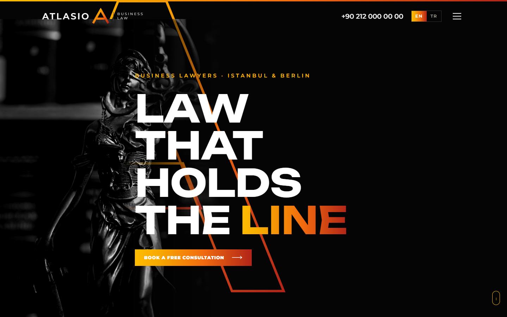
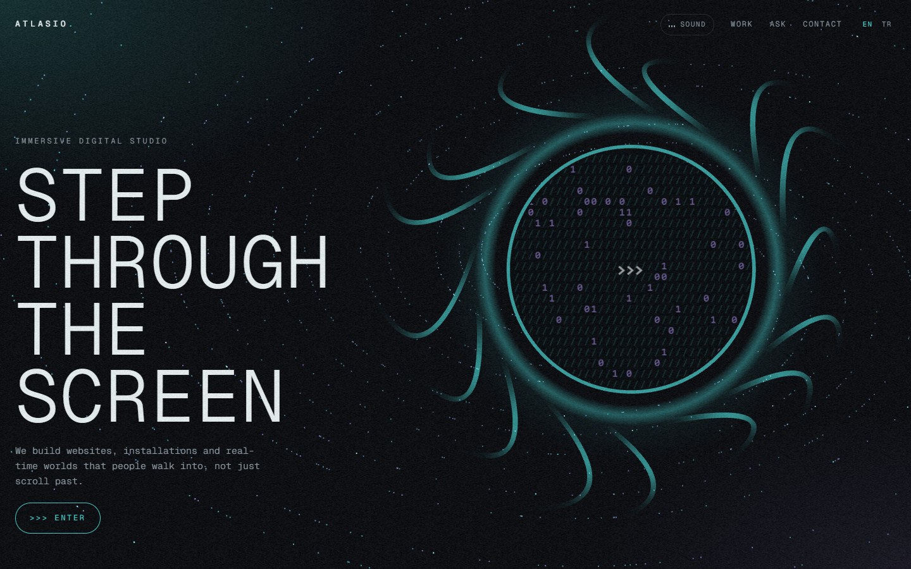
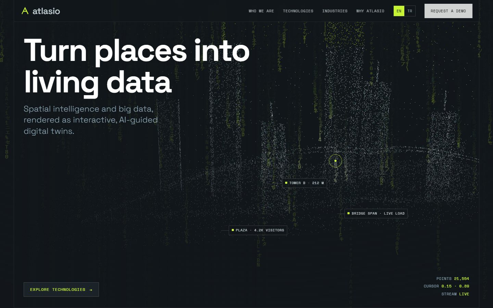
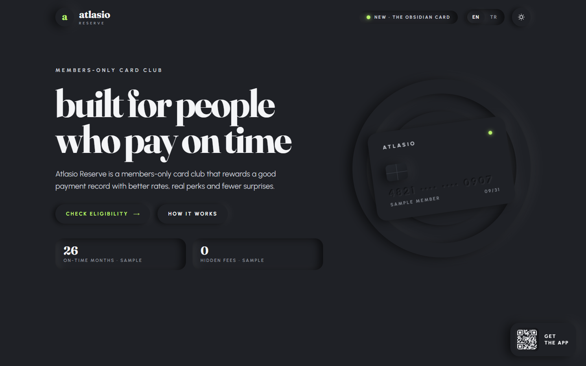
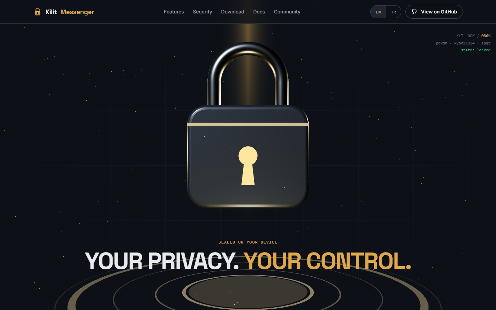
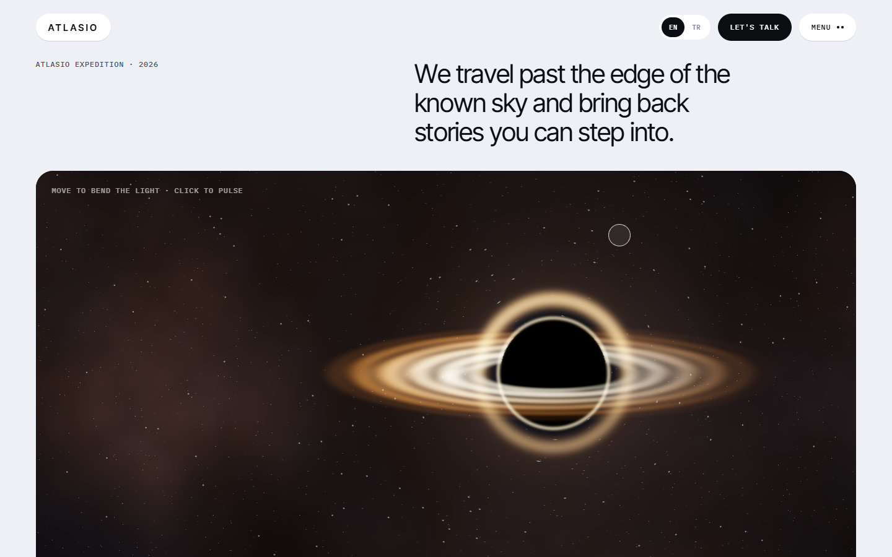
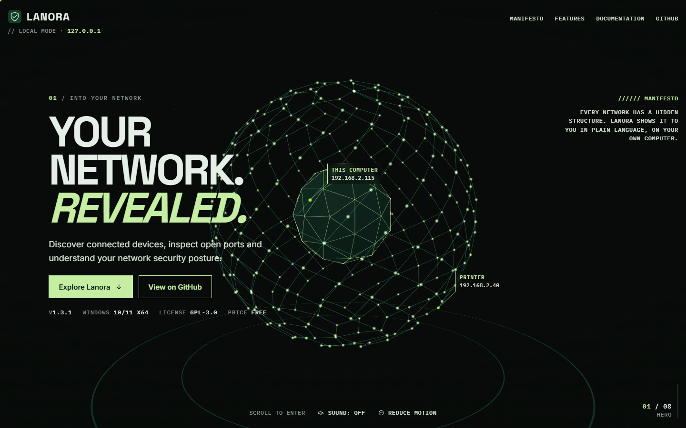
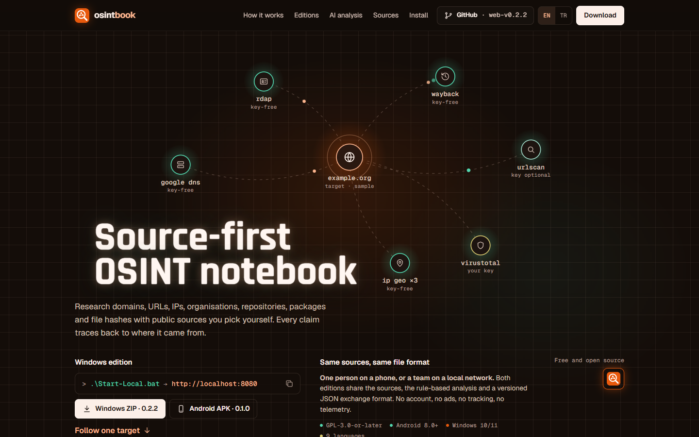

# Web Design Skills

A library of AI web design skills for Claude (Claude Code, Agent Skills). Each skill teaches the model one complete visual
style: the rules, the section patterns, the interactions and a finish checklist, plus a working reference site,
screenshots and copy-ready components.

**Gallery:** https://smyrna-pergamum.github.io/web-design-skills/

## Skills

| | Skill | Style | Demo |
|---|---|---|---|
|  | [**paper-notebook-landing**](skills/paper-notebook-landing) | Warm paper-notebook landing pages: cream paper, chunky soft serif, handwritten notes, sticky notes, a notebook that opens as you scroll, comic strips, giant footer. TR/EN/DE example. | [Live](https://smyrna-pergamum.github.io/web-design-skills/skills/paper-notebook-landing/example/) |
|  | [**noir-gradient-law**](skills/noir-gradient-law) | Law-firm and advisory sites: pure black, bronze statue photography, fire gradient (yellow → orange → red), giant uppercase headlines, duotone-halftone photos, 3D review carousel. EN/TR example. | [Live](https://smyrna-pergamum.github.io/web-design-skills/skills/noir-gradient-law/example/) |
|  | [**portal-webgl-studio**](skills/portal-webgl-studio) | Immersive studio and agency sites: full-screen three.js portal, monospace interface, slash-scramble preloader, film grain, 3D glass project gallery, ask-me-anything terminal, ambient sound. EN/TR example. | [Live](https://smyrna-pergamum.github.io/web-design-skills/skills/portal-webgl-studio/example/) |
|  | [**pointcloud-matrix-tech**](skills/pointcloud-matrix-tech) | Tech, data and AI product sites: framed graphite engineering sheet, matrix rain background, magnetic cursor, three.js point-cloud hero pulled toward the mouse, voxel and wireframe twins. EN/TR example. | [Live](https://smyrna-pergamum.github.io/web-design-skills/skills/pointcloud-matrix-tech/example/) |
|  | [**neumorphic-club-fintech**](skills/neumorphic-club-fintech) | Fintech, card and membership sites in two-material neumorphism: dark relief page with light cards and panels, a light source that follows the cursor, engraved scroll-reveal text, tilting embossed card, slide-to-join, light-relief switch. EN/TR example. | [Live](https://smyrna-pergamum.github.io/web-design-skills/skills/neumorphic-club-fintech/example/) |
|  | [**scroll-lock-cyber-brutalism**](skills/scroll-lock-cyber-brutalism) | Privacy and security product sites: night graphite, hairline grid with amber crosshairs, mono readouts, a three.js padlock the visitor closes by scrolling, honest threat-model and download-verification sections. Real Kilit Messenger site, EN/TR. | [Live](https://smyrna-pergamum.github.io/web-design-skills/skills/scroll-lock-cyber-brutalism/example/) |
|  | [**gravity-lens-space**](skills/gravity-lens-space) | Cinematic space and launch sites: light editorial page with mouse-reactive dark windows — WebGL black-hole lens, hover video previews, floating astronaut over giant words, time-dilation calculator, cursor-reactive headlines. EN/TR example. | [Live](https://smyrna-pergamum.github.io/web-design-skills/skills/gravity-lens-space/example/) |
|  | [**network-journey-webgl**](skills/network-journey-webgl) | Immersive scroll-driven 3D product sites (igloo.inc tradition) built to production standards: one Three.js world behind HTML chapters, HUD and pinned tags, particle morphs, quality tiers, strict CSP, Playwright + axe. Real LANORA site, SvelteKit. | [Live](https://smyrna-pergamum.github.io/web-design-skills/skills/network-journey-webgl/example/) |
|  | [**aperture-topology-story**](skills/aperture-topology-story) | Developer-tool, data and OSINT product sites: dark engineering grid, glowing SVG node topology with travelling packets, then a pinned scroll story where an aperture opens from the central node onto a light paper workspace and cards act out the workflow. Architecture switcher, catalog table, terminal. Real OSINT-Book site, EN/TR. | [Live](https://smyrna-pergamum.github.io/web-design-skills/skills/aperture-topology-story/example/) |

## Install

### As a Claude Code plugin marketplace

```bash
/plugin marketplace add smyrna-pergamum/web-design-skills
/plugin install paper-notebook-landing@web-design-skills
```

Each skill is its own plugin, so you install only the styles you want.

### By copying a folder

Copy any folder from `skills/` into `~/.claude/skills/` (all projects) or `.claude/skills/` inside one project.

## Use

Ask for the style by what it looks like, or name the skill:

> Redesign https://example.com with the paper-notebook-landing skill. Keep all real content.

## Repository layout

```
web-design-skills/
├── .claude-plugin/marketplace.json   # one plugin entry per skill
├── index.html                        # gallery page (GitHub Pages)
├── skills/
│   └── <skill-name>/
│       ├── SKILL.md                  # the skill itself (required)
│       ├── README.md                 # human-facing overview
│       ├── references/               # detailed component code
│       ├── example/index.html        # reference site
│       ├── screenshots/              # PNGs of every section
│       └── scripts/                  # helpers (e.g. screenshot capture)
├── templates/skill-template/         # starting point for a new skill
└── CONTRIBUTING.md                   # how to add a new design
```

## Add a new design

See [CONTRIBUTING.md](CONTRIBUTING.md). In short: copy `templates/skill-template` to `skills/<new-name>`, fill in
`SKILL.md`, add an example and screenshots, then add one entry to `.claude-plugin/marketplace.json`, this README's table and
the gallery in `index.html`.

## License

[MIT](LICENSE) for code and documentation. Example content belongs to its owners (see each skill's README).
Fonts are loaded from Google Fonts under their own licenses.

---

### Türkçe özet

Web Design Skills, Claude için web tasarım skill'lerinden oluşan bir kütüphane. Her skill bir görsel tarzı baştan sona öğretir: kurallar, bölüm
kalıpları, etkileşimler, kontrol listesi, örnek site ve ekran görüntüleri. Kurulum:
`/plugin marketplace add smyrna-pergamum/web-design-skills`, ardından istediğiniz skill için `/plugin install <ad>@web-design-skills`.
Yeni tasarım eklemek için [CONTRIBUTING.md](CONTRIBUTING.md) dosyasına bakın.
