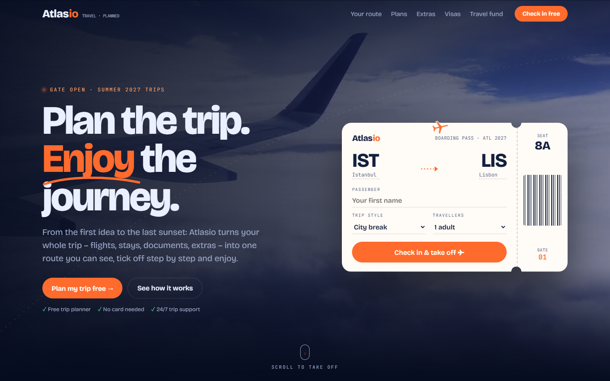
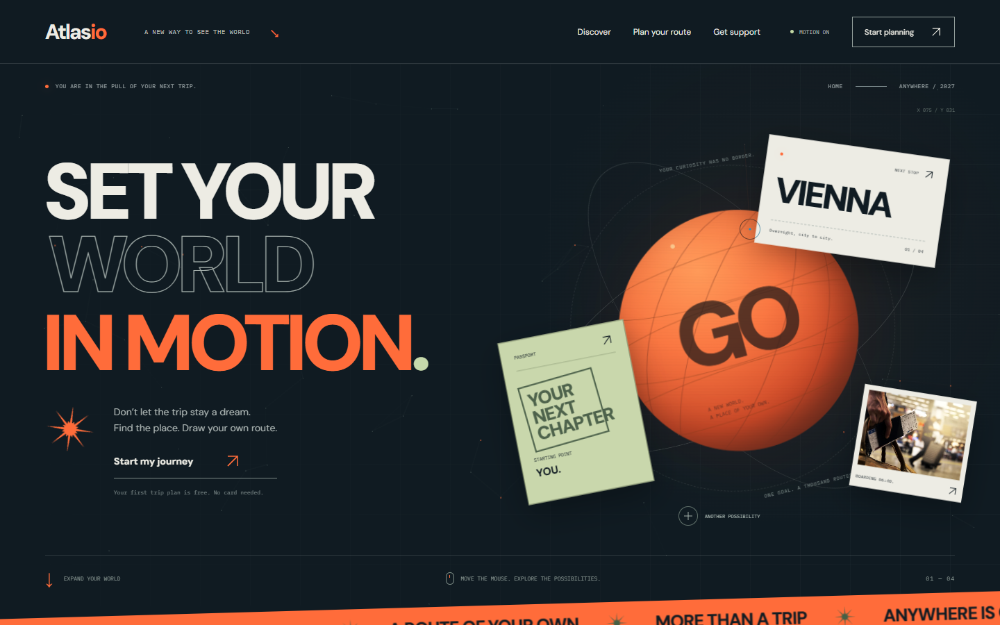
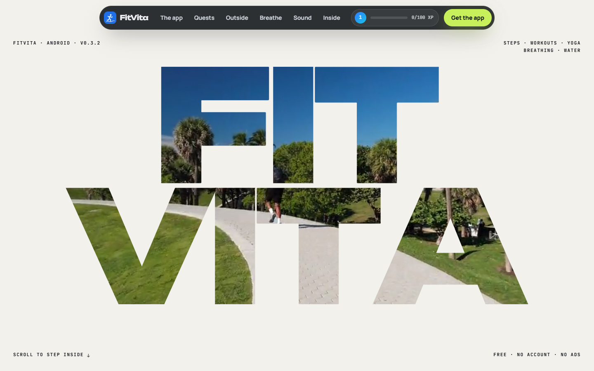
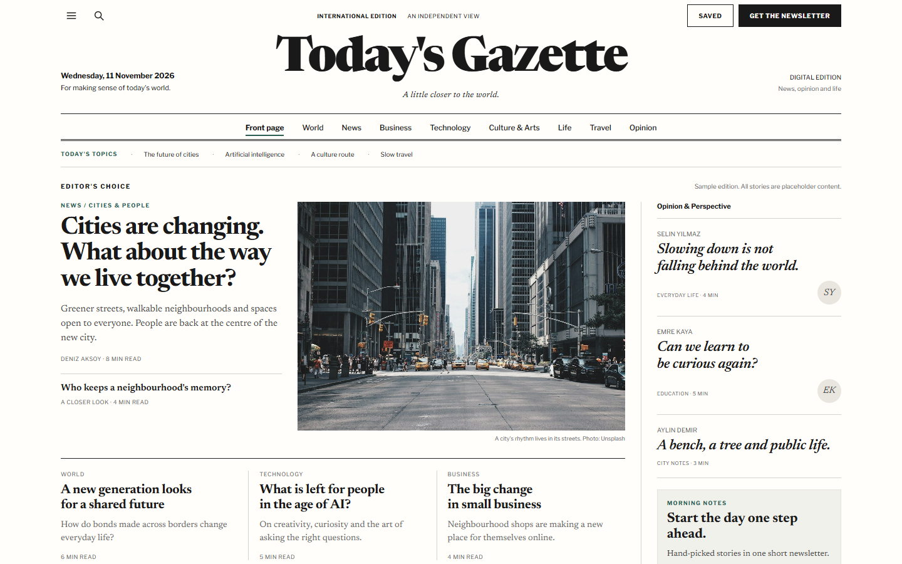

# Web Design Skills

A library of web design skills for **AI coding agents**: Claude (Claude Code, Claude apps), ChatGPT / OpenAI Codex,
Cursor, GitHub Copilot, Gemini CLI and any other agent that can read Markdown. Each skill teaches the agent one complete
visual style: the rules, the section patterns, the interactions and a finish checklist, plus a working reference site,
screenshots and copy-ready components.

Skills use the open **Agent Skills** format: a folder with a `SKILL.md` (YAML front matter + Markdown instructions) and
optional `references/`, `scripts/` and assets. Agents with native skill support load them automatically when a request
matches; every other agent can use the same files as plain instructions.

**Gallery:** https://smyrna-pergamum.github.io/web-design-skills/

## Skills

| | Skill | Style | Demo |
|---|---|---|---|
|  | [**paper-notebook-landing**](skills/paper-notebook-landing) | Warm paper-notebook landing pages: cream paper, chunky soft serif, handwritten notes, sticky notes, a notebook that opens as you scroll, comic strips, giant footer. TR/EN/DE example. | [Live](https://smyrna-pergamum.github.io/web-design-skills/skills/paper-notebook-landing/example/) |
|  | [**noir-gradient-law**](skills/noir-gradient-law) | Law-firm and advisory sites: pure black, bronze statue photography, fire gradient (yellow → orange → red), giant uppercase headlines, duotone-halftone photos, 3D review carousel. EN/TR example. | [Live](https://smyrna-pergamum.github.io/web-design-skills/skills/noir-gradient-law/example/) |
|  | [**portal-webgl-studio**](skills/portal-webgl-studio) | Immersive studio and agency sites: full-screen three.js portal, monospace interface, slash-scramble preloader, film grain, 3D glass project gallery, ask-me-anything terminal, ambient sound. EN/TR example. | [Live](https://smyrna-pergamum.github.io/web-design-skills/skills/portal-webgl-studio/example/) |
|  | [**pointcloud-matrix-tech**](skills/pointcloud-matrix-tech) | Tech, data and AI product sites: framed graphite engineering sheet, matrix rain background, magnetic cursor, three.js point-cloud hero pulled toward the mouse, voxel and wireframe twins. EN/TR example. | [Live](https://smyrna-pergamum.github.io/web-design-skills/skills/pointcloud-matrix-tech/example/) |
|  | [**neumorphic-club-fintech**](skills/neumorphic-club-fintech) | Fintech, card and membership sites in two-material neumorphism: dark relief page with light cards and panels, a light source that follows the cursor, engraved scroll-reveal text, tilting embossed card, slide-to-join, light-relief switch. EN/TR example. | [Live](https://smyrna-pergamum.github.io/web-design-skills/skills/neumorphic-club-fintech/example/) |
|  | [**scroll-lock-cyber-brutalism**](skills/scroll-lock-cyber-brutalism) | Privacy and security product sites: night graphite, hairline grid with amber crosshairs, mono readouts, a three.js padlock the visitor closes by scrolling, honest threat-model and download-verification sections. Real Kilit Messenger site, EN/TR. | [Live](https://smyrna-pergamum.github.io/web-design-skills/skills/scroll-lock-cyber-brutalism/example/) |
|  | [**gravity-lens-space**](skills/gravity-lens-space) | Cinematic space and launch sites: light editorial page with mouse-reactive dark windows — WebGL black-hole lens, hover video previews, floating astronaut over giant words, time-dilation calculator, cursor-reactive headlines. EN/TR example. | [Live](https://smyrna-pergamum.github.io/web-design-skills/skills/gravity-lens-space/example/) |
|  | [**network-journey-webgl**](skills/network-journey-webgl) | Immersive scroll-driven 3D product sites (igloo.inc tradition) built to production standards: one Three.js world behind HTML chapters, HUD and pinned tags, particle morphs, quality tiers, strict CSP, Playwright + axe. Real LANORA site, SvelteKit. | [Live](https://smyrna-pergamum.github.io/web-design-skills/skills/network-journey-webgl/example/) |
|  | [**aperture-topology-story**](skills/aperture-topology-story) | Developer-tool, data and OSINT product sites: dark engineering grid, glowing SVG node topology with travelling packets, then a pinned scroll story where an aperture opens from the central node onto a light paper workspace and cards act out the workflow. Architecture switcher, catalog table, terminal. Real OSINT-Book site, EN/TR. | [Live](https://smyrna-pergamum.github.io/web-design-skills/skills/aperture-topology-story/example/) |
|  | [**flight-path-roadmap**](skills/flight-path-roadmap) | Gamified travel-style homepages for travel agencies, trip planners and tour operators: the cursor becomes a plane with contrails, scrolling flies it through numbered gates (HUD, miles, unlock toasts, landing with confetti), boarding-pass hero form over a video loop, ticket pricing with "price on request", split-flap departures board, travel extras, travel-fund impact section. Fictional travel brand Atlasio, EN. | [Live](https://smyrna-pergamum.github.io/web-design-skills/skills/flight-path-roadmap/example/) |
|  | [**orbit-poster-editorial**](skills/orbit-poster-editorial) | Editorial, poster-like homepages for travel, culture and relocation brands: deep ink and warm paper, giant tight type with an outlined line, a mouse-reactive CSS planet in 3D orbits with floating paper cards, a particle network, and real photos printed into posters in grayscale multiply under huge letters (colour on hover). Route console tabs, blended-photo support cards. Fictional Atlasio Orbit, EN. | [Live](https://smyrna-pergamum.github.io/web-design-skills/skills/orbit-poster-editorial/example/) |
|  | [**knockout-quest-app**](skills/knockout-quest-app) | Experimental, gamified mobile-app landing pages for fitness, health, habit and other consumer apps: a giant knockout wordmark shows a looping video only through its letters and scrolling zooms into one letter, a 3D-tilting phone with reward chips, a sticky tour of real app screenshots, playable daily quests feeding a live XP bar with level-ups and confetti, video tiles with a live fitness HUD, a sound studio (meditation player, nature-sound tiles, radio tuner), breathing orb, bento numbers and a download card with the visitor's score. Real open-source app FitVita, EN. | [Live](https://smyrna-pergamum.github.io/web-design-skills/skills/knockout-quest-app/example/) |
|  | [**glyph-bench-sheets**](skills/glyph-bench-sheets) | Experimental product sites for PDF, document, writing and font tools in a big-platform software style: a black hero whose graphics are glyphs set in the fonts the app really ships, a page the visitor drags from a grey scan to the searchable result, white sheets with rounded tops over dark sections, a rail of tall tool cards (real panels, photos, video), tab chips over a big card with live demos (edit, OCR languages, redact, protect, export), a type card to try every bundled font, and a dark bench with video and a card grid. Real open-source app PDF Werkstatt, EN. | [Live](https://smyrna-pergamum.github.io/web-design-skills/skills/glyph-bench-sheets/example/) |
|  | [**broadsheet-daily-news**](skills/broadsheet-daily-news) | Classic broadsheet newspaper websites for news sites, magazines, local and community papers: a centred serif masthead, double rules, a lead story beside a desaturated photo, ruled columns, an italic opinion sidebar, a feature row and a numbered reading list, with a working front end and no backend: section filters, search with highlighted matches, a reader dialog (drop cap, progress, text size, copy link), shareable story URLs, saved stories and a demo newsletter. Sample edition Today's Gazette, EN. | [Live](https://smyrna-pergamum.github.io/web-design-skills/skills/broadsheet-daily-news/example/) |

## Install

Pick the agent you use. Every option below uses the same folder from `skills/`; nothing is Claude-only.

### Claude Code (plugin marketplace)

```bash
/plugin marketplace add smyrna-pergamum/web-design-skills
/plugin install paper-notebook-landing@web-design-skills
```

Each skill is its own plugin, so you install only the styles you want. Or copy a folder into `~/.claude/skills/`
(all projects) or `.claude/skills/` (one project).

### Claude apps (claude.ai, desktop)

Zip one skill folder (the zip must contain the folder with its `SKILL.md`) and upload it under **Settings → Capabilities
→ Skills**.

### Codex, Cursor, GitHub Copilot, Gemini CLI and other Agent Skills tools

Copy the skill folder into the skills directory your tool reads. Typical project-level locations:

| Agent | Project folder |
|---|---|
| OpenAI Codex (CLI / IDE) | `.agents/skills/` or `.codex/skills/` |
| Cursor | `.cursor/skills/` |
| GitHub Copilot | `.github/skills/` |
| Gemini CLI | `.gemini/skills/` |

Locations and user-level folders change between versions, so check your tool's documentation if a skill is not picked
up. To fetch one skill without cloning the whole repository:

```bash
npx degit smyrna-pergamum/web-design-skills/skills/flight-path-roadmap .agents/skills/flight-path-roadmap
```

### ChatGPT and agents without skill support

Give the agent the files directly:

1. Attach or paste `SKILL.md` and `references/components.md` of the style you want (optionally `example/index.html`).
2. Ask: *"Follow the attached SKILL.md exactly and build …"*.

For repository-based agents (Aider, Cline, Windsurf, Zed and others) you can also add a line to your project's
`AGENTS.md` or rules file: *"For web design work, follow `skills/<name>/SKILL.md` and its `references/`."*

## Use

Ask for the style by what it looks like, or name the skill:

> Redesign https://example.com with the paper-notebook-landing skill. Keep all real content.

> Build our travel agency's homepage with the flight-path-roadmap skill. Our booking process has six steps: …

## Repository layout

```
web-design-skills/
├── .claude-plugin/marketplace.json   # Claude Code marketplace: one plugin entry per skill
├── AGENTS.md                         # instructions for any agent working inside this repository
├── index.html                        # gallery page (GitHub Pages)
├── skills/
│   └── <skill-name>/
│       ├── SKILL.md                  # the skill itself (required, Agent Skills format)
│       ├── README.md                 # human-facing overview
│       ├── references/               # detailed component code
│       ├── example/index.html        # reference site
│       ├── screenshots/              # PNGs of every section
│       └── scripts/                  # helpers (e.g. screenshot capture)
├── templates/skill-template/         # starting point for a new skill
└── CONTRIBUTING.md                   # how to add a new design
```

## Add a new design

See [CONTRIBUTING.md](CONTRIBUTING.md). In short: copy `templates/skill-template` to `skills/<new-name>`, fill in
`SKILL.md`, add an example and screenshots, then add one entry to `.claude-plugin/marketplace.json`, this README's table and
the gallery in `index.html`.

## License

[MIT](LICENSE) for code and documentation. Example content belongs to its owners (see each skill's README).
Fonts are loaded from Google Fonts under their own licenses.

---

### Türkçe özet

Web Design Skills, yapay zekâ kodlama ajanları (Claude, ChatGPT / Codex, Cursor, GitHub Copilot, Gemini CLI ve
Markdown okuyabilen diğerleri) için web tasarım skill'lerinden oluşan bir kütüphane. Her skill bir görsel tarzı baştan
sona öğretir: kurallar, bölüm kalıpları, etkileşimler, kontrol listesi, örnek site ve ekran görüntüleri. Skill'ler açık
Agent Skills formatında (`SKILL.md`). Claude Code: `/plugin marketplace add smyrna-pergamum/web-design-skills`, ardından
`/plugin install <ad>@web-design-skills`. Diğer ajanlar: klasörü aracın skills dizinine kopyalayın ya da `SKILL.md`
dosyasını sohbete ekleyin.
Yeni tasarım eklemek için [CONTRIBUTING.md](CONTRIBUTING.md) dosyasına bakın.
