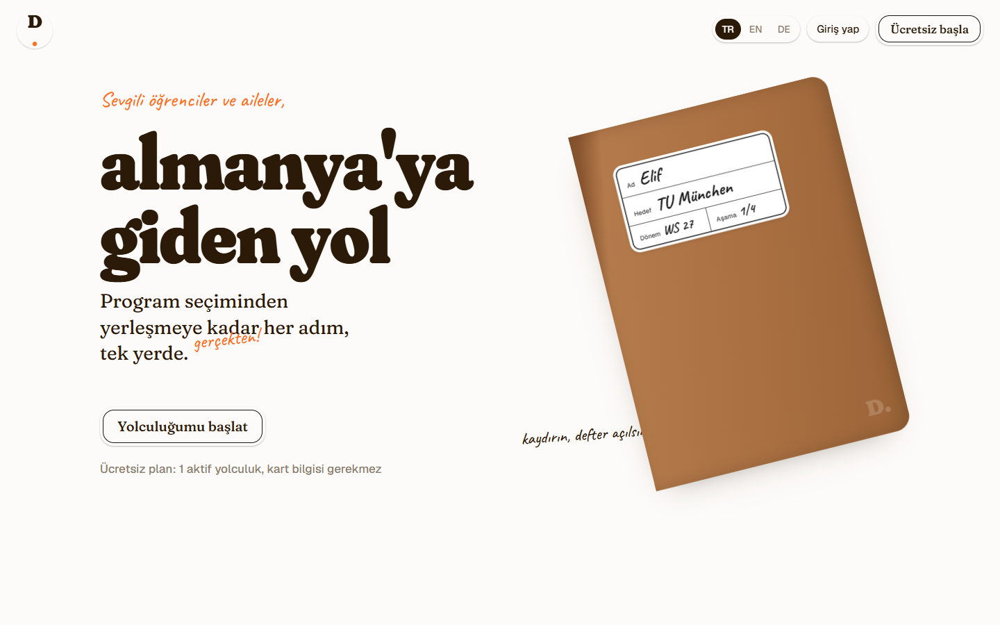
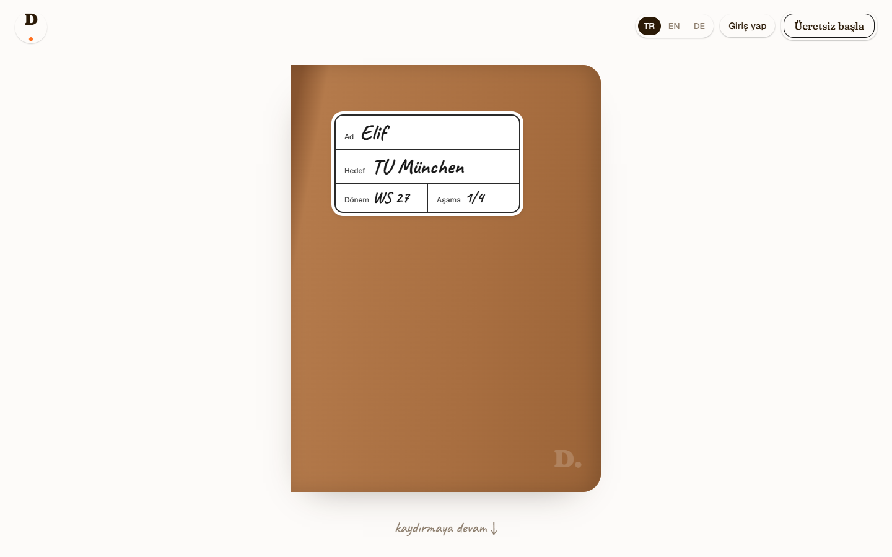
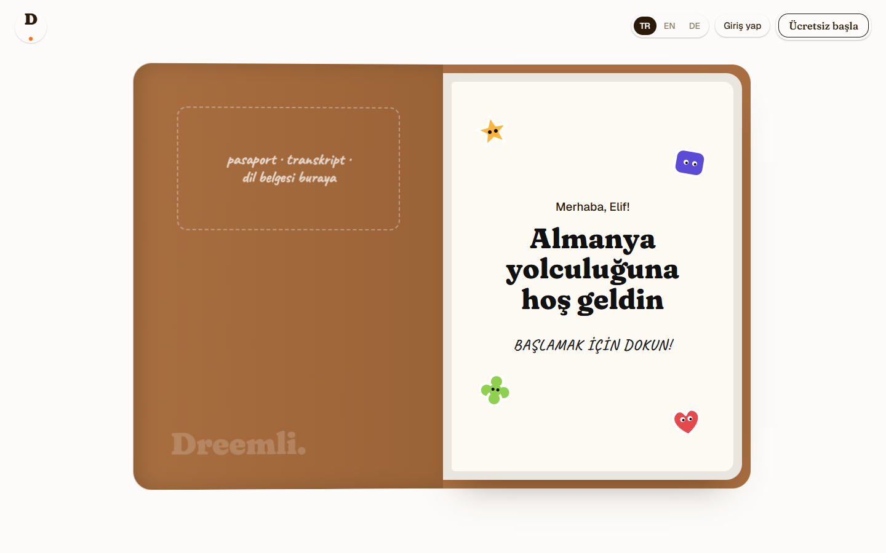
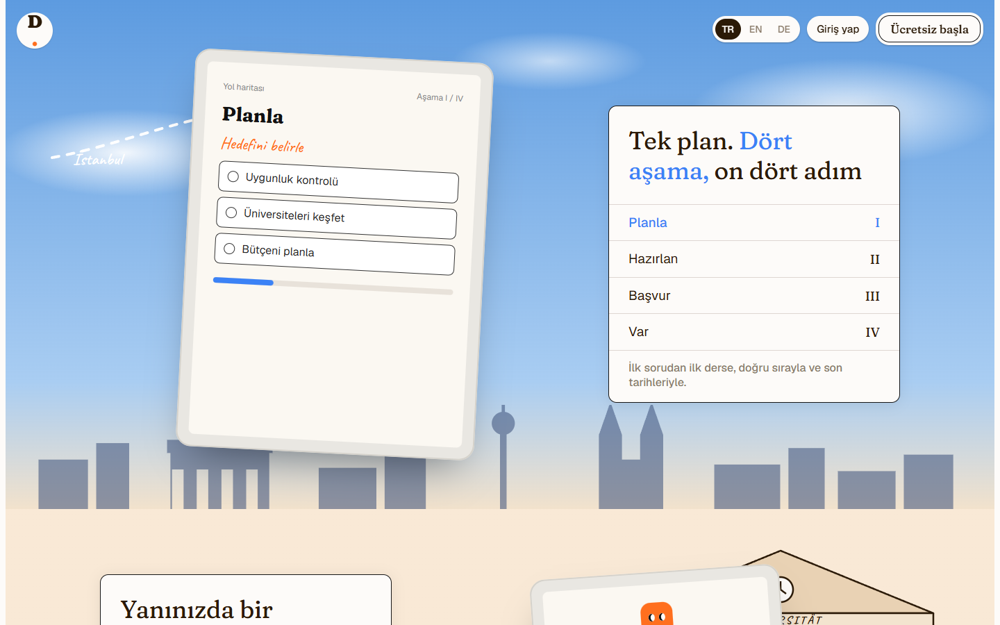
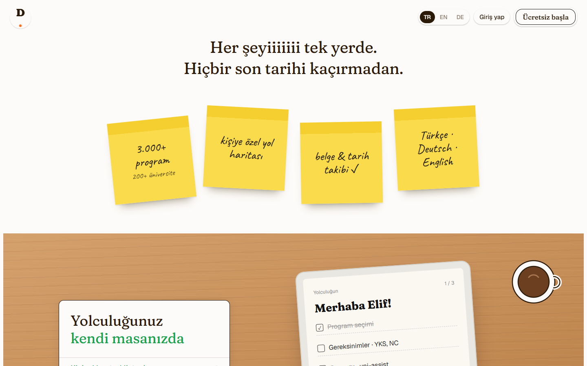
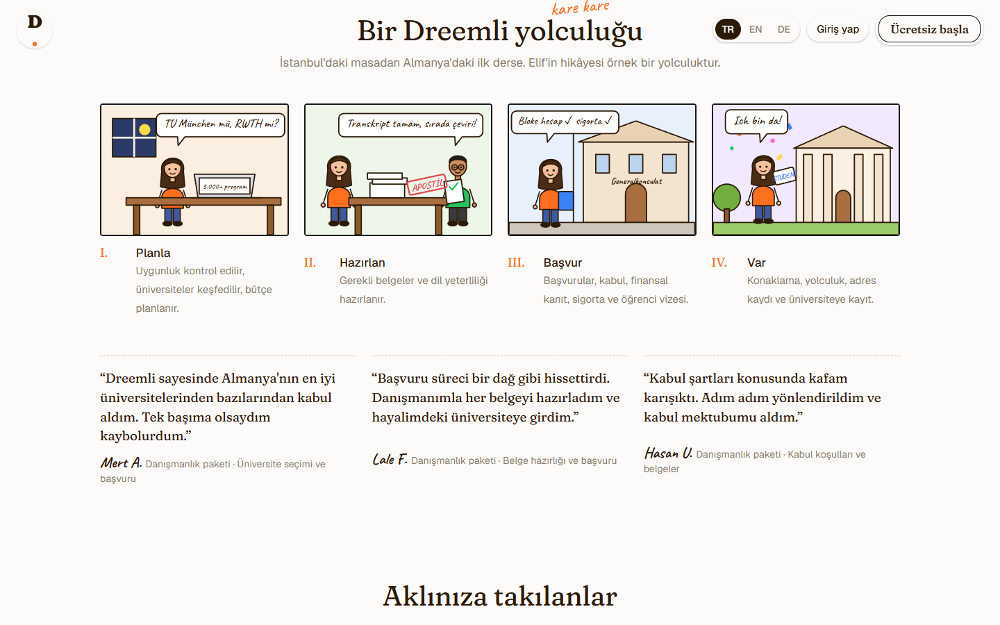
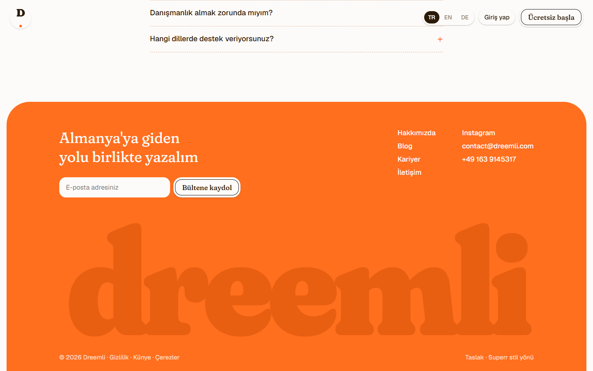

# superr-style-landing

An AI skill (for Claude Code / Claude Agent Skills) that designs landing pages in the warm **paper-notebook style** of
[superr.ai](https://www.superr.ai/): cream paper, chunky soft serif headlines, handwritten marker notes, yellow sticky notes,
name-label notebooks, illustrated scenes with roman-numeral panels, doodles, lined paper, a comic strip and a giant orange footer.

It ships with a complete reference build: the homepage of **Dreemli**, a study-in-Germany platform, in Turkish, English and German.



| Notebook travels down… | …and opens | Four-stage journey |
|---|---|---|
|  |  |  |
| **Sticky notes** | **Comic strip** | **Giant footer** |
|  |  |  |

More in [`screenshots/`](screenshots) (desktop 1440×900, mobile 390×844, TR/EN/DE).

## What's inside

```
superr-style-landing/
├── SKILL.md                    # the skill: style rules, section patterns, interactions, checklist
├── references/components.md    # copy-ready HTML/CSS/JS for every component
├── example/index.html          # full reference page (single file, no build step)
├── screenshots/*.png           # every section, desktop + mobile + languages
└── scripts/screenshots.mjs     # re-create the screenshots with headless Chrome (no npm install)
```

## Features of the example page

- **Scroll-driven notebook** – the notebook in the hero travels down, straightens and grows as you scroll, then its cover opens.
- **Three languages** – TR / EN / DE switch in the top-right corner; the choice is remembered.
- **Auto-sizing comic speech bubbles** – bubbles are drawn around the measured text, so they fit in every language.
- **Interactive panels** – roman-numeral feature lists update a device mock (e.g. the 4 stages Plan → Prepare → Apply → Arrive).
- Pure inline SVG/CSS illustrations, no image files; Google Fonts only (Fraunces, Geist, Caveat).
- Respects `prefers-reduced-motion`; responsive down to 390px.

## Install the skill

Copy this folder into your skills directory:

```bash
git clone https://github.com/smyrna-pergamum/superr-style-landing.git ~/.claude/skills/superr-style-landing
```

or, for one project only, into `.claude/skills/superr-style-landing/` inside that project.

Then ask, for example:

> Redesign https://example.com in the superr style. Keep all real content, add TR/EN switching.

> Make a superr-style landing page for our language school using this brochure (PDF attached).

## View the example

Live: **https://smyrna-pergamum.github.io/superr-style-landing/example/**

Or open `example/index.html` locally in any browser.

## Regenerate the screenshots

Requires Node 22+ and Chrome/Chromium.

```bash
node scripts/screenshots.mjs example/index.html screenshots
```

Set `CHROME=/path/to/browser` if Chrome is not in the default location.

## Credits and disclaimer

- The visual direction is **inspired by** [superr.ai](https://www.superr.ai/). This project is not affiliated with or endorsed
  by Superr / Superlinear Technologies. No Superr logos, illustrations, photos or copy are included; the skill tells the
  model not to copy them.
- The example content (texts, services, contact details) belongs to **Dreemli** ([dreemli.com](https://www.dreemli.com)) and is
  used as a demonstration of the style.
- Fonts: [Fraunces](https://fonts.google.com/specimen/Fraunces), [Geist](https://fonts.google.com/specimen/Geist) and
  [Caveat](https://fonts.google.com/specimen/Caveat) are licensed under the SIL Open Font License and loaded from Google Fonts.

## License

Code and documentation: [MIT](LICENSE).

---

### Türkçe özet

Bu klasör, superr.ai'nin sıcak "kâğıt defter" tarzında açılış sayfaları tasarlayan bir yapay zekâ skill'idir.
`SKILL.md` stil kurallarını, bölüm kalıplarını ve kontrol listesini; `references/components.md` hazır kod parçalarını;
`example/index.html` üç dilli (TR/EN/DE) Dreemli örnek sitesini; `screenshots/` ise tüm bölümlerin görüntülerini içerir.
Kurulum için klasörü `~/.claude/skills/superr-style-landing` altına kopyalamanız yeterli.
