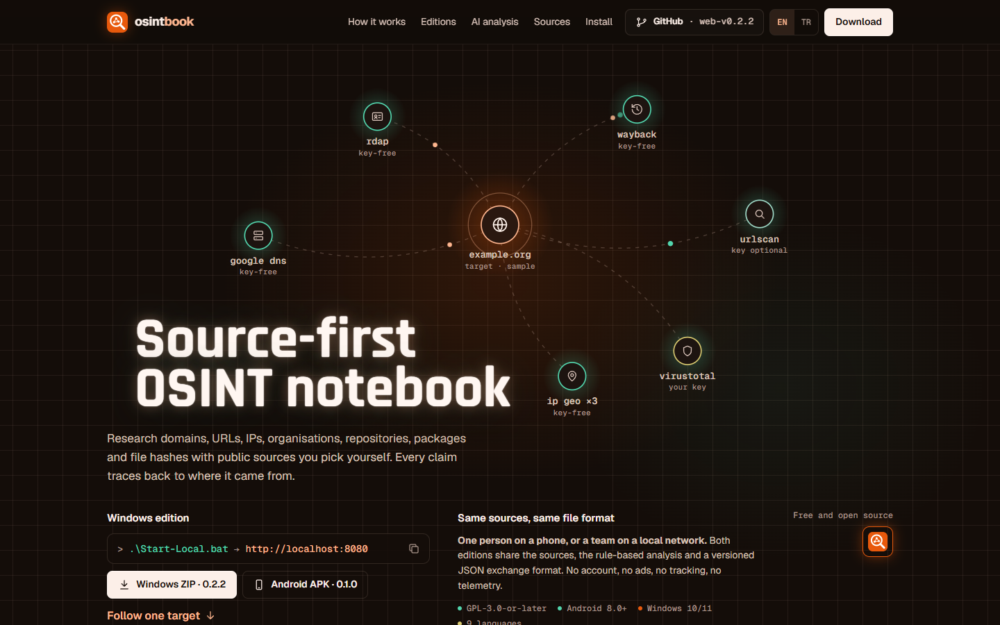
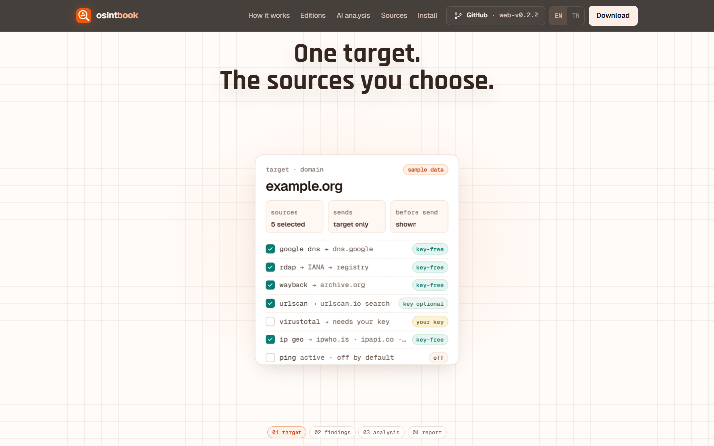
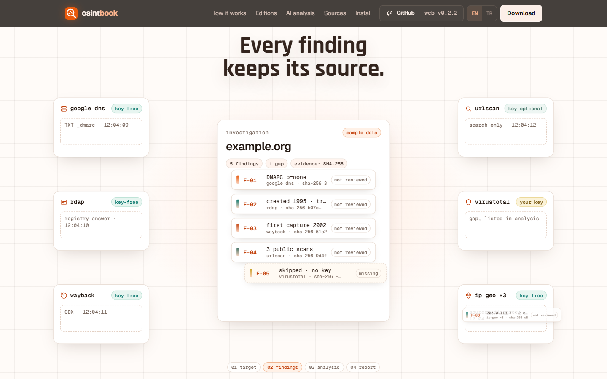
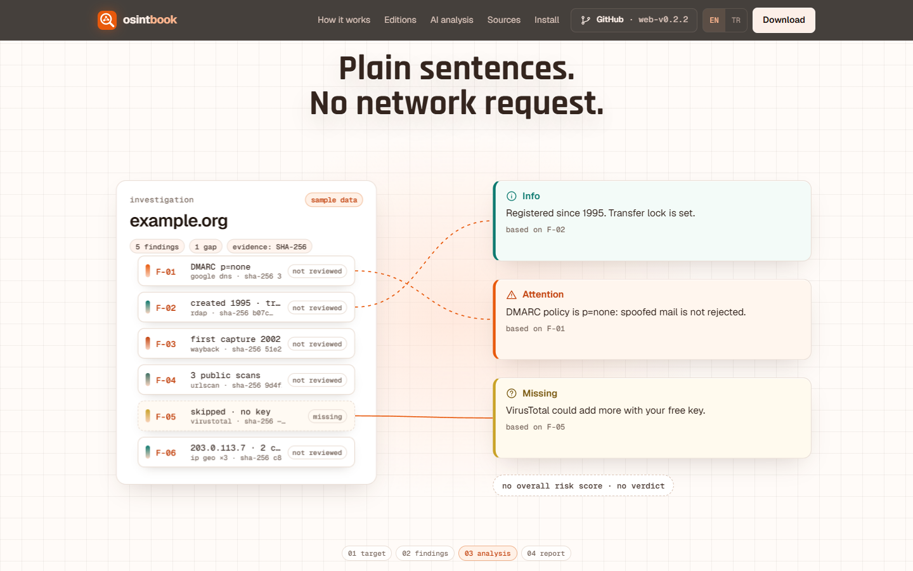
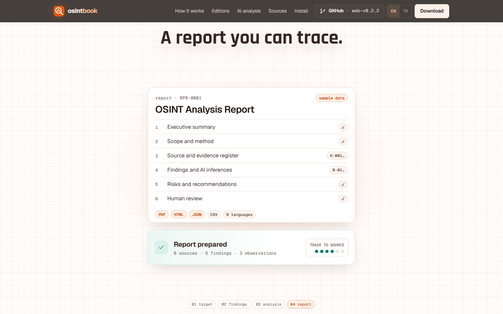
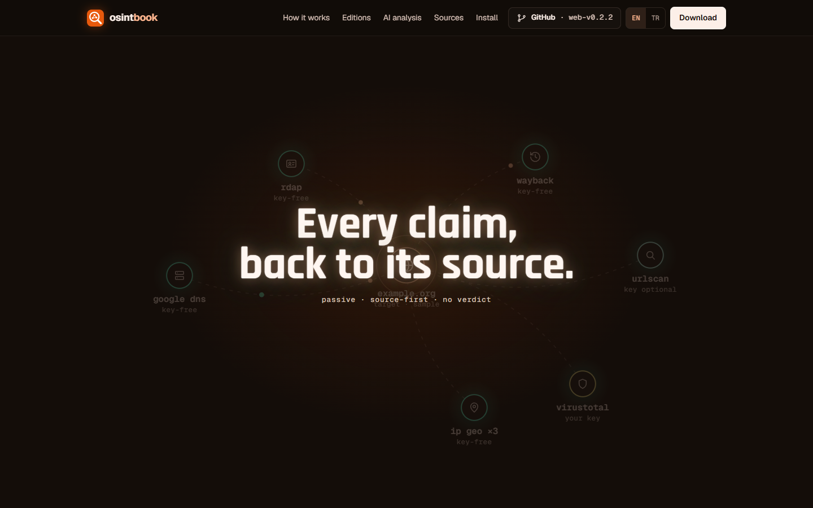
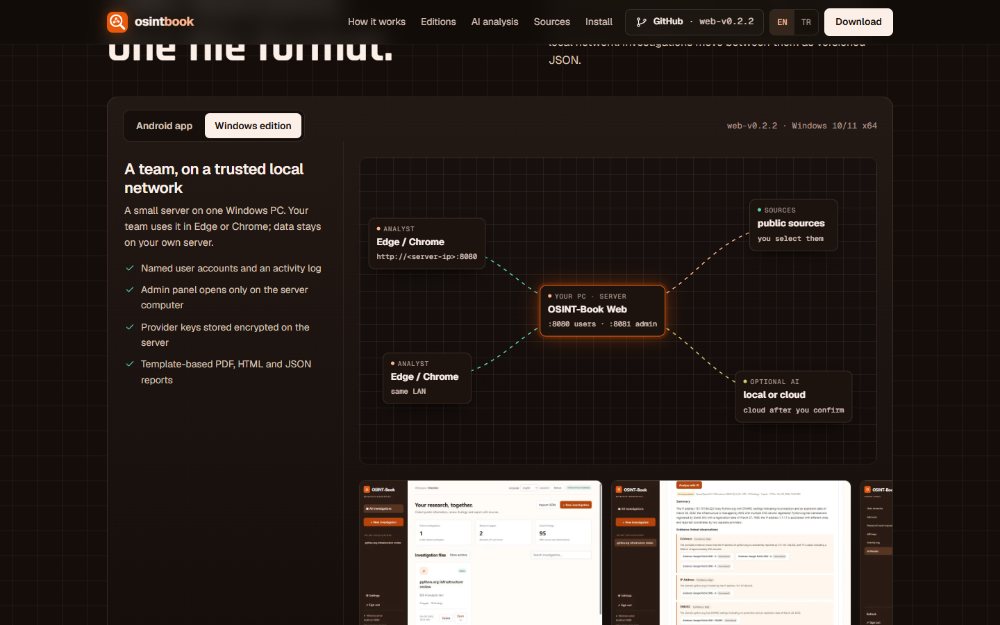
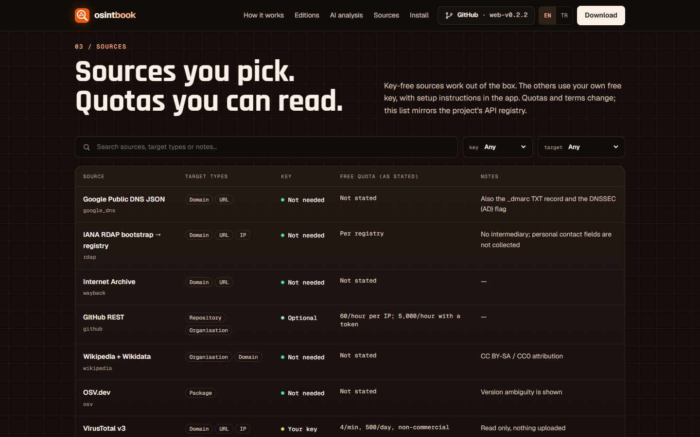
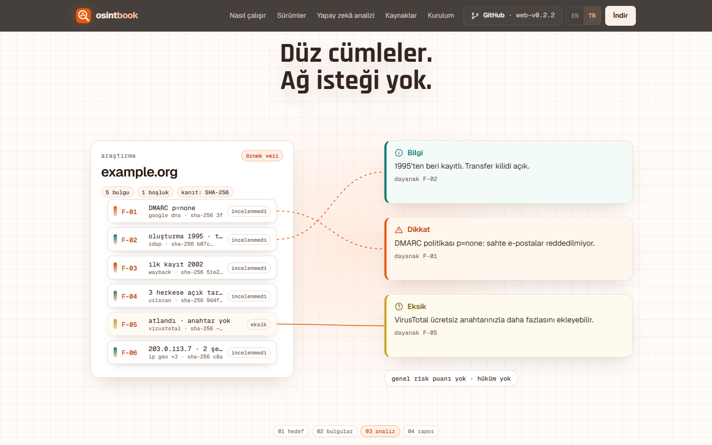
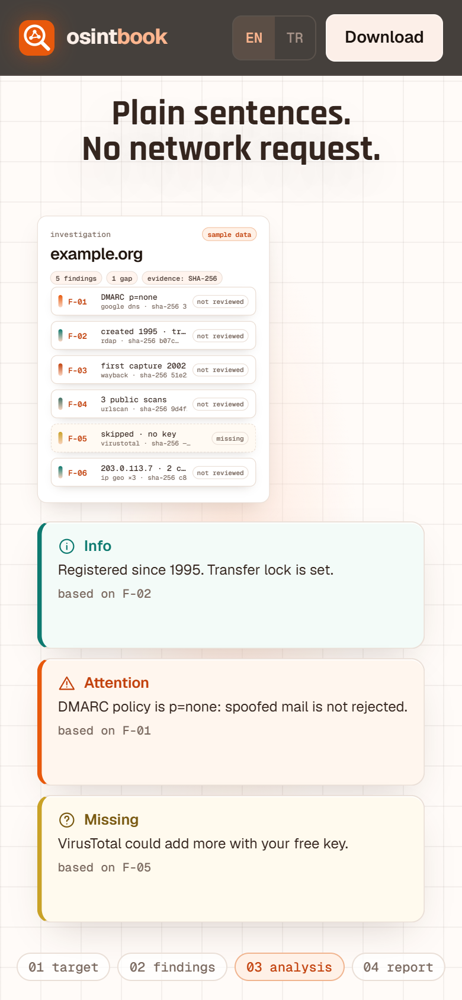

# aperture-topology-story

> Part of the [web-design-skills](../../README.md) library.

An AI skill (Claude Code / Agent Skills) for developer-tool, data, network and OSINT product websites: a dark
engineering grid with a **glowing node topology** hero and a huge glowing condensed headline, then a pinned
**aperture story**. As you scroll, a circular aperture opens from the central node onto a light paper-grid workspace,
and the product's real workflow plays out with cards. Results fly from source cards into a notebook, connectors
link the results to observations, and everything folds into a report. Then the aperture closes back into the node on a
glowing closing line. After that come calm technical sections: an architecture switcher, module blocks, a searchable
catalog table, a scope split, a terminal and link-card footer. All of it rewinds when you scroll back up.

The reference build is the real website for **[OSINT-Book](https://github.com/smyrna-pergamum/osint-book)**, a passive,
source-first OSINT notebook for Android and Windows, in English and Turkish. It uses the app's own colours: the icon's
orange, the dark theme's brown-black for the page and the light theme's cream for the workspace. Every claim comes from
the app's README, user guide, API registry and release notes. The story's data is sample data (`example.org`,
documentation IPs) and is labelled as such.



| Aperture opens | Findings | Analysis |
|---|---|---|
|  |  |  |
| **Report** | **Closing line** | **Editions** |
|  |  |  |
| **Sources catalog** | **Turkish** | **Mobile** |
|  |  |  |

More in [`screenshots/`](screenshots): desktop 1440×900, mobile 390×844, reduced motion and EN/TR.

## What's inside

```
aperture-topology-story/
├── SKILL.md                    # style rules, colour mapping from the product, sections, the aperture timeline, checklist
├── references/components.md    # copy-ready code: tokens, SVG topology + packets, aperture stage + keyframe engine,
│                               # paper cards, diagram, puzzle blocks, catalog table, terminal, i18n helper
├── example/index.html          # OSINT-Book site (single file, no framework, Google Fonts only)
├── example/assets/             # app icon (SVG) and real app screenshots (WebP)
├── screenshots/*.png
└── scripts/screenshots.mjs     # re-create the screenshots (headless Chrome, story positions, TR, reduced motion, mobile)
```

## Features of the example page

- SVG topology hero: one target node with halo and ring, six source nodes with access labels, packets travelling out
  (brand colour) and back (teal).
- Aperture story in four phases (target → findings → analysis → report). One scroll value drives the clip-path circle
  and about 20 cards through keyframes. It has a separate narrow-screen board and static frames for reduced motion.
  Add `?motion=reduce` to the URL to preview the static frames.
- Architecture switcher (Android app / Windows edition) with animated connectors and the real app screenshots.
- AI module blocks (local, analysis queue, cloud), a sources catalog with search, filters and paging, a does / never-does
  scope split, download cards with real file sizes, and a tabbed terminal with the real SHA-256 values and copy.
- EN/TR for every string, including the ones JavaScript builds. No cookies, no analytics, no third-party scripts.

## Re-create the screenshots

```bash
cd skills/aperture-topology-story
node scripts/screenshots.mjs example/index.html screenshots
```

Needs Node 22+ and Chrome (set `CHROME=/path/to/chrome` if it is not in the default place).

## Credits

Example content, app icon and screenshots: © the OSINT-Book authors, GPL-3.0-or-later. Fonts: Rajdhani, Geist and
Geist Mono via Google Fonts under their own licences. Map data in the screenshots © OpenStreetMap contributors.
