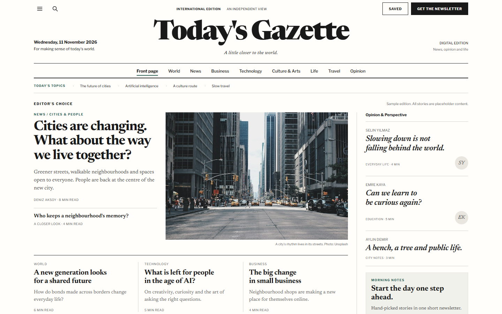
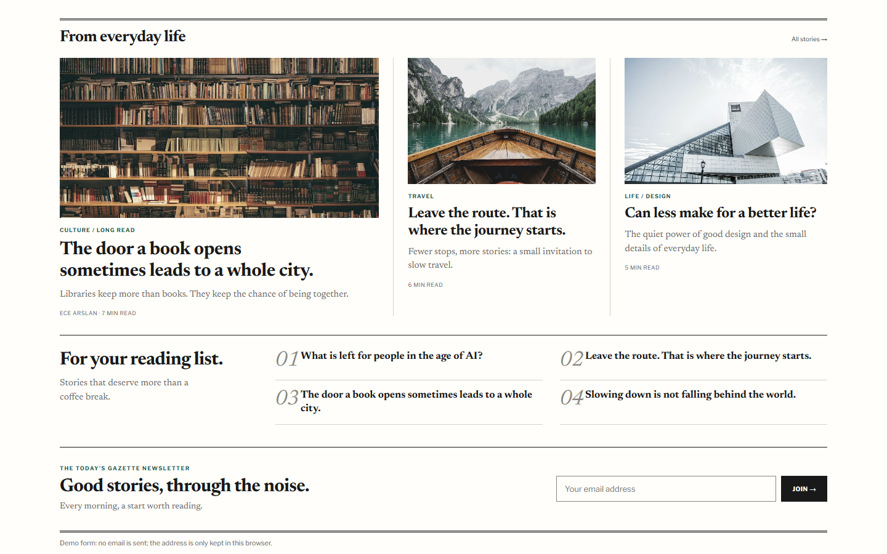
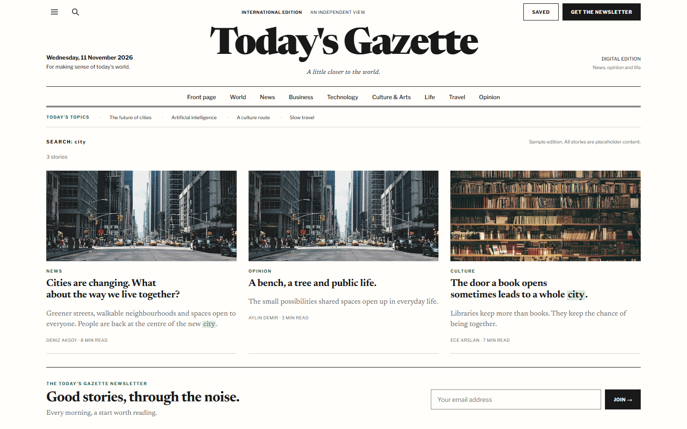
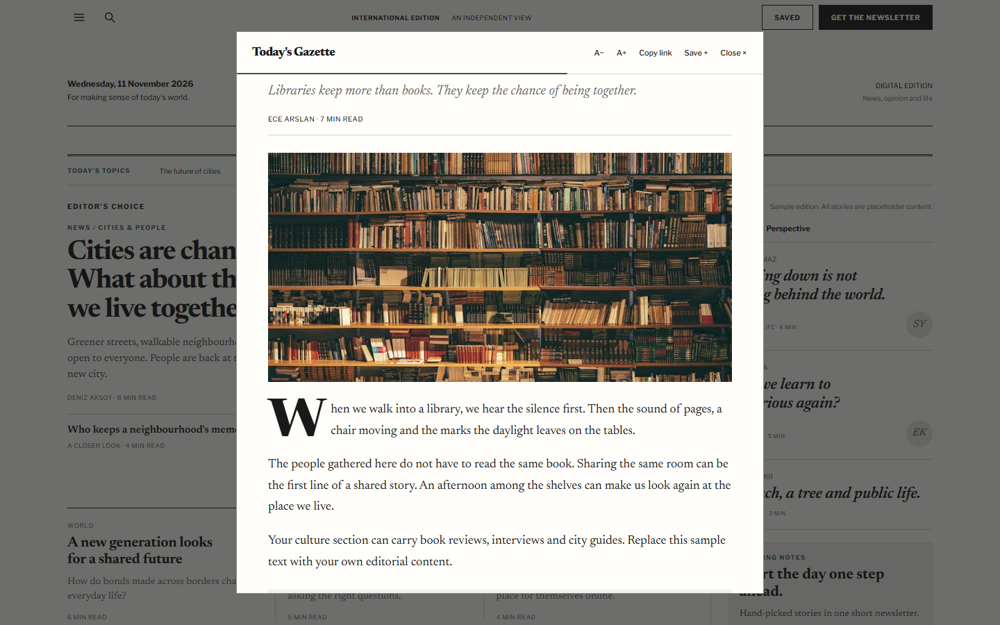
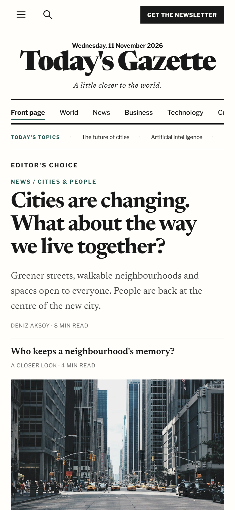
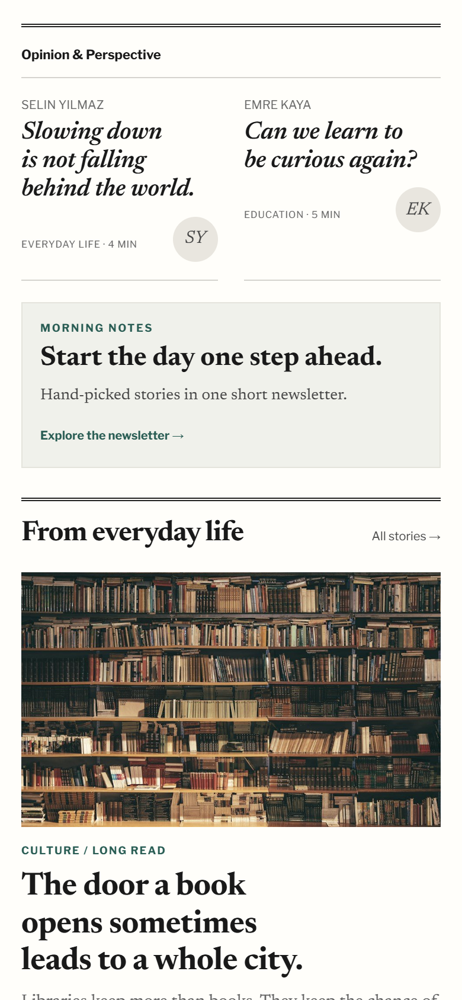
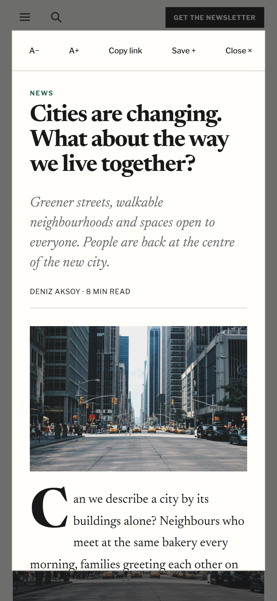

# broadsheet-daily-news

> Part of the [web-design-skills](../../README.md) library.

An AI agent skill (Agent Skills / `SKILL.md` format) for **classic broadsheet newspaper websites**. A centred serif
masthead, double rules, a lead story beside a desaturated photo, ruled columns, an italic opinion sidebar and a
numbered reading list — and behind the print look a working news site in one HTML file: sections, search with
highlighted matches, a reader dialog with drop cap, reading progress and text size, shareable story links that work
with the back button, saved stories and a demo newsletter, all without a backend.

It ships with a complete reference build: **Today's Gazette**, an English sample edition with placeholder stories and
four Unsplash photos. Every story says it is sample content.



| Feature row | Search results | Reader dialog |
|---|---|---|
|  |  |  |
| **Mobile front page** | **Mobile opinion** | **Mobile reader** |
|  |  |  |

More in [`screenshots/`](screenshots) (desktop 1440×900, mobile 390×844).

## What's inside

```
broadsheet-daily-news/
├── SKILL.md                    # style rules, sections, behaviour, build rules, checklist
├── references/components.md    # copy-ready code: tokens, masthead, rules, sidebar, router, search, reader dialog
├── example/index.html          # reference site (single file, inline CSS and JS, no libraries)
├── example/assets/             # 4 photos (~680 KB)
├── screenshots/*.png
└── scripts/screenshots.mjs     # re-create the screenshots (Node 22+, Chrome; serves the example locally)
```

## Features of the example page

- Newsreader masthead and headlines with optical sizing, Libre Franklin for the newspaper apparatus.
- Section nav with an accent underline; on phones it scrolls, and the menu button wraps it into a grid.
- Topics strip, section filters and search (press `/`) that re-render a results grid with highlighted matches.
- Reader `<dialog>`: drop cap, reading progress bar, A−/A+ text size (remembered), copy link, save, Esc to close.
- Story links are `#story/<id>` URLs: shareable, and the back button closes the reader.
- Saved stories with a count badge and a demo newsletter, kept in `localStorage`, with a toast when storage is blocked.
- Print styles that print an open story on its own.

## Re-create the screenshots

```bash
node scripts/screenshots.mjs example screenshots
```

Based on a Turkish newspaper template ("Günün Gazetesi"), translated to English and extended. Photos from Unsplash.
