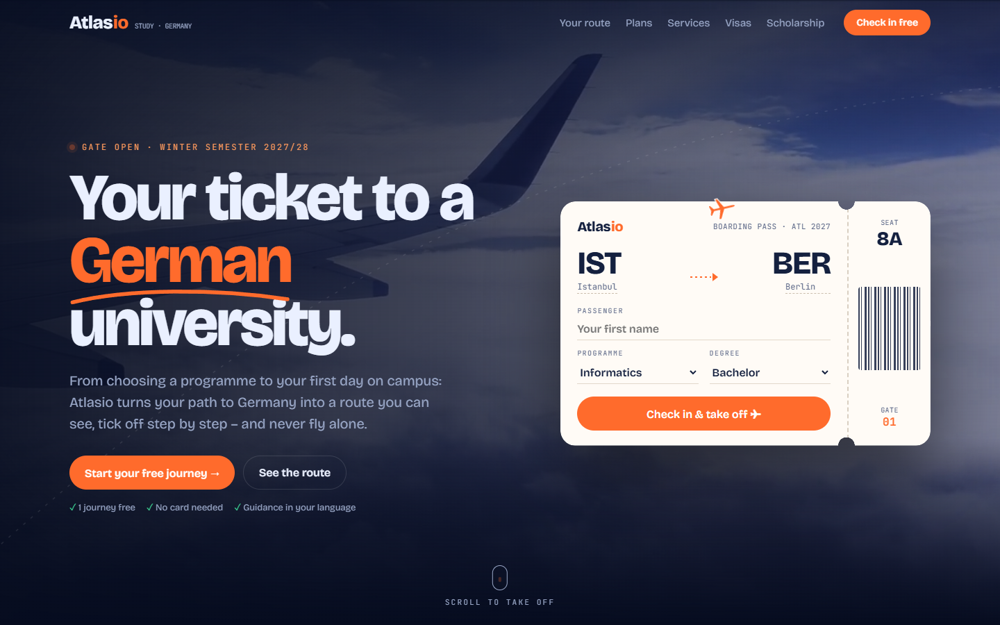
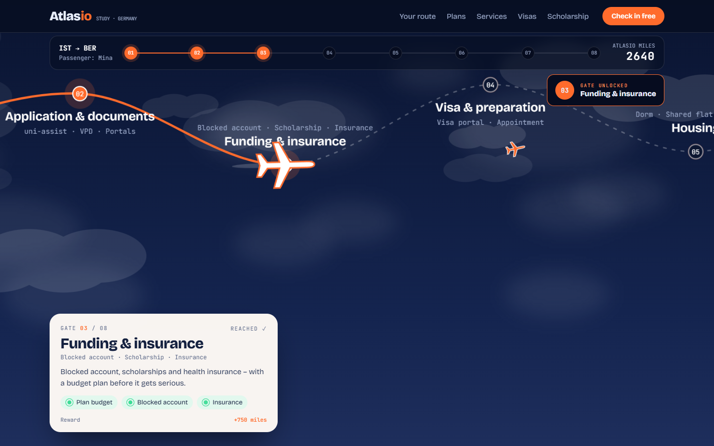
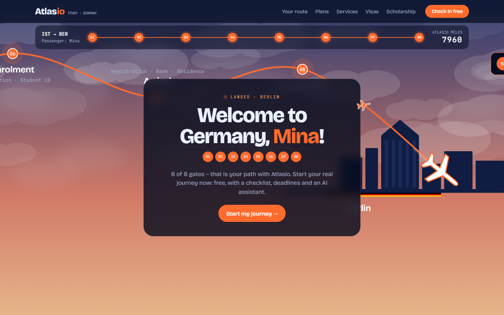
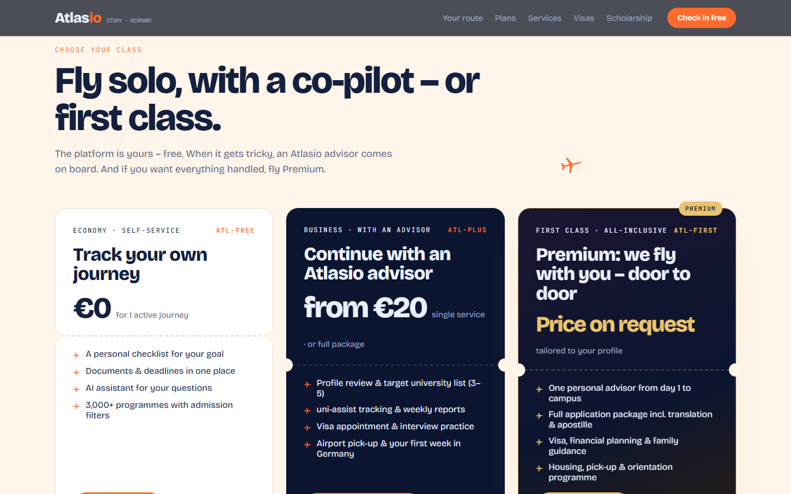
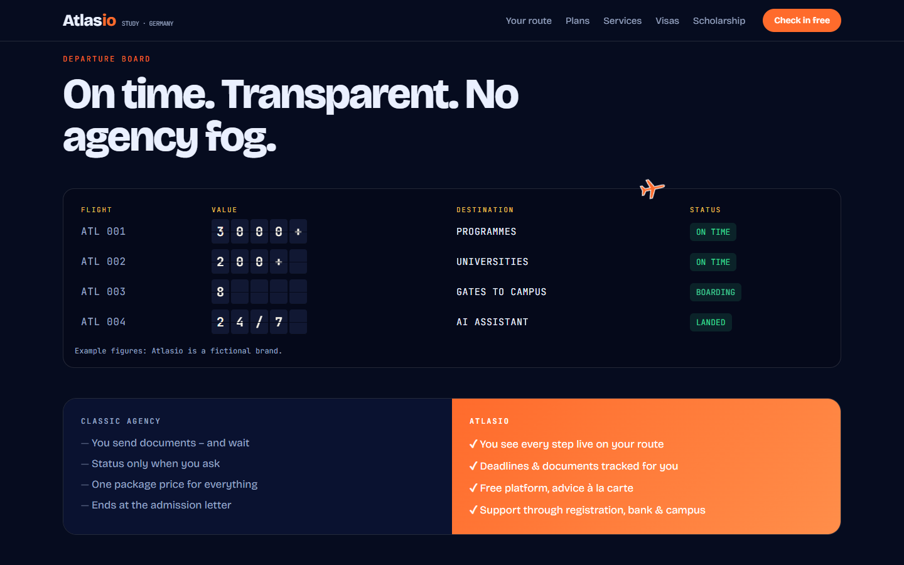
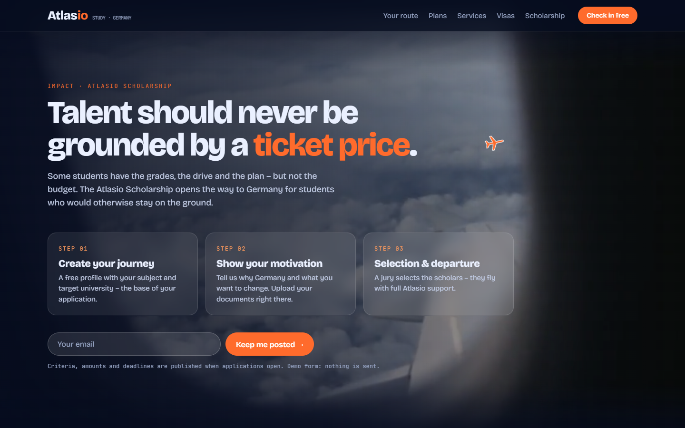
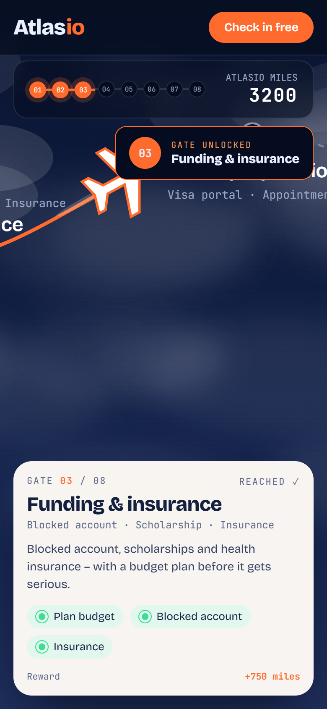

# flight-path-roadmap

> Part of the [web-design-skills](../../README.md) library.

An AI agent skill (Agent Skills / `SKILL.md` format) for gamified, travel-themed homepages: the **mouse becomes a
plane** with a contrail, and **scrolling flies a plane along a route** through numbered gates. The visitor checks in on
a boarding pass, unlocks gates, earns miles, lands at the destination and picks a cabin class.

It ships with a complete reference build: **Atlasio**, a fictional study-in-Germany platform, in English.



| Flight: gate 3 | Landing | Cabin classes |
|---|---|---|
|  |  |  |
| **Departure board** | **Scholarship (impact)** | **Mobile flight** |
|  |  |  |

More in [`screenshots/`](screenshots) (desktop 1440×900, mobile 390×844).

## What's inside

```
flight-path-roadmap/
├── SKILL.md                    # style rules, sections, effects, media pipeline, checklist
├── references/components.md    # copy-ready code: plane cursor, boarding pass, flight world, HUD, board, tickets…
├── example/index.html          # reference site (single file, no libraries)
├── example/assets/             # 2 compressed video loops + posters (~2.7 MB)
├── screenshots/*.png
└── scripts/screenshots.mjs     # re-create the screenshots (Node 22+, Chrome; serves the example locally)
```

## Features of the example page

- Plane cursor that turns toward its direction of travel and leaves two fading wing-tip contrails; grows over links,
  hides over form fields, off on touch and with reduced motion.
- Video-loop hero with an interactive boarding pass (origin, destination, name, programme, degree) that stamps
  "CHECKED IN" and personalises the whole page.
- Scroll-driven flight: a pinned SVG world the camera follows, a curved route through eight gates, night sky turning
  to sunrise, HUD with progress dots and a miles counter, gate cards with missions that tick themselves, unlock toasts
  and a landing scene with confetti.
- Three ticket-style tiers: Economy (free), Business (advisor) and First / Premium with **"Price on request"**.
- Split-flap departure board, "classic agency vs us" comparison, marketplace marquee, language "altitude" chart,
  passport-stamp visa cards.
- Scholarship impact section on a second video loop with step cards and a sign-up pill.
- Responsive down to 390px; respects `prefers-reduced-motion`.

## Install

The skill is a plain folder with a `SKILL.md`, so it works with any agent that reads the Agent Skills format, and
can be pasted into agents that don't. See the [main README](../../README.md#install) for every option.

```bash
# Claude Code (2.1.275+ in one step)
/plugin install flight-path-roadmap --marketplace smyrna-pergamum/web-design-skills

# Claude Code (older versions)
/plugin marketplace add smyrna-pergamum/web-design-skills
/plugin install flight-path-roadmap@web-design-skills
```

Then ask, for example:

> Build our relocation agency's homepage with the flight-path-roadmap skill. Our process has six steps: …

## Regenerate the screenshots

```bash
node scripts/screenshots.mjs example screenshots
```

## Credits and notes

- **Atlasio is fictional.** Copy, prices and figures are examples written for this template; the forms send nothing.
- Video loops: royalty-free stock clips (Pixabay and Pexels licences) supplied by the repository owner, trimmed of
  audio and compressed.
- Fonts: [Bricolage Grotesque](https://fonts.google.com/specimen/Bricolage+Grotesque) and
  [JetBrains Mono](https://fonts.google.com/specimen/JetBrains+Mono) (SIL Open Font License) from Google Fonts.

## License

Code and documentation: [MIT](../../LICENSE). Media: see the credits above.

---

### Türkçe özet

Oyunlaştırılmış, seyahat temalı ana sayfalar için bir web tasarım skill'i: fare kondens izi bırakan bir uçağa dönüşür,
scroll ile uçak numaralı kapılardan geçen bir rotada uçar. Ziyaretçi biniş kartıyla check-in yapar, kapıların kilidini
açar, mil toplar, hedefe iner ve bir kabin sınıfı seçer (Economy, Business, Premium "fiyat için sorun"). Video arka
planlı hero, kalkış tabelası, burs (impact) bölümü dahil. Örnek site kurgusal "Atlasio" (İngilizce).
