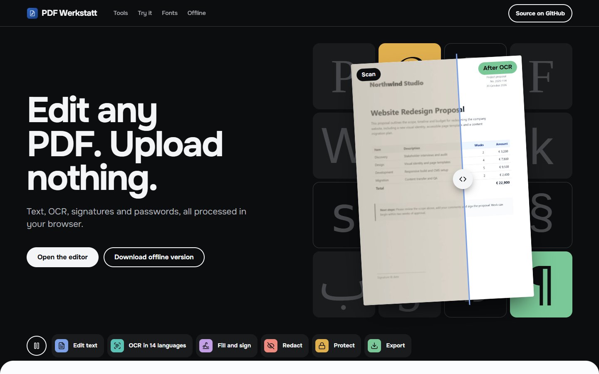
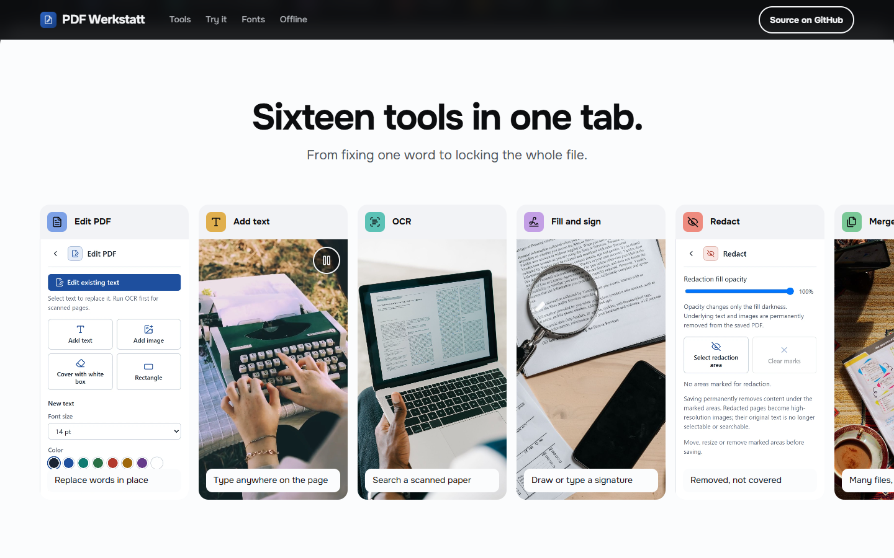
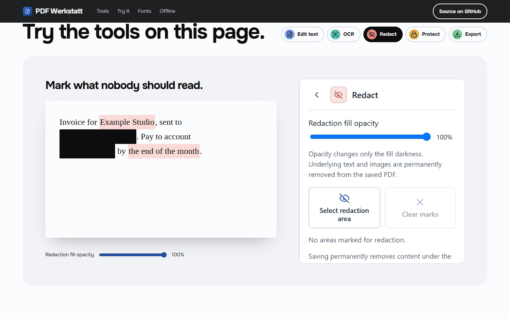
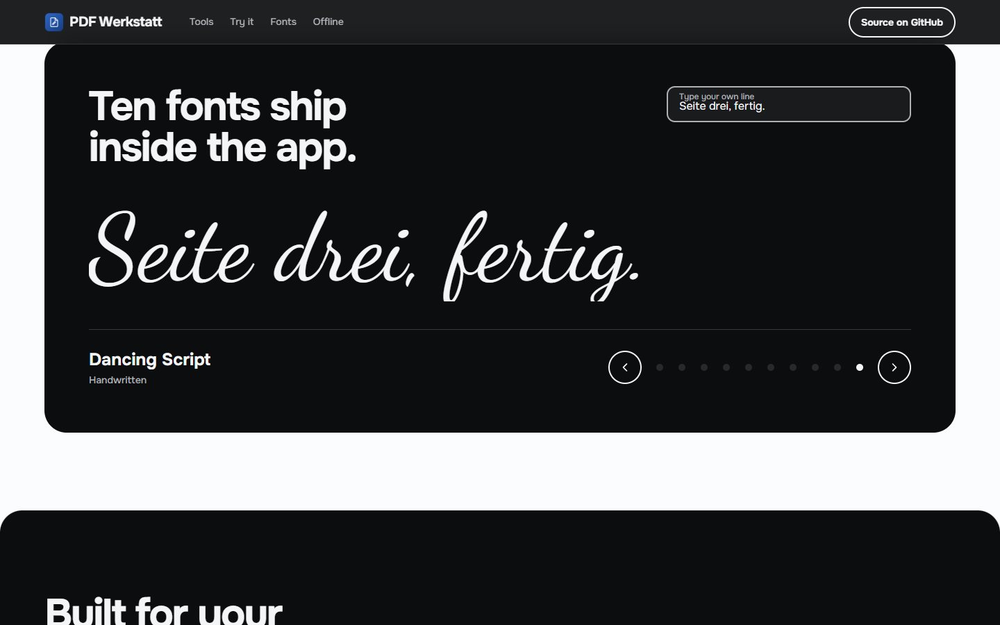
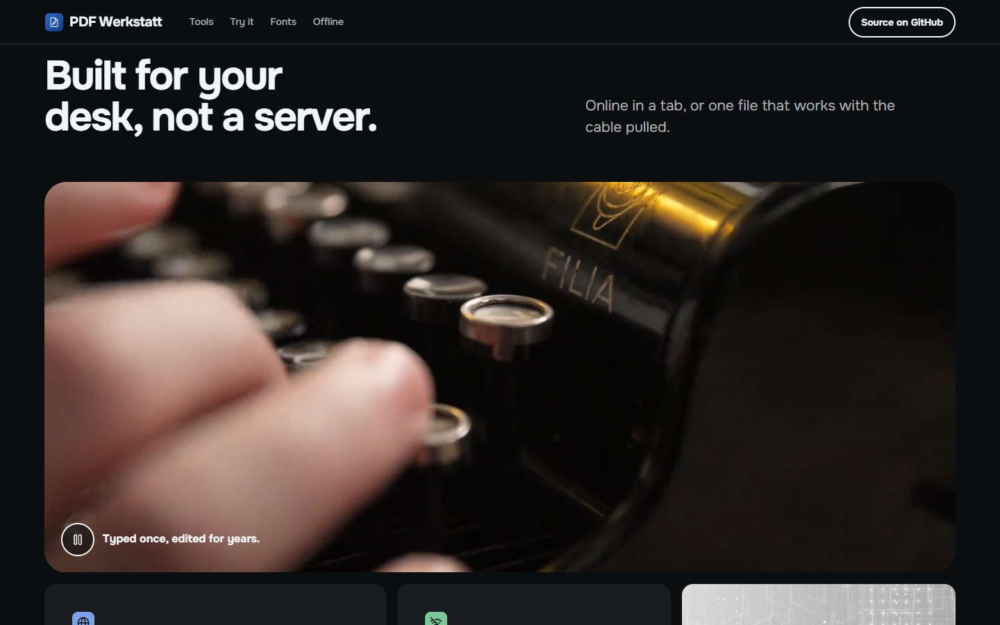
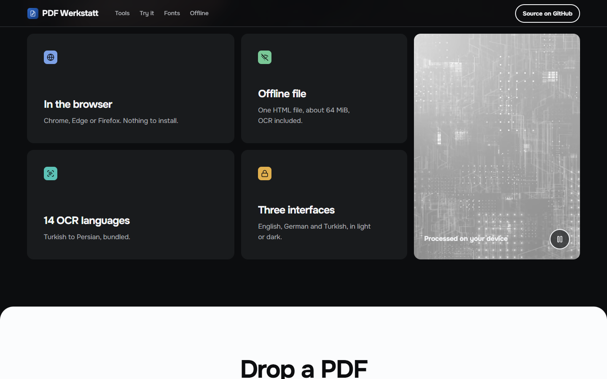
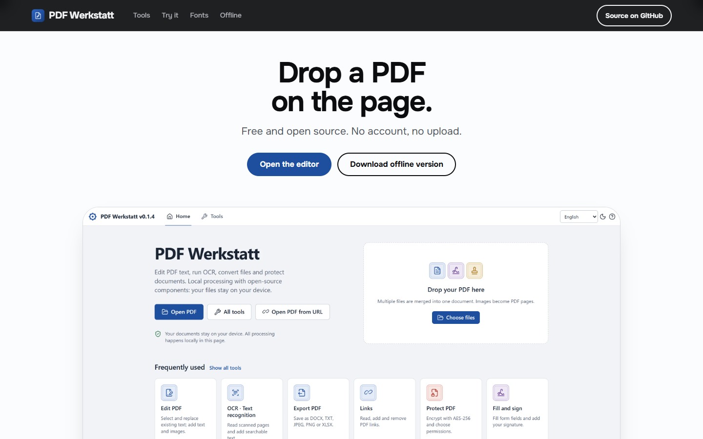

# glyph-bench-sheets

> Part of the [web-design-skills](../../README.md) library.

An AI agent skill (Agent Skills / `SKILL.md` format) for experimental **product sites for document, PDF, writing and
font tools**. It borrows the confident layout of a big software platform — black hero, bold head, pill buttons, white
sheets with rounded tops sliding over dark sections, a rail of tall tool cards, tab chips over a big card — and makes
every graphic out of **the product's own type**: the hero is a mosaic of glyphs set in the fonts the app ships, with a
real page on top that the visitor drags from a grey scan to the clean, searchable result.

It ships with a complete reference build: **PDF Werkstatt**, the repository owner's real open-source PDF editor that
runs entirely in the browser, in English, with real captures of the app, its ten bundled fonts, three Pexels videos
and four photos.



| Rail of tools | Try the tools on the page | Type your own line |
|---|---|---|
|  |  |  |
| **Dark bench with video** | **Card grid** | **Close with the start screen** |
|  |  |  |

More in [`screenshots/`](screenshots) (desktop 1440×900, mobile 390×844).

## What's inside

```
glyph-bench-sheets/
├── SKILL.md                    # style rules, sections, effects, media pipeline, checklist
├── references/components.md    # copy-ready code: tokens, sheets, pills, mosaic, scan slider, loops, rail, tabs, type card
├── example/index.html          # reference site (no libraries)
├── example/tokens.css, base.css, page.css
├── example/assets/             # 3 videos + posters, 4 photos, app captures, icon, fonts/ (10 WOFF2), ~4.3 MB
├── screenshots/*.png
└── scripts/screenshots.mjs     # re-create the screenshots (Node 22+, Chrome; serves the example locally)
```

## Features of the example page

- Hero glyph mosaic: 16 tiles in the app's fonts (Tinos, Inter, Arimo, Cousine, Noto, Noto Arabic, DejaVu ×3,
  Dancing Script); one tile changes font and letter every few seconds while in view, with a pause button.
- A rotated page on the mosaic with a drag/keyboard slider from the scan to the page after OCR, with the searched
  word highlighted.
- A strip of six tool links that jump to the matching demo tab.
- A horizontal snap rail of seven tall tool cards: real panel captures, photos and a looping video.
- Five live demos next to the real panels: edit a line (font, size, B/I/U), pick OCR languages, redact words with an
  opacity slider, encryption settings, export formats.
- A dark type card where the visitor types a line and flips through all ten bundled fonts.
- A dark bench with a 21:9 video reel and a card grid with a tall video; every loop pauses off screen, on hover and
  from its own button, and stays still with reduced motion.
- Built with the Hallmark design floor: OKLCH tokens, no horizontal scroll at 375px, focus states everywhere.

## Re-create the screenshots

```bash
node scripts/screenshots.mjs example screenshots
```

Media: videos and photos from Pexels (free licence); fonts under their own open licences (SIL OFL, Apache 2.0,
Bitstream Vera/DejaVu); app captures © the PDF Werkstatt authors, AGPL-3.0.
