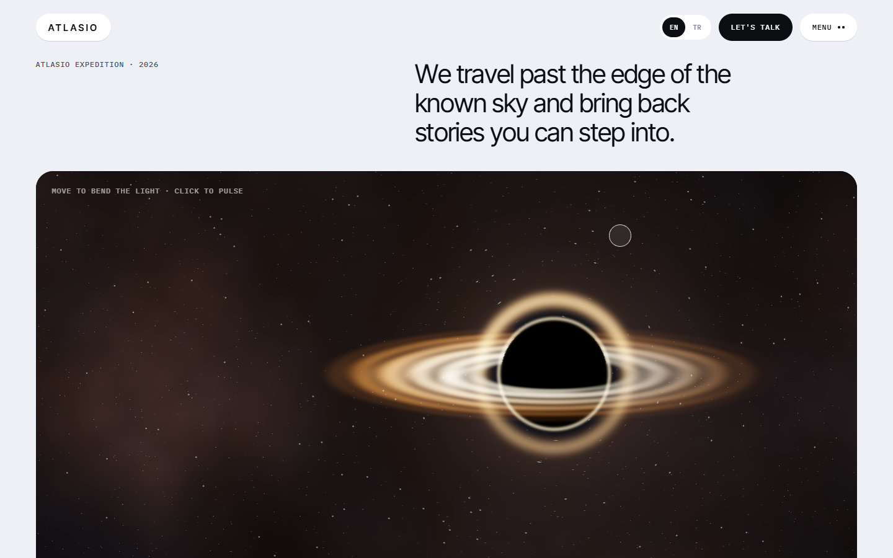
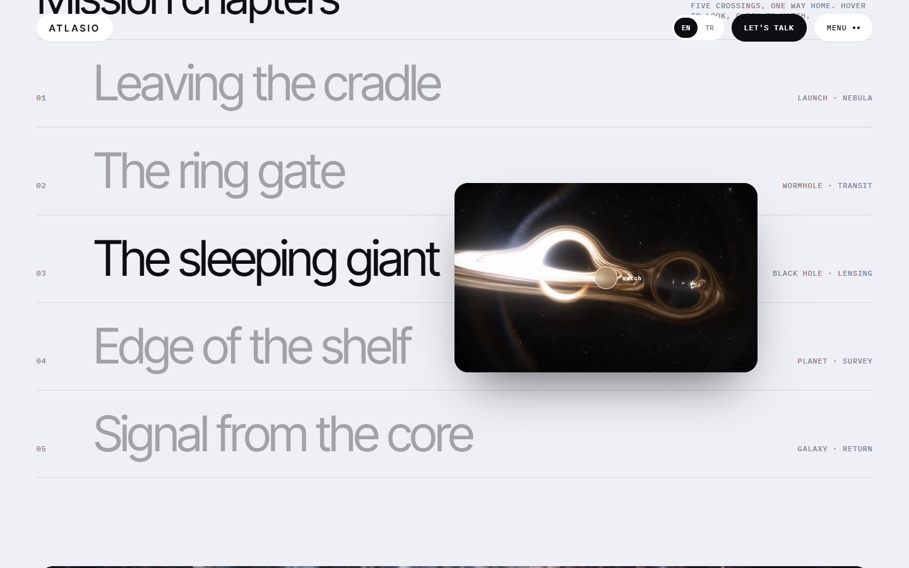
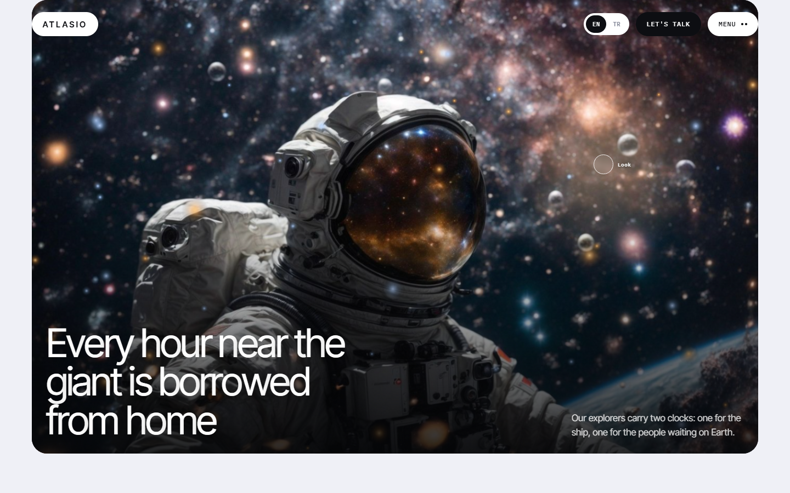
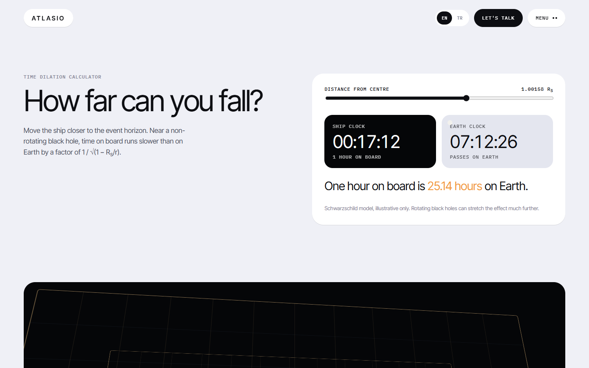
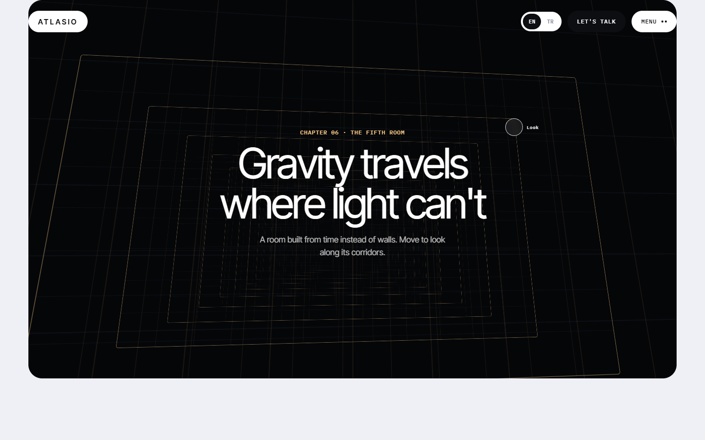
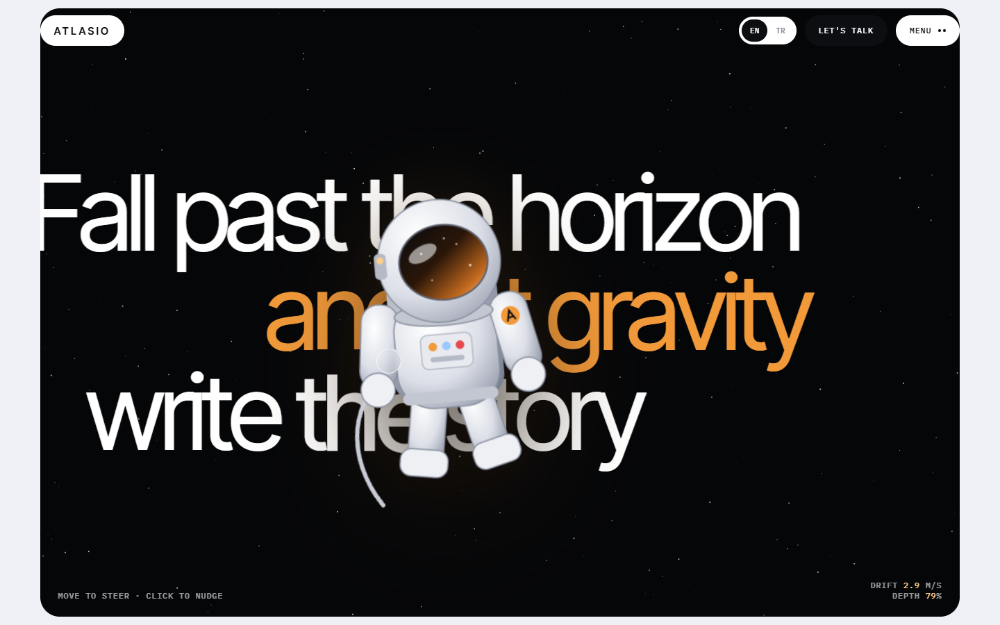
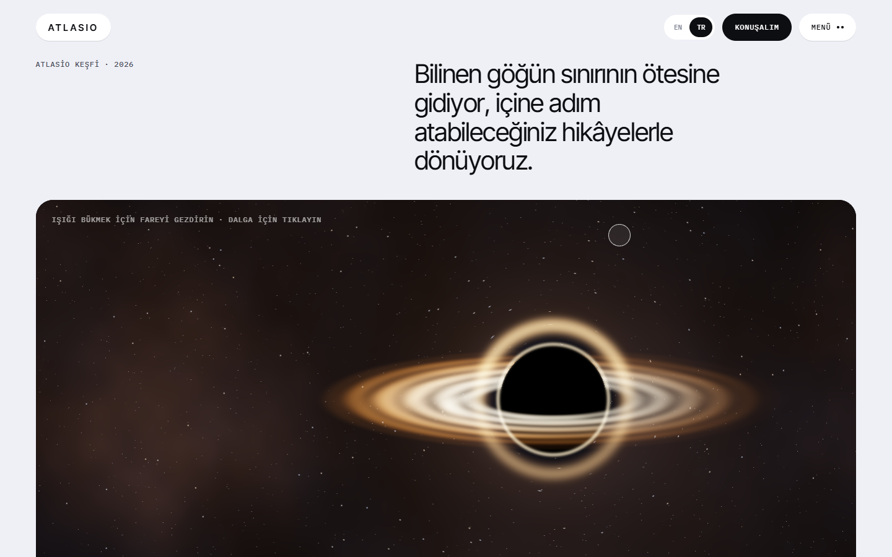

# gravity-lens-space

> Part of the [web-design-skills](../../README.md) library.

An AI skill (Claude Code / Agent Skills) for cinematic space, science and launch websites: a calm light editorial page
that holds rounded dark windows full of **mouse-reactive** media — a real-time black-hole lens shader, floating video
previews, a tilting astronaut scene, a working time-dilation calculator and a tesseract corridor.

It ships with a complete reference build: **Atlasio**, a fictional deep-space expedition, in English and Turkish,
inspired by space-travel cinema and by award-winning interactive studio sites.



| Chapters (hover preview) | Explorer | Time dilation |
|---|---|---|
|  |  |  |
| **Tesseract** | **Drifting astronaut** | **Turkish** |
|  |  |  |

More in [`screenshots/`](screenshots) (desktop 1440×900, mobile 390×844, EN/TR).

## What's inside

```
gravity-lens-space/
├── SKILL.md                    # style rules, sections, effects, media pipeline, checklist
├── references/components.md    # copy-ready code: lens shader, preview list, explorer, calculator, tesseract…
├── example/index.html          # reference site (single file, no libraries)
├── example/assets/             # 5 compressed video loops + posters, astronaut still (~4 MB total)
├── screenshots/*.png
└── scripts/screenshots.mjs     # re-create the screenshots; moves a virtual mouse, renders WebGL with SwiftShader
```

## Features of the example page

- Raw-WebGL black-hole shader: lensed starfield, accretion disk with Doppler brightening, photon ring, lensed far-side
  arc, click pulse; follows the mouse; live HUD with horizon distance and time factor; video fallback without WebGL.
- Chapter list with a floating video preview that chases the cursor and tilts with its speed; click opens a reel dialog.
- Astronaut window with 3D tilt, visor glare and orbs that flee the pointer and drift back.
- Time-dilation calculator using the Schwarzschild formula, with live ship and Earth clocks.
- A finale where a drawn astronaut floats over giant scroll-sliding words, follows the mouse on a spring, rolls with
  its speed, moves its limbs and is nudged by clicks.
- Headlines whose letters thicken and step away from the cursor (variable font weight).
- Tesseract corridor that turns with the mouse, rolling-letter buttons,
  contextual frosted-glass cursor ring ("Watch", "Look"; ring only on interactive canvases; amber only for "Play").
- EN / TR switch; respects `prefers-reduced-motion`; responsive down to 390px.

## Install

```bash
/plugin marketplace add smyrna-pergamum/web-design-skills
/plugin install gravity-lens-space@web-design-skills
```

Or copy this folder to `~/.claude/skills/gravity-lens-space/`.

Then ask, for example:

> Build our planetarium's new exhibition site with the gravity-lens-space skill. Use these four video loops.

## Regenerate the screenshots

```bash
node scripts/screenshots.mjs example/index.html screenshots
```

## Credits and notes

- **Atlasio is fictional.** Chapter names, copy and contact details (`.example` domain) are placeholders written for
  this template; no film titles, names, quotes or reference-site assets are used.
- Video loops: royalty-free clips from [Pixabay](https://pixabay.com/) (Pixabay Content License), trimmed and compressed.
  Astronaut still: supplied by the repository owner, copyright-free.
- Fonts: [Inter Tight](https://fonts.google.com/specimen/Inter+Tight) and [IBM Plex Mono](https://fonts.google.com/specimen/IBM+Plex+Mono)
  (SIL Open Font License) from Google Fonts.

## License

Code and documentation: [MIT](../../LICENSE). Media: see the credits above.

---

### Türkçe özet

Uzay, bilim ve lansman siteleri için sinematik bir web tasarım skill'i. Açık, sakin bir sayfada fareye tepki veren koyu
"pencereler": gerçek zamanlı kara delik shader'ı, imleci takip eden video önizlemeleri, eğilen astronot sahnesi, gerçek
formülle çalışan zaman genişlemesi hesaplayıcısı, tesseract koridoru, dev yazıların önünde fareyi takip eden astronot
ve imlece göre harfleri kalınlaşan başlıklar. Örnek site kurgusal "Atlasio" derin uzay keşfi
(EN/TR). Kurulum: `/plugin marketplace add smyrna-pergamum/web-design-skills` ve
`/plugin install gravity-lens-space@web-design-skills`.
