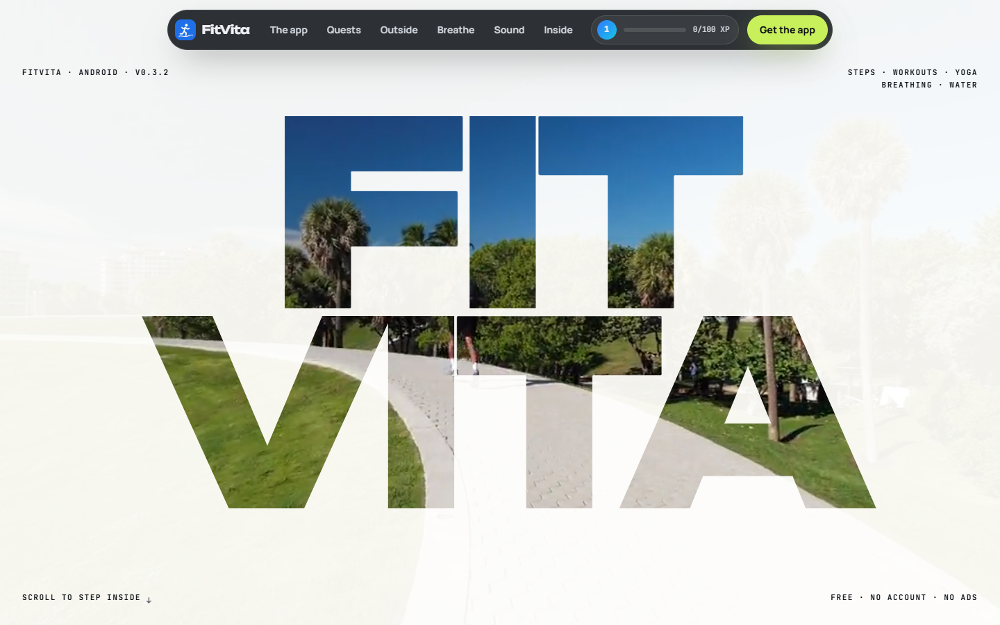
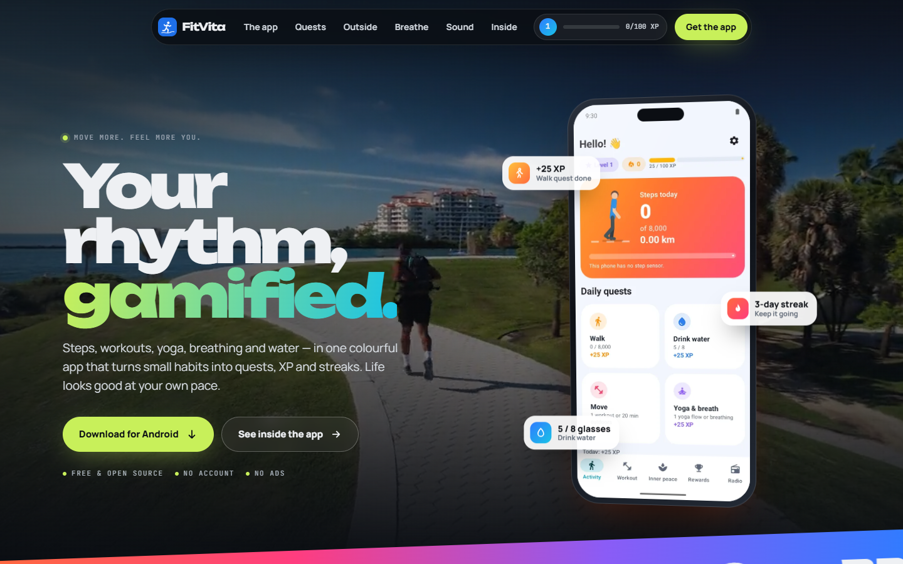
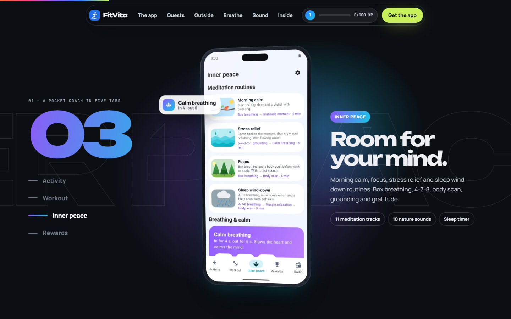
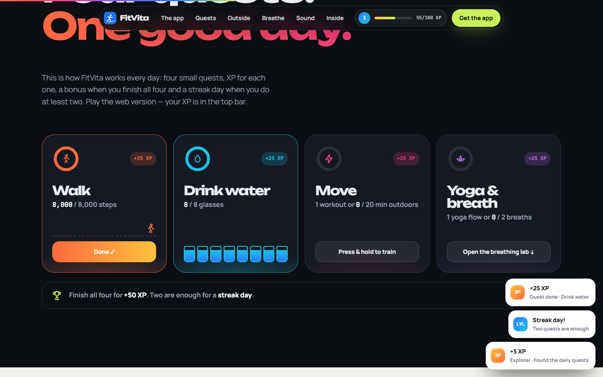
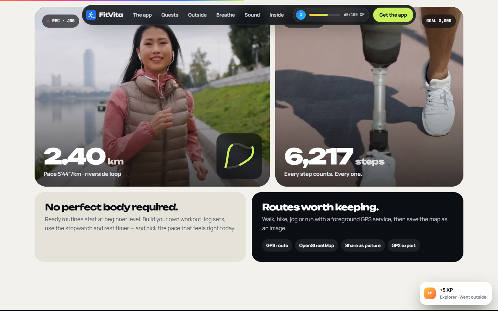
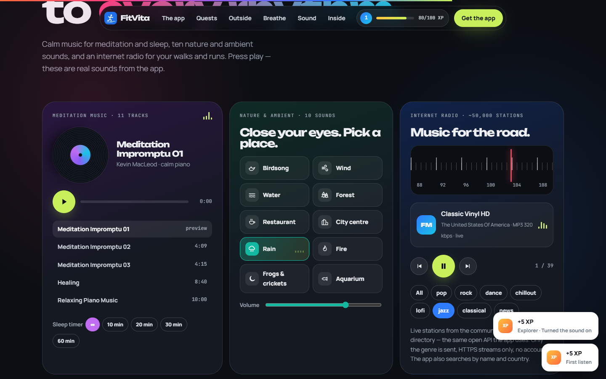
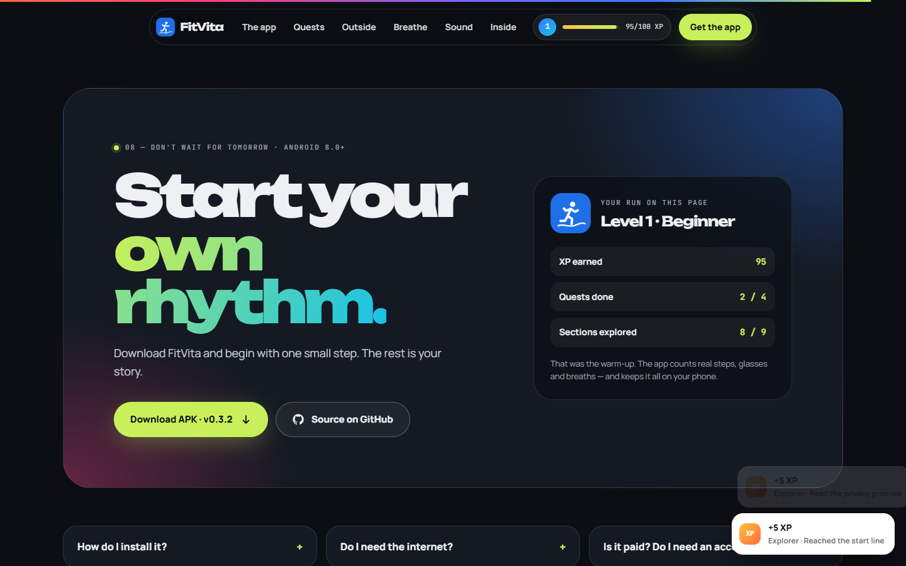

# knockout-quest-app

> Part of the [web-design-skills](../../README.md) library.

An AI agent skill (Agent Skills / `SKILL.md` format) for experimental, gamified **mobile-app landing pages**. A giant
knockout wordmark shows a looping video only through its letters; scrolling zooms into one letter until the video
fills the screen. After that the page **plays like the app**: XP for exploring, the app's real daily quests to tap
through, level-ups with confetti, the app's own music, nature sounds and radio tuner, and the visitor's score next to
the download button.

It ships with a complete reference build: **FitVita**, the repository owner's real open-source Android fitness and
healthy-living app, in English, with its real screenshots, its own meditation music and nature sounds, three Pexels videos and three photos.



| Hero after the zoom | Sticky app tour | Playable daily quests |
|---|---|---|
|  |  |  |
| **Video tiles with a live HUD** | **Sound studio** | **Download card with score** |
|  |  |  |

More in [`screenshots/`](screenshots) (desktop 1440×900, mobile 390×844).

## What's inside

```
knockout-quest-app/
├── SKILL.md                    # style rules, sections, effects, media pipeline, checklist
├── references/components.md    # copy-ready code: knockout zoom, phone, sticky tour, XP engine, quests, HUD…
├── example/index.html          # reference site (single file, no libraries)
├── example/assets/             # 3 videos + posters, 3 photos, 4 app screenshots, icon, sound/ clips (~6 MB)
├── screenshots/*.png
└── scripts/screenshots.mjs     # re-create the screenshots (Node 22+, Chrome; serves the example locally)
```

## Features of the example page

- Paper-white knockout intro (`mix-blend-mode:screen`) that zooms into the "I" of FIT with scroll.
- Dark hero with a 3D-tilting CSS phone, floating reward chips and magnetic buttons.
- Sticky tour: the phone stays while four real screenshots, tab colours, copy and a giant outlined tab name change.
- XP widget in the header: +5 XP per explored section, toasts, levels, confetti.
- Four playable quests copied from the app (tap steps, fill 8 glasses, press-and-hold to train, two calm breaths),
  +50 XP bonus and a streak toast.
- Video tiles with a REC pill, running timer, live distance, pace and steps, and a self-drawing route.
- Sound studio: meditation player with a spinning record, track list and sleep timer; 10 nature-sound tiles with
  equaliser bars and volume; a **live radio** using the same Radio Browser API as the app (needle slides to the genre,
  a burst of Web Audio static, then a real HTTPS station; prev/next, skips dead streams).
- The knockout zoom plays once; scrolling back up shows the finished hero.
- Photo accordion (grayscale multiply → colour), breathing orb (in 4 s, out 6 s), bento of animated numbers,
  scroll-scrubbed privacy lines, FAQ.
- Respects `prefers-reduced-motion`; responsive down to 390px with no horizontal scroll.

## Install

```bash
# Claude Code (2.1.275+ in one step)
/plugin install knockout-quest-app --marketplace smyrna-pergamum/web-design-skills

# Claude Code (older versions)
/plugin marketplace add smyrna-pergamum/web-design-skills
/plugin install knockout-quest-app@web-design-skills
```

Other agents (Codex, Cursor, Copilot, Gemini CLI, ChatGPT…): see the [main README](../../README.md#install).

Then ask, for example:

> Build the landing page for our habit-tracker app with the knockout-quest-app skill. Here are four screenshots,
> our XP rules and two videos.

## Regenerate the screenshots

```bash
node scripts/screenshots.mjs example screenshots
```

## Credits and notes

- **FitVita** is a real app: [github.com/smyrna-pergamum/fitvita](https://github.com/smyrna-pergamum/fitvita)
  (GPL-3.0-or-later). App screenshots and icon come from that project. Download links point to its v0.3.2 release.
- Videos and photos: [Pexels](https://www.pexels.com/license/) (free to use), supplied by the repository owner;
  trimmed, resized and compressed.
- Sound previews: 16–42 s clips cut from the app's bundled audio (all from Wikimedia Commons). Music: “Meditation
  Impromptu 01” by Kevin MacLeod (incompetech.com), CC BY 3.0. Nature: Birdsong morning 01 – Matutinho (CC BY-SA 4.0);
  Wind sounds – Robert EA Harvey (CC BY-SA 4.0); Stream river water – jackthemurray (CC0); Waidachswald Abend – Evillan
  (CC0); Cafe ambiance – Marble Toast (CC0); Sunday in the city – cori (public domain); Light Rain Distant Thunder –
  kvgarlic (CC0); Campfire ambience – Glaneur de sons (CC BY 3.0); Crickets choir – Serg Childed (CC BY-SA 4.0);
  Artis aquarium – Beeld en Geluid (CC BY-SA 3.0). Trimmed, faded and re-encoded; the BY-SA clips stay under BY-SA.
- Live radio: station list from the community-run [Radio Browser](https://www.radio-browser.info/) API (only the genre
  is sent); streams come from the stations themselves.
- Fonts: [Unbounded](https://fonts.google.com/specimen/Unbounded), [Manrope](https://fonts.google.com/specimen/Manrope)
  and [JetBrains Mono](https://fonts.google.com/specimen/JetBrains+Mono) (SIL Open Font License) from Google Fonts.

## License

Code and documentation: [MIT](../../LICENSE). App screenshots and icon: FitVita (GPL-3.0-or-later). Photos, videos
and sounds: see the credits above.

---

### Türkçe özet

Deneysel, oyunlaştırılmış mobil uygulama tanıtım sayfaları için bir web tasarım skill'i. Beyaz girişte dev bir
logo yazısı var, video yalnızca harflerin içinden görünüyor; kaydırınca kamera "I" harfinin içine dalıyor ve video
tüm ekranı kaplıyor. Sonra sayfa uygulama gibi davranıyor: gezdikçe XP, uygulamanın gerçek günlük görevleri (adım,
su bardakları, basılı tutarak antrenman, nefes), seviye atlama ve konfeti, indirme butonunun yanında ziyaretçinin
skoru. Uygulamanın kendi meditasyon müziği, 10 doğa sesi ve radyo ayarlayıcısı da çalınabiliyor. Sabit kalan telefonda gerçek ekranlar değişiyor, videolarda canlı fitness göstergeleri var. Örnek site: gerçek
açık kaynak Android uygulaması FitVita (İngilizce).
