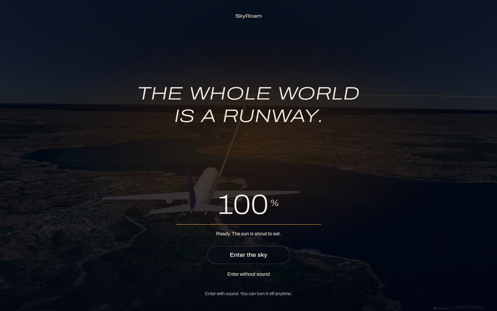
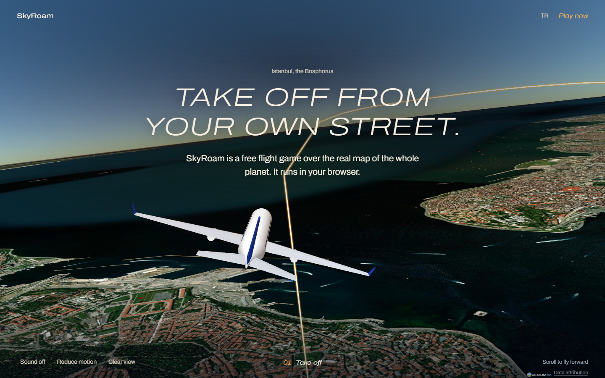
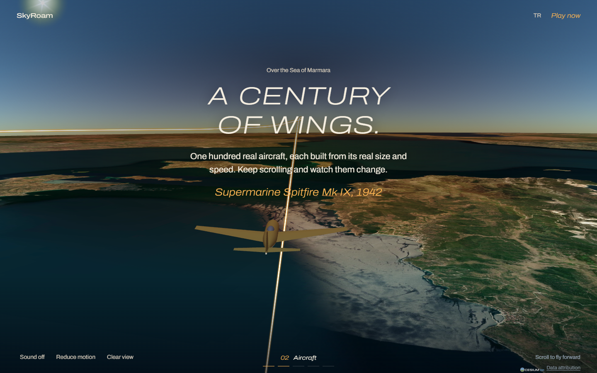
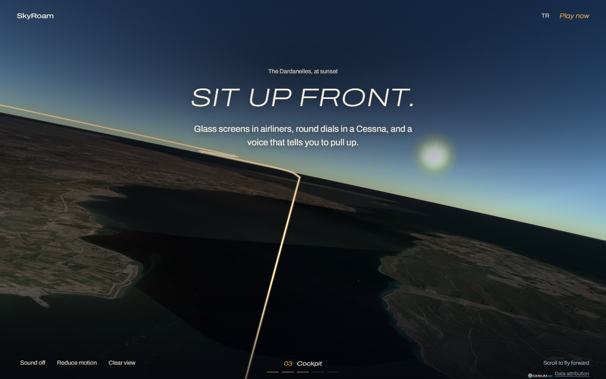
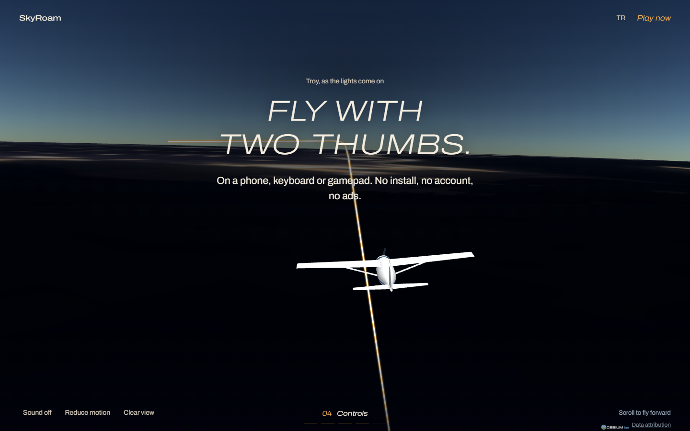
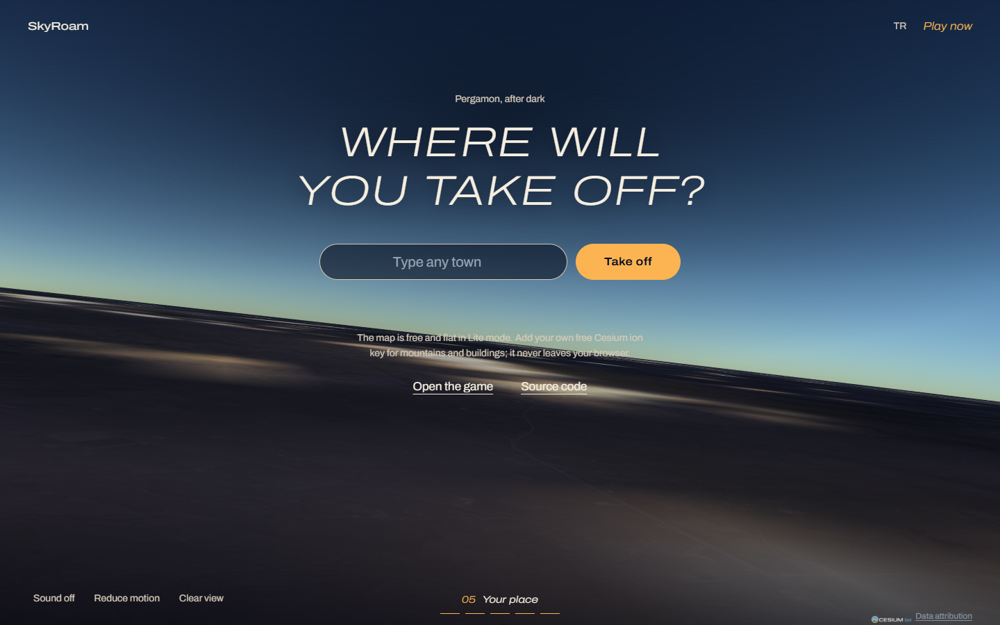
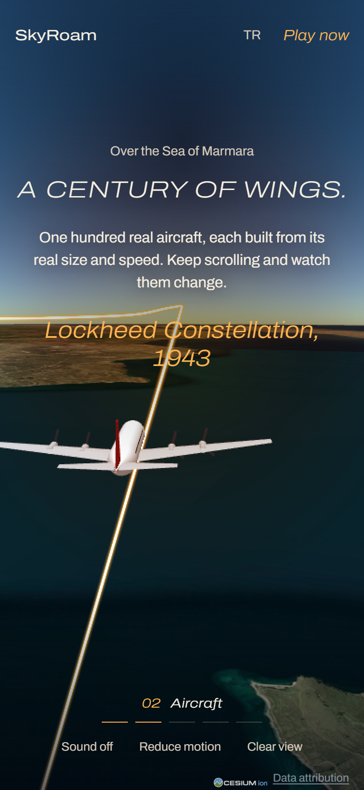

# live-globe-flight-film

> Part of the [web-design-skills](../../README.md) library.

An AI agent skill (Agent Skills / `SKILL.md` format) for **experimental, scroll-driven "film" websites set on a live 3D
globe**. A dark entrance gate counts the planet in and asks to enter with sound; then every scroll moves a real
aircraft along a real route over the real map, a glowing golden trail leads ahead, the sun sets, city lights come on,
and one wide, light, italic capital line per chapter fades in. The last chapter hands the visitor the controls.

It ships with a complete reference build: the real **SkyRoam** website, a free open-source browser flight game. The
page is one evening flight from Istanbul over the Sea of Marmara, the Dardanelles and Troy to Pergamon, with the
game's own aircraft models (the Wright Flyer turns into a Spitfire, a DC-3, Concorde and an A380 as you scroll).



| Take off over the Bosphorus | A century of wings | Sit up front |
|---|---|---|
|  |  |  |
| **City lights over Troy** | **Take off anywhere** | **Mobile** |
|  |  |  |

More in [`screenshots/`](screenshots) (desktop 1440×900, mobile 390×844).

## What's inside

```
live-globe-flight-film/
├── SKILL.md                    # style rules, chapters, interactions, build rules, checklist
├── references/components.md    # copy-ready code: tokens, layers, viewer + light grading, route, camera, trail, gate, fade, sound
├── example/index.html          # reference site (inline CSS, ES-module script, CesiumJS from jsDelivr)
├── example/assets/js/          # the game's aircraft generator (fleet data, model builder)
├── example/assets/sounds/      # engine and wind loops (Pixabay)
├── example/assets/img/         # fallback screenshot for browsers without WebGL
├── screenshots/*.png
└── scripts/screenshots.mjs     # re-create the screenshots (Node 22+, Chrome; serves the example locally)
```

## Features of the example page

- Entrance gate with a real loading figure (globe tiles), *Enter the sky* with sound or *Enter without sound*.
- Scroll-driven flight along a Catmull-Rom route with even speed, banking, bob and sway; eased camera.
- Golden glowing trail along the route; time of day from progress; graded dusk; NASA Black Marble city lights.
- An aircraft that changes through 11 types from 1903 to 2005 inside one chapter, with name and year live.
- Camera slides into the nose for the cockpit chapter.
- Engine and wind loops whose volume and pitch follow scroll speed.
- Instrument strip: sound, reduce motion, clear view, chapter number and dots.
- Town search (Open-Meteo) that launches the real game at that town; TR/EN.
- Fallback screenshot without WebGL; no gate without script; `prefers-reduced-motion` respected.

## Re-create the screenshots

```bash
node scripts/screenshots.mjs example screenshots
```

The page streams live map tiles, so the script needs an internet connection and waits for each view to finish loading.

## Credits

Map: [CesiumJS](https://github.com/CesiumGS/cesium) (Apache-2.0), Esri World Imagery (© Esri, Maxar, Earthstar
Geographics), NASA Black Marble via NASA GIBS. Place search: Open-Meteo (GeoNames, CC BY 4.0). Sounds: Pixabay
Content License. Aircraft models are generated in code from public dimensions; names are their makers' trademarks.

Live site: https://smyrna-pergamum.github.io/skyroam/ · Game: https://github.com/smyrna-pergamum/skyroam

---

## Türkçe

Canlı bir 3D dünya (CesiumJS) üzerinde geçen, kaydırmayla ilerleyen deneysel "film" web siteleri için bir yapay zekâ
ajanı becerisi. Karanlık bir giriş kapısı gezegeni yükler ve sesle girmeyi önerir; sonra her kaydırma gerçek bir uçağı
gerçek harita üzerinde bir rota boyunca uçurur, önde altın rengi bir ışık izi uzanır, güneş batar, şehir ışıkları yanar
ve her bölümde tek bir geniş, ince, italik büyük harfli satır belirir. Örnek: SkyRoam'ın gerçek web sitesi, İstanbul'dan
Bergama'ya bir akşam uçuşu.
