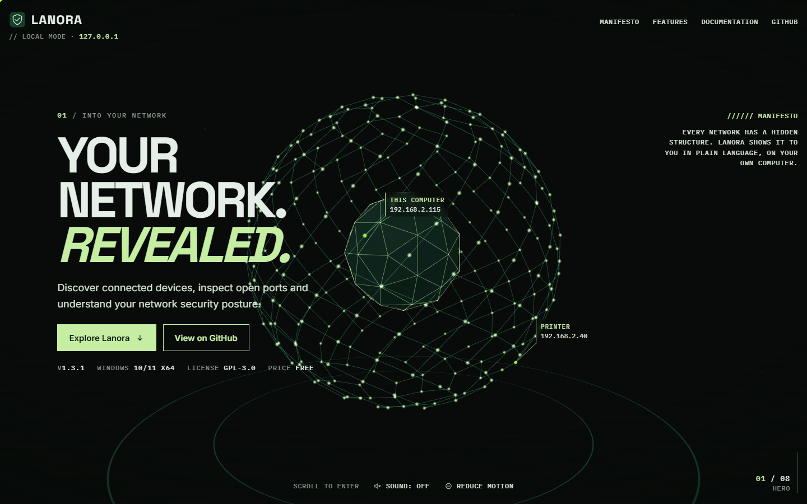
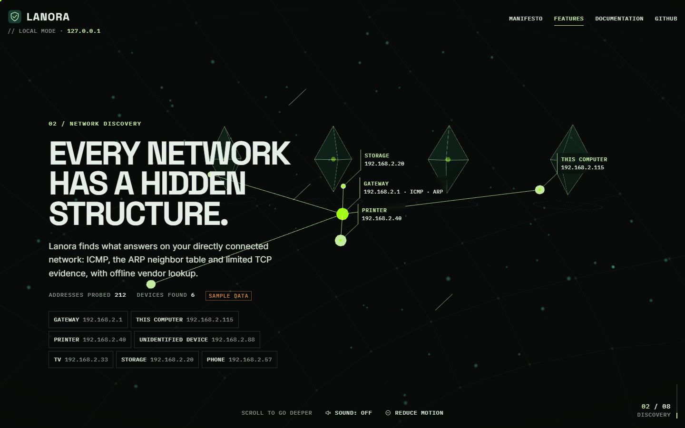
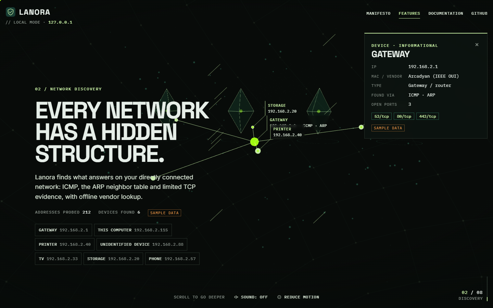
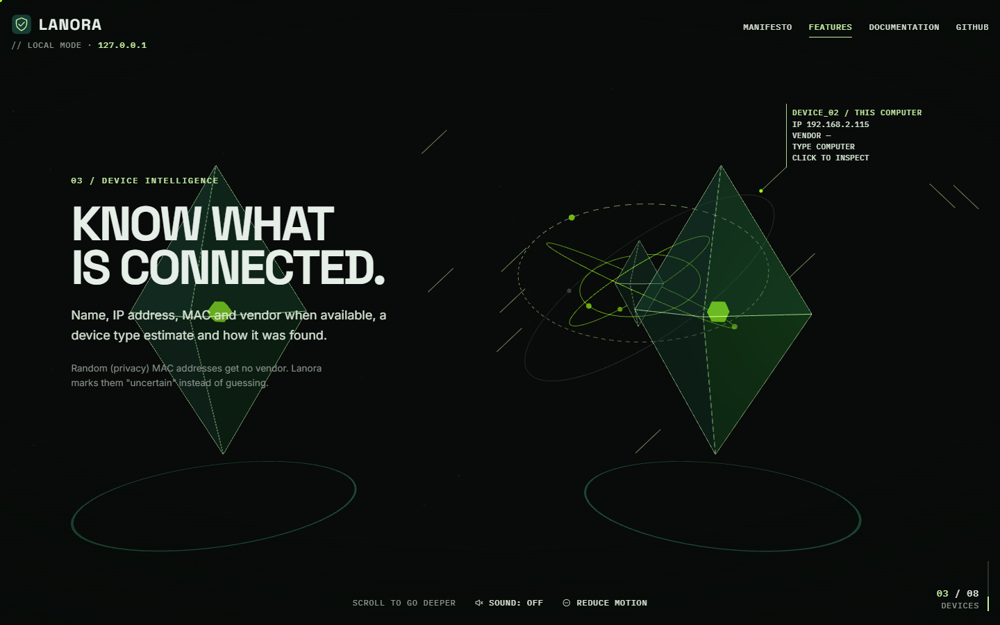
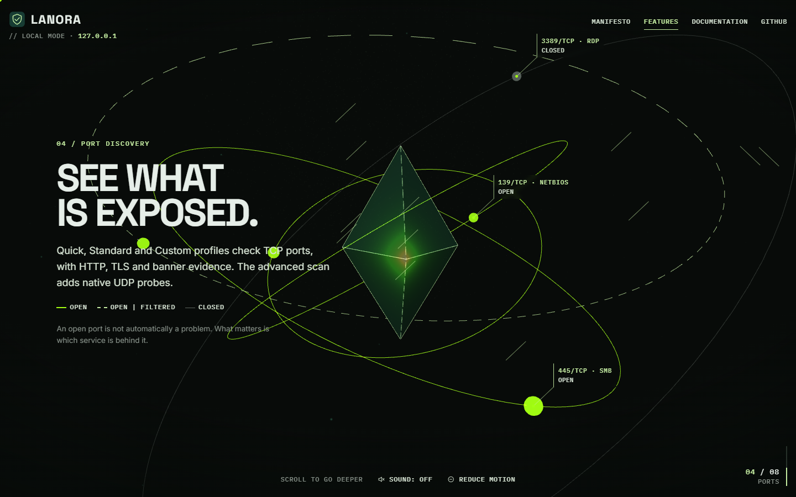
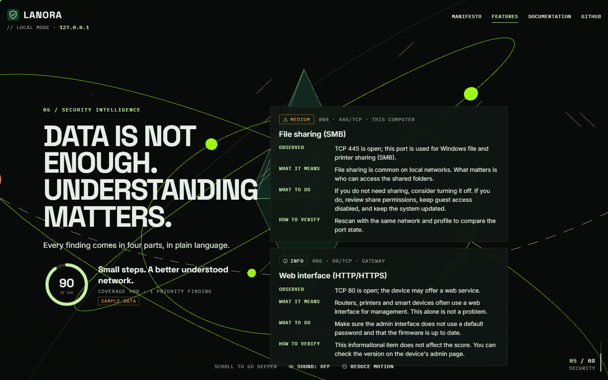
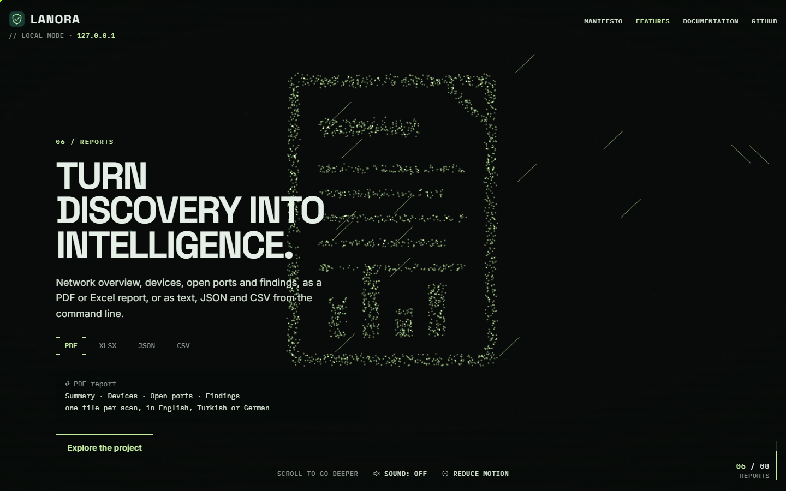
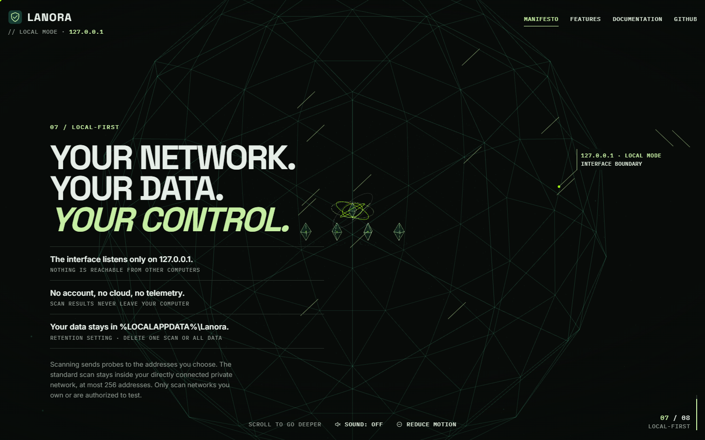
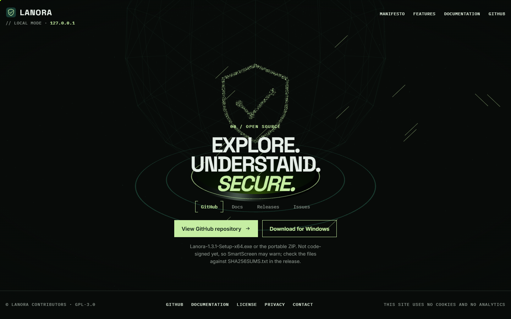
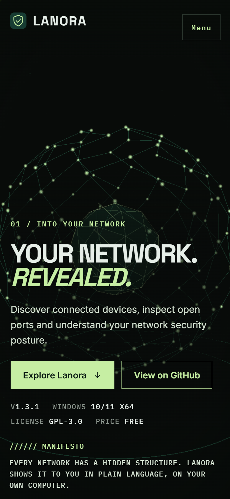

# network-journey-webgl

> Part of the [web-design-skills](../../README.md) library.

An AI skill (Claude Code / Agent Skills) for **immersive, scroll-driven 3D product websites** in the igloo.inc
tradition, built to production standards. One Three.js world sits behind real HTML chapters, and a camera flies
through it on a single scroll value. The page is framed by HUD corners with mono labels, and leader-line tags are
pinned to 3D objects. A particle cloud morphs into line drawings. The palette is forest green and lime on a night
background.

The engineering is part of the skill:
- a static SvelteKit build
- four quality tiers with pre-rendered stills
- 43 KB of JavaScript before first paint
- a strict CSP
- no third-party requests
- Playwright + axe tests
- a GitHub Pages workflow

The reference build is the real website for **[LANORA](https://github.com/smyrna-pergamum/Lanora)**, the free,
open-source network scanner for Windows.



| Discovery | Device panel | Devices |
|---|---|---|
|  |  |  |
| **Ports** | **Security** | **Reports** |
|  |  |  |
| **Local-first** | **Explore** | **Mobile** |
|  |  |  |

## Measured on the LANORA build

| Check | Result |
| --- | --- |
| Lighthouse mobile (Performance / Accessibility / Best practices / SEO) | 94–95 / 100 / 100 / 100 |
| Lighthouse desktop | 100 / 100 / 100 / 100 |
| Mobile LCP / CLS | 2.2 s / 0.004 |
| JavaScript before first paint | 43 KB gzip |
| Playwright + axe, desktop and mobile | 16 / 16 passing |

Measured locally on the production build (Lighthouse 12.8.2, headless Chrome).

## What's inside

```
network-journey-webgl/
├── SKILL.md                    # style, chapter patterns, interactions, engineering rules, checklist
├── references/components.md    # camera path, ScrollTrigger + Lenis, quality tiers, lazy start, tags, particle morph, CSP, axe test
├── example/                    # static build of the LANORA site (serve it; it is not a single file)
├── source/                     # the SvelteKit project (npm install && npm run dev)
├── screenshots/*.png
└── scripts/capture.mjs         # review screenshots and Static-tier stills via headless Chrome
```

## Install

```bash
/plugin marketplace add smyrna-pergamum/web-design-skills
/plugin install network-journey-webgl@web-design-skills
```

Or copy this folder to `~/.claude/skills/network-journey-webgl/`.

Then ask, for example:

> Build an immersive 3D site for our backup tool with the network-journey-webgl skill. Chapters: connect, snapshot,
> encrypt, restore.

## Run the example source

```bash
cd source
npm install
npm run dev
```

## Credits and notes

- Content follows the LANORA README, the 1.3.1 release notes and `ruleset.json`. The network shown is sample data and
  is labelled as such.
- Structure and HUD inspired by [igloo.inc](https://www.igloo.inc/) (Abeto / Bureaux). No assets or copy were taken.
- [three.js](https://threejs.org/) (MIT), [GSAP](https://gsap.com/) (standard no-charge license),
  [Lenis](https://lenis.darkroom.engineering/) (MIT). Fonts: Space Grotesk, Inter and IBM Plex Mono (SIL OFL), via
  Fontsource.

## License

Skill text and references: [MIT](../../LICENSE). The LANORA site in `example/` and `source/`: GPL-3.0, like LANORA.

---

### Türkçe özet

igloo.inc çizgisinde, scroll ile ilerleyen deneysel bir 3D ürün sitesi skill'i, üretim kalitesinde kurulmuş hâliyle.
Gerçek HTML bölümlerin arkasında tek bir Three.js dünyası var; kamera tek bir scroll değeriyle bu dünyanın içinde
ilerliyor. Köşelerde HUD var, 3D nesnelere etiketler bağlı, parçacıklar çizimlere dönüşüyor. Renkler orman yeşili ve
lime. Altyapı da skill'in parçası: SvelteKit statik build, dört kalite basamağı, ilk boyamada 43 KB JavaScript, sıkı
CSP, Playwright + axe testleri ve GitHub Pages iş akışı. Örnek, LANORA ağ tarayıcısının gerçek sitesi. Kurulum:
`/plugin marketplace add smyrna-pergamum/web-design-skills` ve `/plugin install network-journey-webgl@web-design-skills`.
