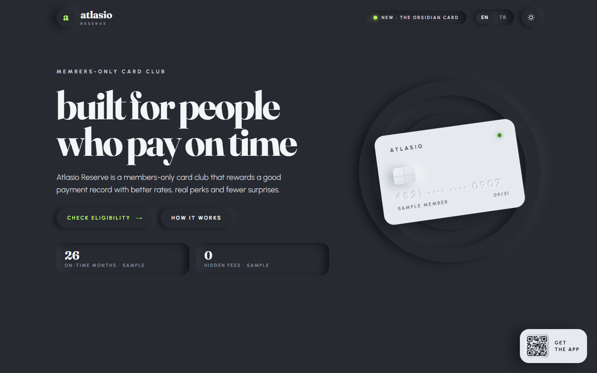
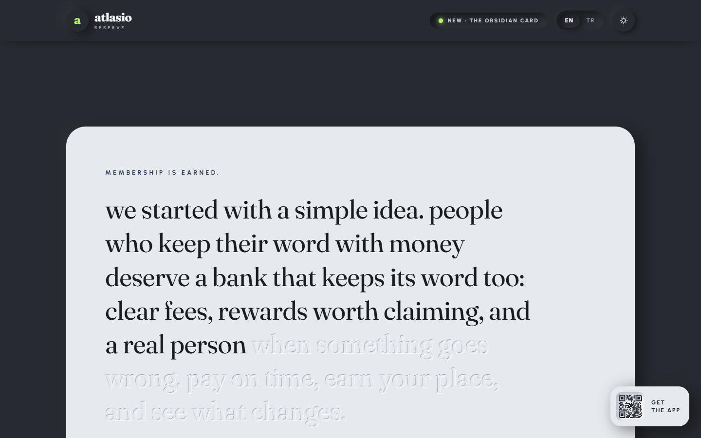
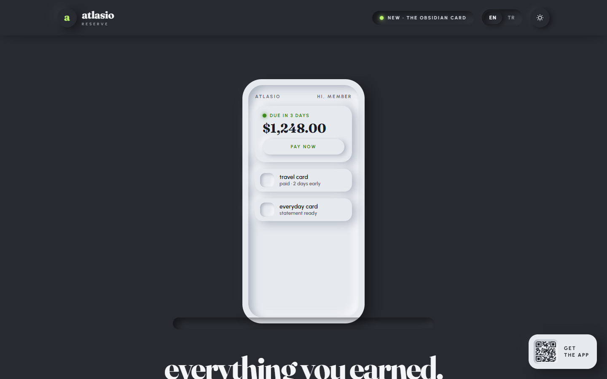
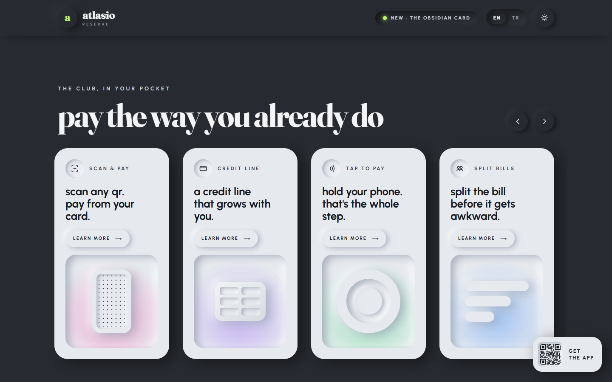
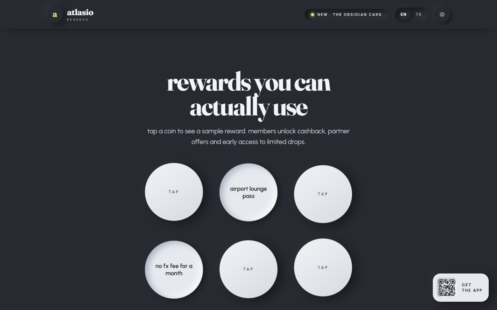
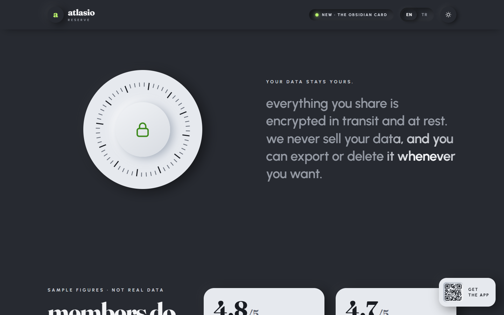
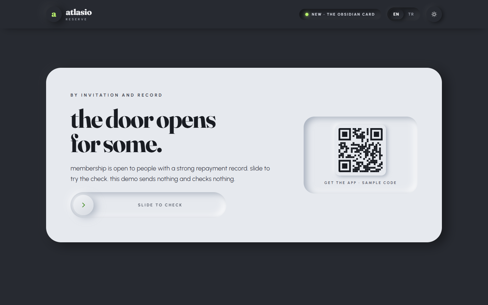
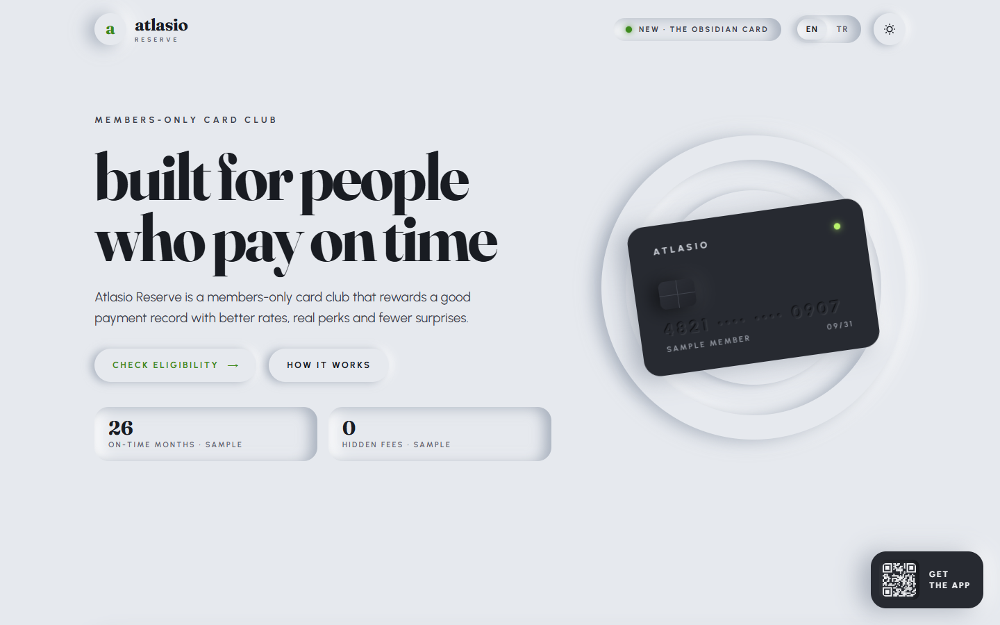
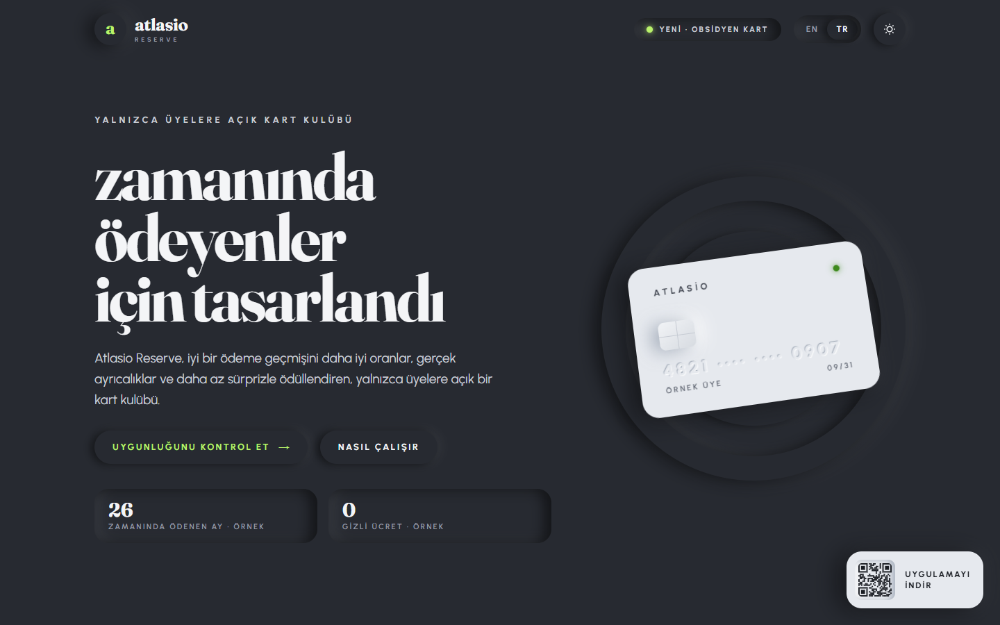
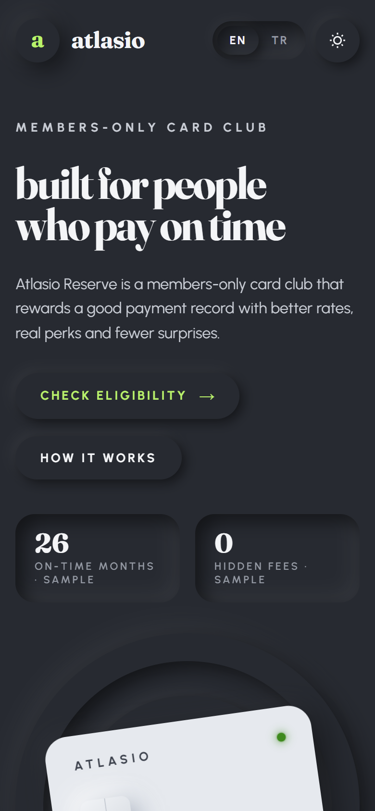

# neumorphic-club-fintech

> Part of the [web-design-skills](../../README.md) library.

An AI skill (Claude Code / Agent Skills) for premium fintech, card and membership websites in **two-material
neumorphism**: a dark relief page with light relief islands for cards, panels, coins and the phone, depth only from paired
shadows, heavy lowercase serif headlines and a single lime LED accent. Its signature layers:

- **Cursor light** – the light source follows the mouse, so every raised and pressed shadow on the page turns with it.
- **Engraved words** – a manifesto carved into the surface lights up word by word as you scroll.
- **Relief objects** – an embossed card that tilts with the mouse, a phone rising out of a slot, fanning card slabs,
  pressable reward coins, a rotating lock dial and a slide-to-join control.
- **Swap materials** – one switch inverts the page: light relief page with dark islands.

It ships with a complete reference build: **Atlasio Reserve**, a fictional members-only card club, in English and Turkish.



| Engraved story | Phone rising | Pay rail |
|---|---|---|
|  |  |  |
| **Reward coins** | **Lock dial + spotlight** | **Slide to join** |
|  |  |  |
| **Light relief** | **Turkish** | **Mobile** |
|  |  |  |

More in [`screenshots/`](screenshots) (desktop 1440×900, mobile 390×844, dark and light, EN/TR).

## What's inside

```
neumorphic-club-fintech/
├── SKILL.md                    # style rules, sections, interactions, checklist
├── references/components.md    # copy-ready code: material tokens, cursor light, tilt card, engraved reveal, rail, coins, slider…
├── example/index.html          # reference site (single file, no images, no libraries)
├── screenshots/*.png
└── scripts/screenshots.mjs     # re-create the screenshots; moves a virtual mouse and captures both themes
```

## Features of the example page

- Two materials (dark page, light islands) with raised, pressed, convex and engraved variants, all built from shadow tokens.
- A light source that follows the cursor and re-lights every shadow on the page.
- Fraunces lowercase display, Urbanist UI, wide-tracked uppercase eyebrows, a lime LED for live states.
- Embossed tilting card on relief rings, engraved scroll-reveal manifesto, phone rising from an inset slot.
- Card slabs that fan open on scroll, horizontal rail of relief tiles with coloured glow wells.
- Pressable floating reward coins, rotating lock dial with a drifting spotlight paragraph.
- Slide-to-join with pointer and keyboard support, pressed-when-open FAQ, floating app badge.
- Material swap switch, EN / TR switch, `prefers-reduced-motion` support, responsive down to 390px.

## Install

```bash
/plugin marketplace add smyrna-pergamum/web-design-skills
/plugin install neumorphic-club-fintech@web-design-skills
```

Or copy this folder to `~/.claude/skills/neumorphic-club-fintech/`.

Then ask, for example:

> Build our credit card landing page with the neumorphic-club-fintech skill. The LED should show the next due date.

## Regenerate the screenshots

```bash
node scripts/screenshots.mjs example/index.html screenshots
```

## Credits and notes

- **Atlasio Reserve is fictional.** Ratings, streaks, amounts and rewards are labelled samples; the QR is a decorative
  pattern, not a working code.
- No external images and no libraries: every visual is CSS or canvas.
- Fonts: [Fraunces](https://fonts.google.com/specimen/Fraunces) and [Urbanist](https://fonts.google.com/specimen/Urbanist)
  (SIL Open Font License) from Google Fonts.

## License

Code and documentation: [MIT](../../LICENSE).

---

### Türkçe özet

Premium fintech, kredi kartı ve üyelik siteleri için **iki malzemeli neumorfik** (soft UI) bir web tasarım skill'i.
Sayfa koyu; kartlar, paneller, jetonlar ve telefon açık renk. Derinlik yalnızca kabarık ve gömük gölge çiftlerinden gelir. İmza efektler: imleci takip
eden **ışık kaynağı** (sayfadaki tüm gölgeler onunla döner), scroll'da kelime kelime aydınlanan **oyma metin**, fareyle
eğilen kabartma kart, yuvadan yükselen telefon, basılabilir ödül jetonları, dönen kilit kadranı ve **kaydırarak katıl**
kontrolü. Tek tuşla malzemeler yer değiştirir: açık sayfa, koyu kartlar. Örnek site kurgusal "Atlasio Reserve" kart kulübü (EN/TR). Kurulum:
`/plugin marketplace add smyrna-pergamum/web-design-skills` ve `/plugin install neumorphic-club-fintech@web-design-skills`.
