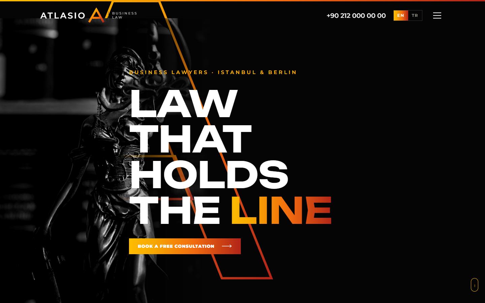
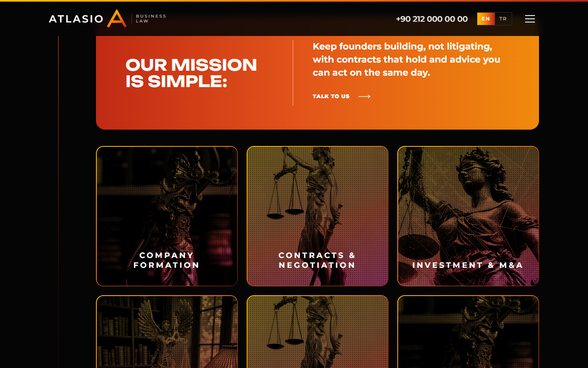
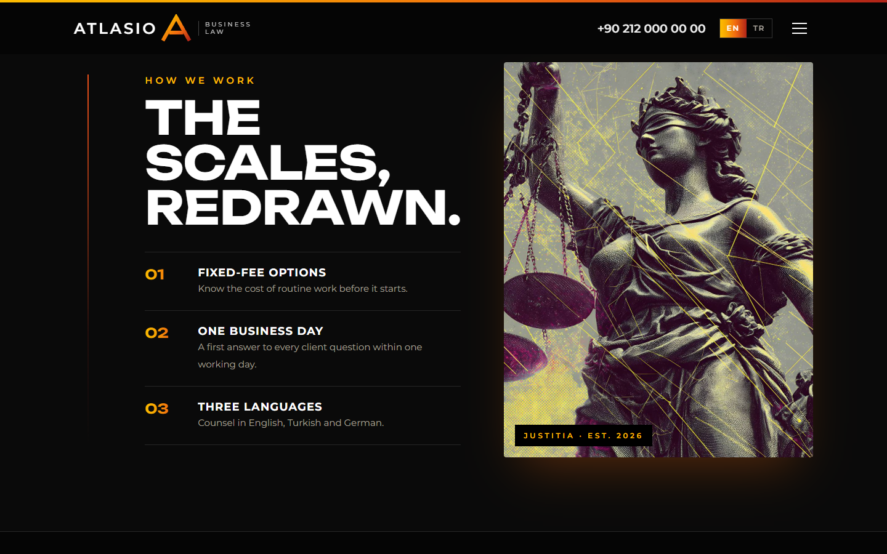
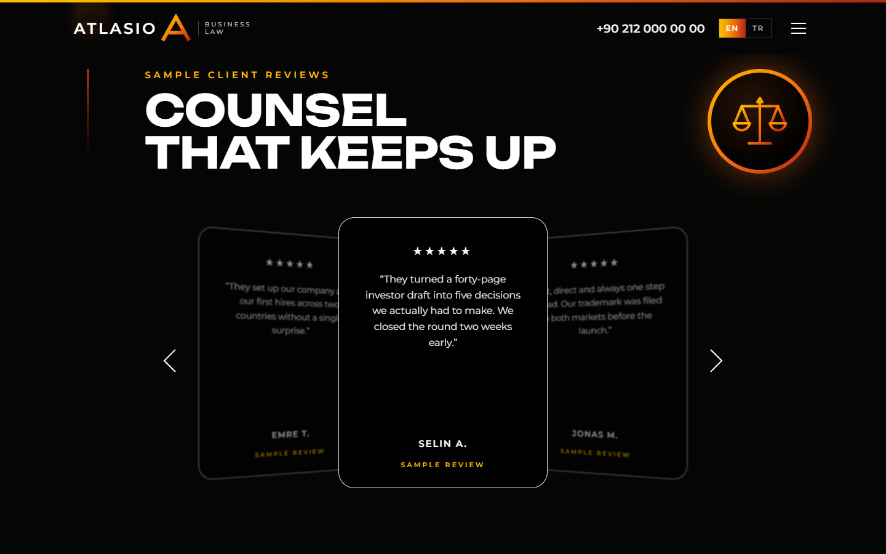
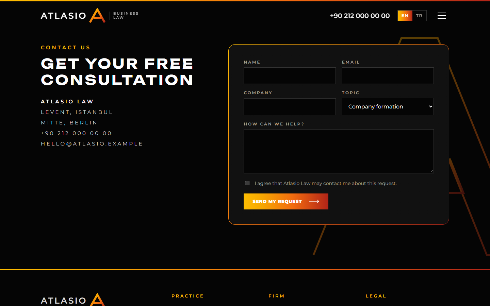
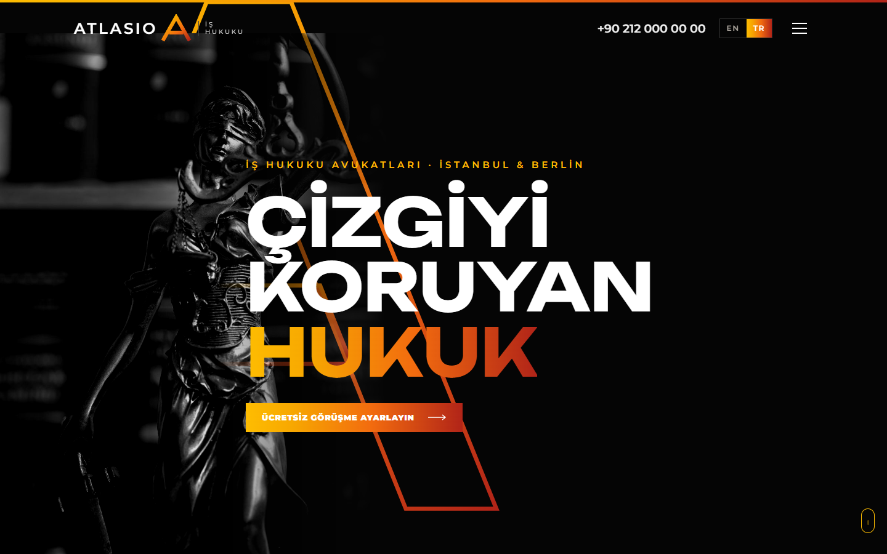

# noir-gradient-law

> Part of the [design-skills](../../README.md) library.

An AI skill (Claude Code / Agent Skills) for law-firm and advisory websites in a bold **noir gradient** style: pure black,
monochrome bronze statue photography, one fire gradient (yellow → orange → red), giant uppercase Unbounded headlines,
gradient-border cards, a duotone-halftone photo treatment and a 3D review carousel.

It ships with a complete reference build: **Atlasio Law**, a fictional business law firm, in English and Turkish.



| Practice areas | Halftone band | 3D reviews |
|---|---|---|
|  |  |  |
| **Who we help** | **Contact** | **Turkish** |
|  |  |  |

More in [`screenshots/`](screenshots) (desktop 1440×900, mobile 390×844, EN/TR, menu open).

## What's inside

```
noir-gradient-law/
├── SKILL.md                    # style rules, sections, effects, checklist
├── references/components.md    # copy-ready HTML/CSS/JS for every component
├── example/index.html          # reference site (single file)
├── example/assets/             # the four statue photos used by the example
├── screenshots/*.png
└── scripts/screenshots.mjs     # re-create the screenshots (Node 22+ and Chrome, no npm install)
```

## Features of the example page

- Hollow gradient monogram that draws itself in behind the hero; statue photo masked into the black.
- Duotone + halftone treatment that turns any photo into the same warm, dotted series, plus generated scratch lines.
- Infinite marquee of client types, gradient-bordered practice cards with hover descriptions, mission banner.
- 3D review carousel with arrows, swipe and arrow keys; full-screen menu with Esc to close.
- EN / TR language switch; validated contact form that sends nothing (template).
- Respects `prefers-reduced-motion`; responsive down to 390px.

## Install

```bash
/plugin marketplace add smyrna-pergamum/design-skills
/plugin install noir-gradient-law@design-skills
```

Or copy this folder to `~/.claude/skills/noir-gradient-law/`.

Then ask, for example:

> Build a website for our tax advisory firm with the noir-gradient-law skill. Use our three office photos.

## Regenerate the screenshots

```bash
node scripts/screenshots.mjs example/index.html screenshots
```

## Credits and notes

- **Atlasio Law is fictional.** Contact details use the reserved `.example` domain and a placeholder phone number;
  all reviews are marked as samples.
- The four photos in `example/assets/` were supplied by the repository owner and are free of copyright restrictions.
  For real projects, replace them with the firm's own images.
- Fonts: [Unbounded](https://fonts.google.com/specimen/Unbounded) and [Montserrat](https://fonts.google.com/specimen/Montserrat),
  SIL Open Font License, loaded from Google Fonts.

## License

Code and documentation: [MIT](../../LICENSE). Example images: copyright-free (see above).

---

### Türkçe özet

Hukuk ve danışmanlık büroları için siyah zeminli, ateş gradyanlı (sarı → turuncu → kırmızı), heykel fotoğraflı cesur bir
web tasarım skill'i. Örnek site kurgusal "Atlasio Law" (EN/TR). Kurulum:
`/plugin marketplace add smyrna-pergamum/design-skills` ve `/plugin install noir-gradient-law@design-skills`.
