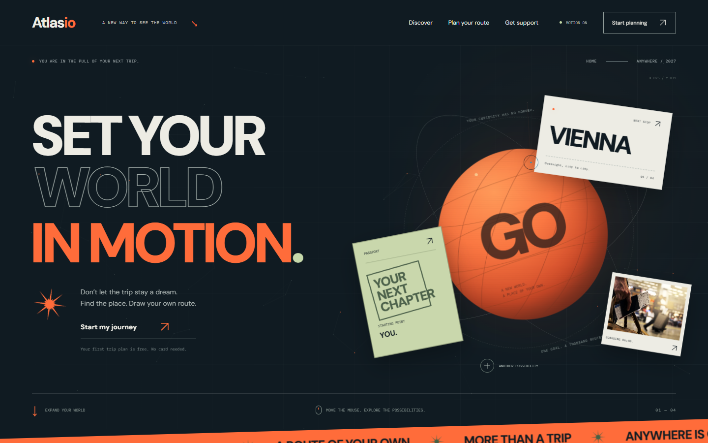
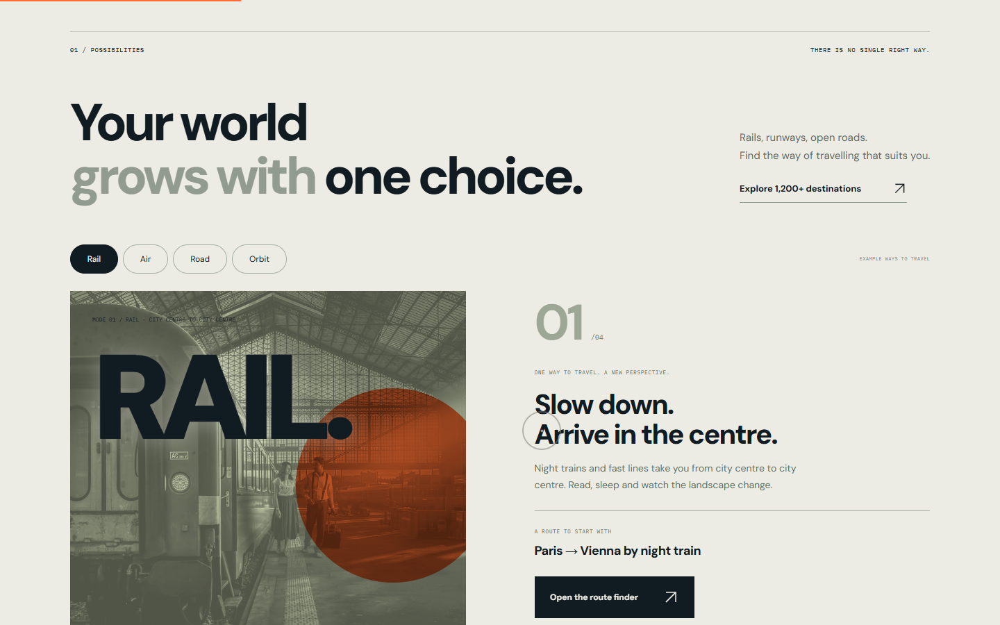
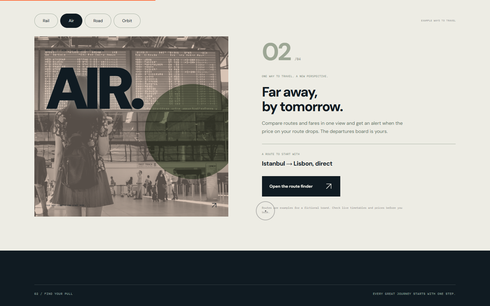
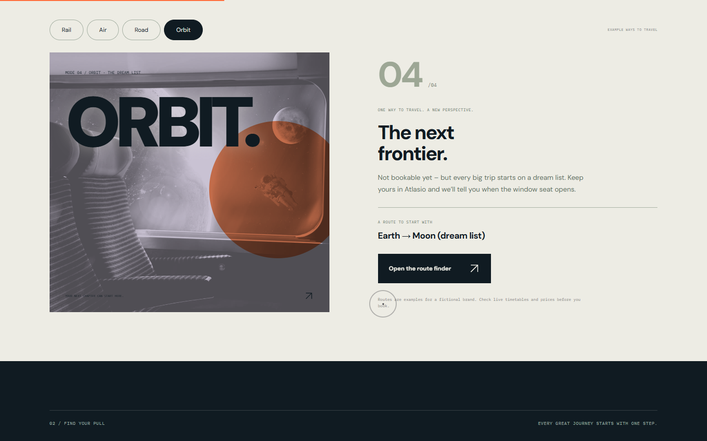
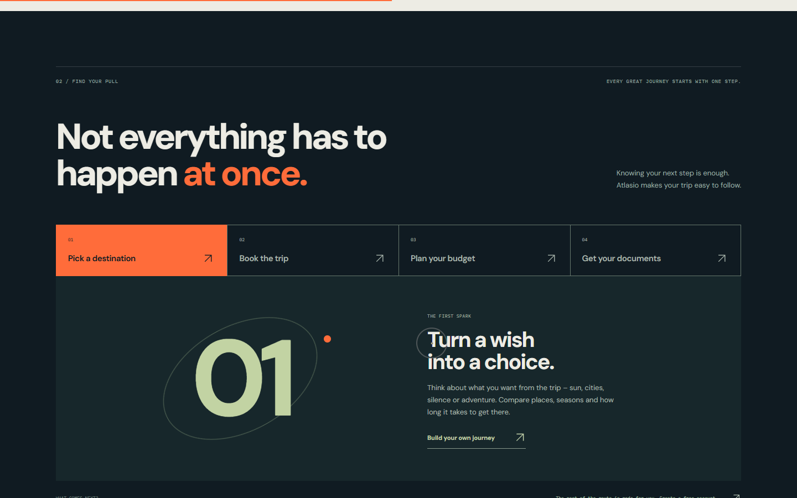
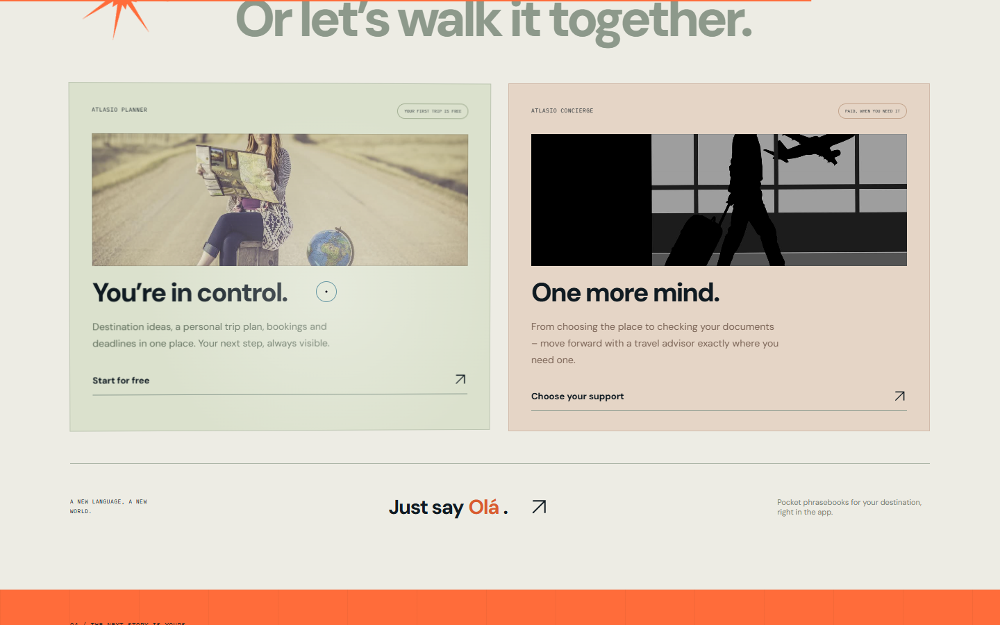
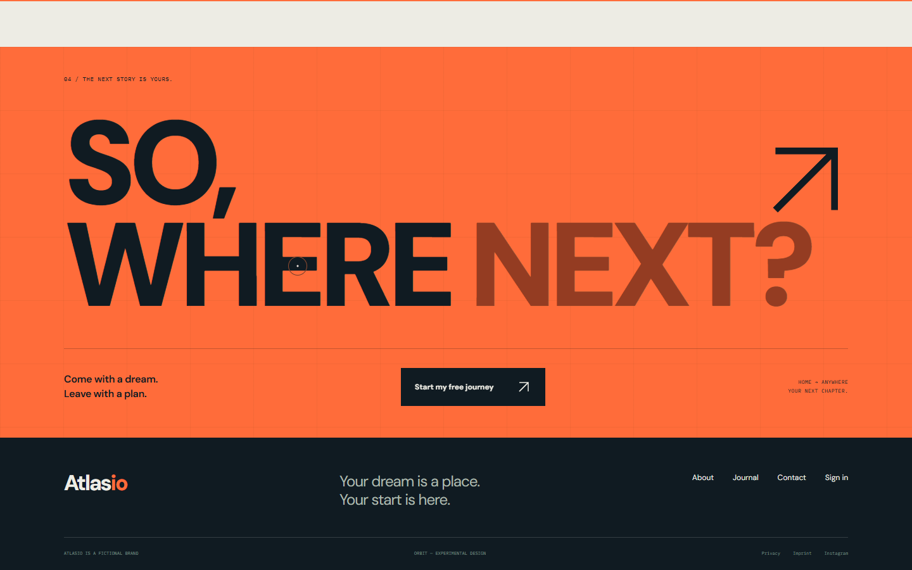

# orbit-poster-editorial

> Part of the [web-design-skills](../../README.md) library.

An AI agent skill (Agent Skills / `SKILL.md` format) for editorial, poster-like homepages: deep ink and warm paper,
giant tight type with an outlined line, a **mouse-reactive CSS planet** in 3D orbits surrounded by floating paper
cards, and **real photography printed into posters** – grayscale, multiplied into the poster colour under huge
letters, with colour coming back on hover.

It ships with a complete reference build: **Atlasio Orbit**, a fictional travel brand, in English, with seven
travel photographs blended into the design.



| Poster: Rail | Poster: Air | Poster: Orbit |
|---|---|---|
|  |  |  |
| **Route console** | **Support cards (hover)** | **Final call** |
|  |  |  |

More in [`screenshots/`](screenshots) (desktop 1440×900, mobile 390×844).

## What's inside

```
orbit-poster-editorial/
├── SKILL.md                    # style rules, sections, effects, photo pipeline, checklist
├── references/components.md    # copy-ready code: headline drift, orbit universe, particle canvas, blended poster…
├── example/index.html          # reference site (single file, no libraries)
├── example/assets/             # 7 compressed travel photos (~750 KB)
├── screenshots/*.png
└── scripts/screenshots.mjs     # re-create the screenshots (Node 22+, Chrome; serves the example locally)
```

## Features of the example page

- Three-line headline (solid, outlined, orange) whose lines drift by different amounts with the mouse.
- CSS planet in tilted 3D orbits; destination ticket, passport stamp and a photo print float in depth with the cursor;
  live X/Y coordinate readout.
- Particle network canvas that flees the pointer and draws orange lines to it.
- Tilted orange ticker with star glyphs.
- Four "ways to travel" posters (Rail, Air, Road, Orbit): each photo is printed in grayscale into the poster tint
  under a giant word and a coloured sun disc; switching cross-fades the photo; hover restores colour and tilts the
  poster in 3D.
- Route console with keyboard-accessible tabs and a giant number in a rotating orbit ring.
- Support cards with blended photos, 3D tilt and a cursor-following light.
- Full-orange final call, motion toggle, reading progress bar, magnetic buttons, ring cursor.
- Respects `prefers-reduced-motion`; responsive down to 390px.

## Install

```bash
# Claude Code (2.1.275+ in one step)
/plugin install orbit-poster-editorial --marketplace smyrna-pergamum/web-design-skills

# Claude Code (older versions)
/plugin marketplace add smyrna-pergamum/web-design-skills
/plugin install orbit-poster-editorial@web-design-skills
```

Other agents (Codex, Cursor, Copilot, Gemini CLI, ChatGPT…): see the [main README](../../README.md#install).

Then ask, for example:

> Build our tourism board's homepage with the orbit-poster-editorial skill. Use these six photos.

## Regenerate the screenshots

```bash
node scripts/screenshots.mjs example screenshots
```

## Credits and notes

- **Atlasio is fictional.** Copy, routes and figures are examples written for this template; links stay on the page.
- Photos: royalty-free stock images (Pixabay licence) supplied by the repository owner; resized, compressed and
  cropped where they showed third-party advertising.
- Fonts: [DM Sans](https://fonts.google.com/specimen/DM+Sans) and [IBM Plex Mono](https://fonts.google.com/specimen/IBM+Plex+Mono)
  (SIL Open Font License) from Google Fonts.

## License

Code and documentation: [MIT](../../LICENSE). Photos: see the credits above.

---

### Türkçe özet

Editoryal, afiş gibi ana sayfalar için bir web tasarım skill'i: koyu mürekkep ve sıcak kâğıt zemin, kontur satırlı dev
başlık, fareyle eğilen 3B yörüngelerde bir CSS gezegeni ve etrafında yüzen kâğıt kartlar, imleçten kaçan parçacık ağı.
Gerçek fotoğraflar kutuya konmaz, afişe basılır: gri tonlu, afiş rengiyle çarpılmış (multiply), dev harflerin altında;
üzerine gelince renk geri gelir. Örnek site kurgusal seyahat markası "Atlasio Orbit" (İngilizce, 7 fotoğraflı).
