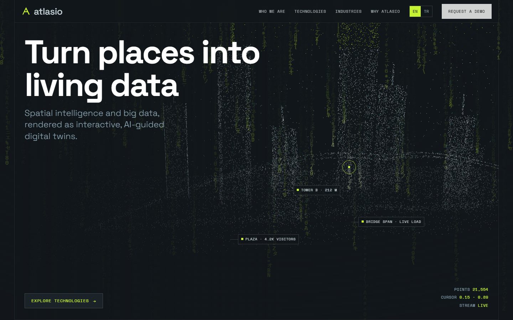
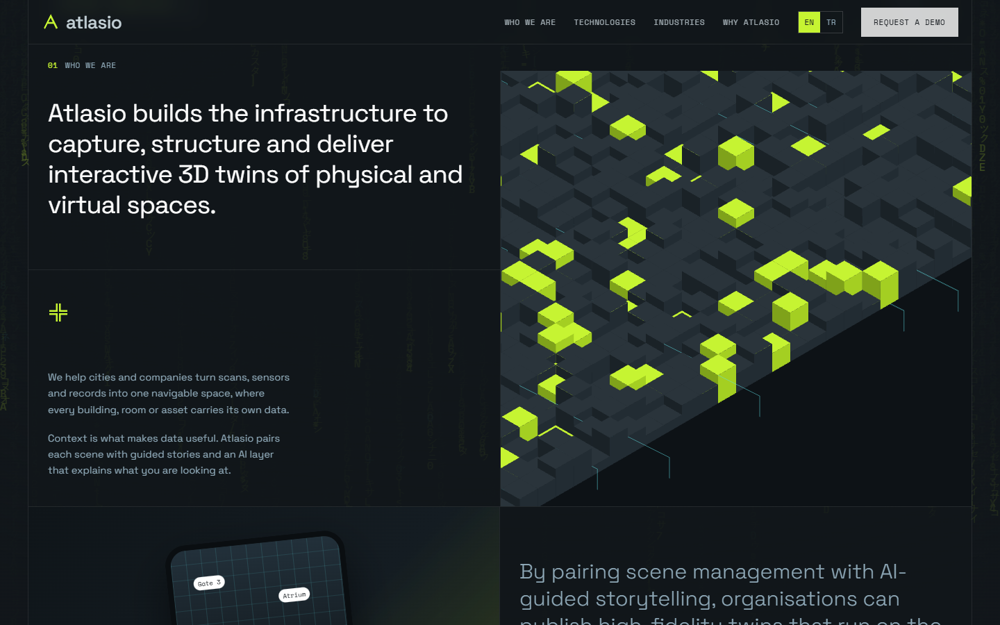
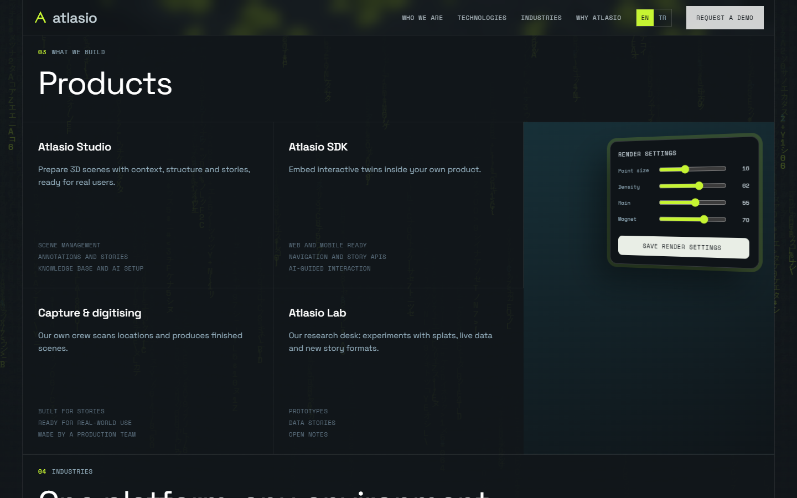
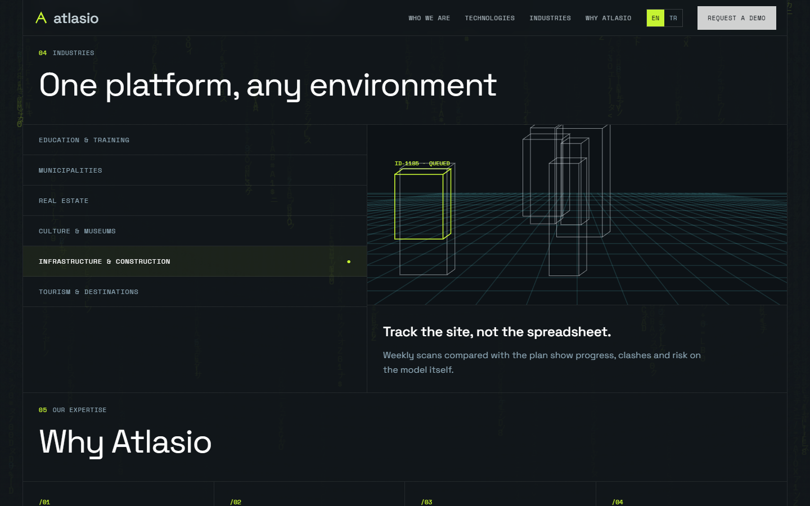
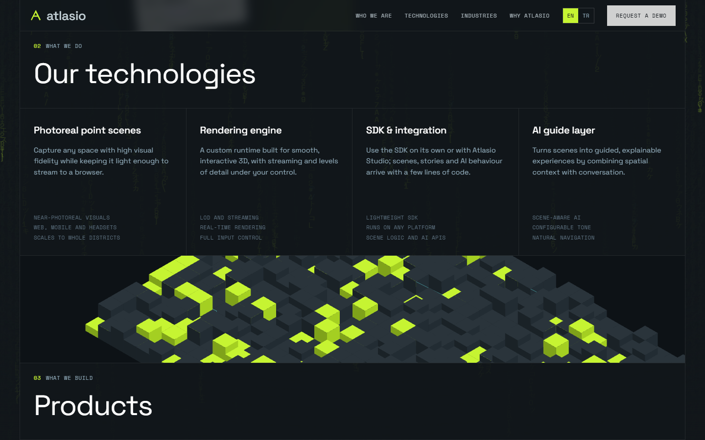
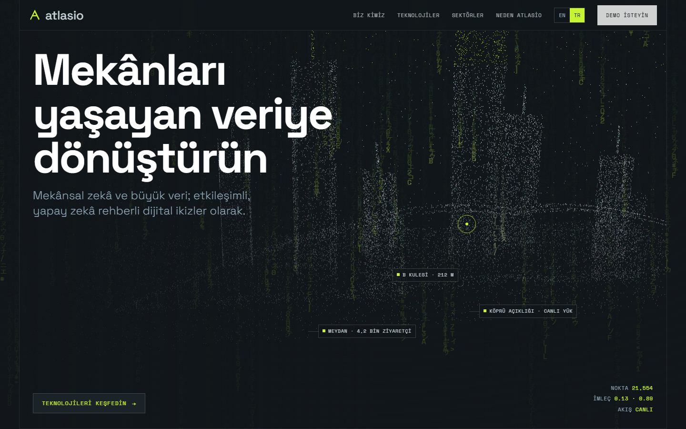
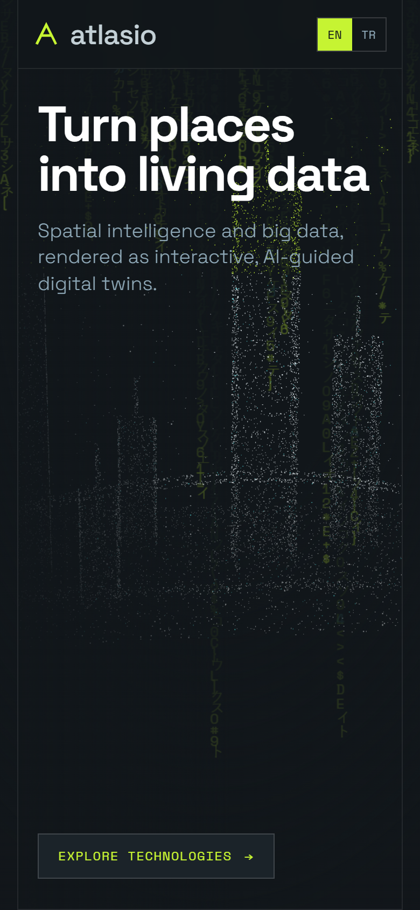

# pointcloud-matrix-tech

> Part of the [web-design-skills](../../README.md) library.

An AI skill (Claude Code / Agent Skills) for technology, data and AI product websites, styled as a dark engineering
document, with three signature layers:

- **Matrix rain** – a full-page background of falling characters that glows brighter around the cursor.
- **Magnetic mouse** – a cursor that snaps to buttons and links while magnetic buttons lean toward it.
- **Point-cloud hero** – a three.js city of ~20,000 points (towers, bridge, ground scan) that is pulled toward the mouse.

It ships with a complete reference build: **Atlasio**, a fictional spatial-data / digital-twin platform, in English and
Turkish.



| Who we are | Products + live settings | Industries |
|---|---|---|
|  |  |  |
| **Technologies** | **Turkish** | **Mobile** |
|  |  |  |

More in [`screenshots/`](screenshots) (desktop 1440×900, mobile 390×844, EN/TR).

## What's inside

```
pointcloud-matrix-tech/
├── SKILL.md                    # style rules, sections, effects, checklist
├── references/components.md    # copy-ready code: rain, magnet, point cloud, voxels, twin view, settings panel
├── example/index.html          # reference site (single file, three.js from cdnjs)
├── screenshots/*.png
└── scripts/screenshots.mjs     # re-create the screenshots; moves a virtual mouse and renders WebGL with SwiftShader
```

## Features of the example page

- Framed graphite sheet with hairline cells, `01 WHO WE ARE` section numbering, Space Grotesk + Space Mono, lime accent.
- Matrix rain behind everything, quieter behind text, brighter near the cursor.
- Magnetic cursor ring that morphs to the hovered button; magnetic CTAs.
- three.js point-cloud skyline with callout tags and a live readout (points, cursor coordinates).
- Generated imagery only: isometric voxel fields, a phone with an AI guide, a wireframe twin per industry.
- A render-settings panel whose sliders change point size, density, rain opacity and magnet strength live.
- Industry tabs with keyboard support, count-up metrics, hairline contact form.
- EN / TR switch; respects `prefers-reduced-motion`; responsive down to 390px.

## Install

```bash
/plugin marketplace add smyrna-pergamum/web-design-skills
/plugin install pointcloud-matrix-tech@web-design-skills
```

Or copy this folder to `~/.claude/skills/pointcloud-matrix-tech/`.

Then ask, for example:

> Build our AI analytics landing page with the pointcloud-matrix-tech skill. The point cloud should form a data centre.

## Regenerate the screenshots

```bash
node scripts/screenshots.mjs example/index.html screenshots
```

## Credits and notes

- **Atlasio is fictional.** Products, metrics (labelled as samples) and contact details (`.example` domain) are placeholders.
- No external images: every visual is generated in the browser.
- [three.js](https://threejs.org/) r128 (MIT) from cdnjs. Fonts: [Space Grotesk](https://fonts.google.com/specimen/Space+Grotesk)
  and [Space Mono](https://fonts.google.com/specimen/Space+Mono) (SIL Open Font License) from Google Fonts.

## License

Code and documentation: [MIT](../../LICENSE).

---

### Türkçe özet

Teknoloji, veri ve yapay zekâ ürünleri için koyu "mühendislik çizimi" tarzında bir web tasarım skill'i. Üç imza katman:
arka planda akan **Matrix yağmuru**, butonlara yapışan **mıknatıslı imleç** ve fareye doğru çekilen **nokta bulutu hero**.
Örnek site kurgusal "Atlasio" mekânsal veri platformu (EN/TR). Kurulum:
`/plugin marketplace add smyrna-pergamum/web-design-skills` ve `/plugin install pointcloud-matrix-tech@web-design-skills`.
