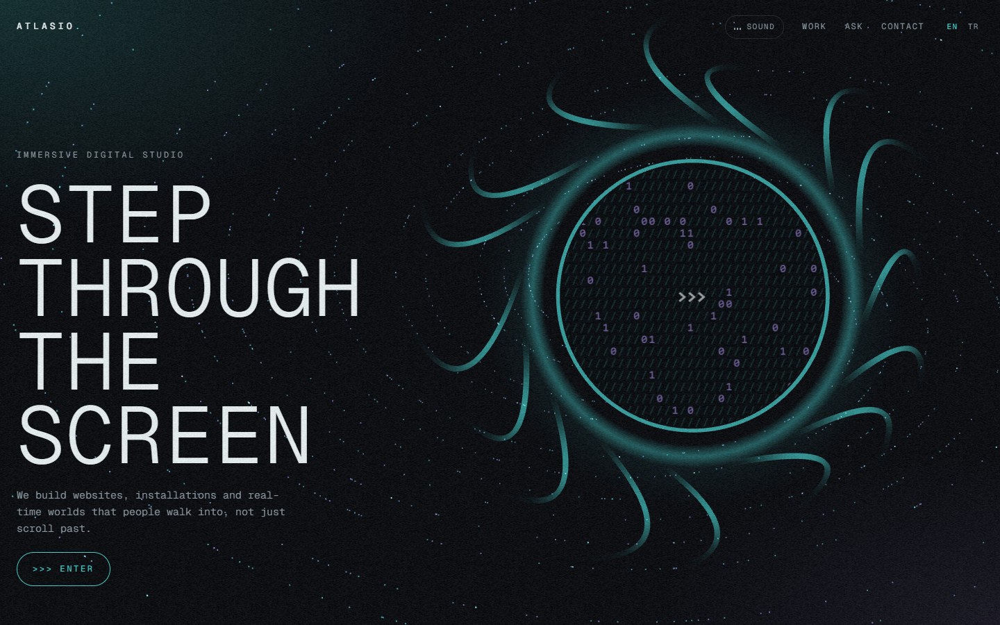
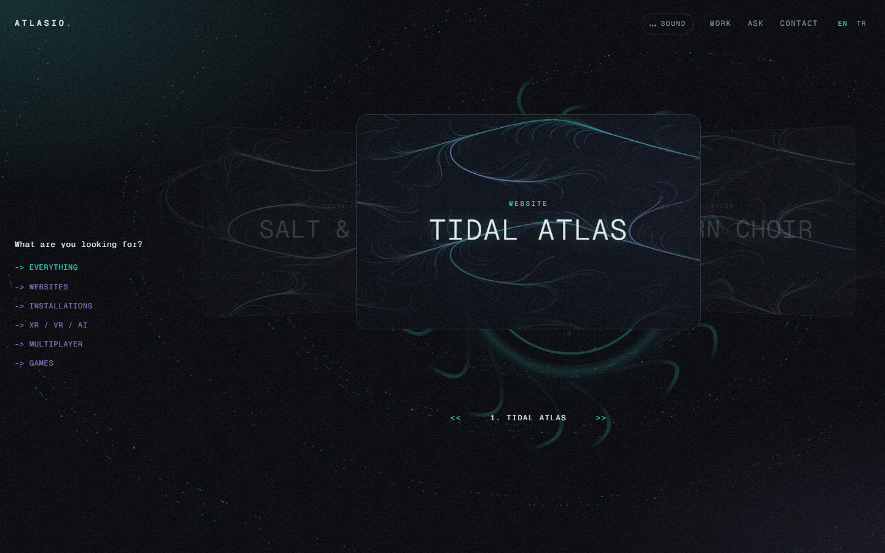
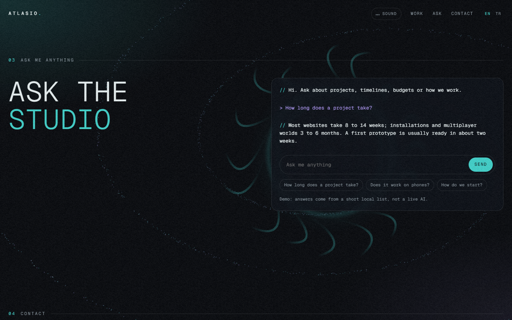
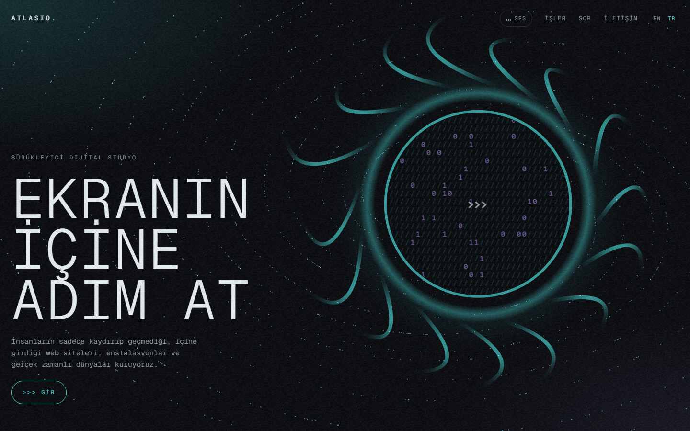
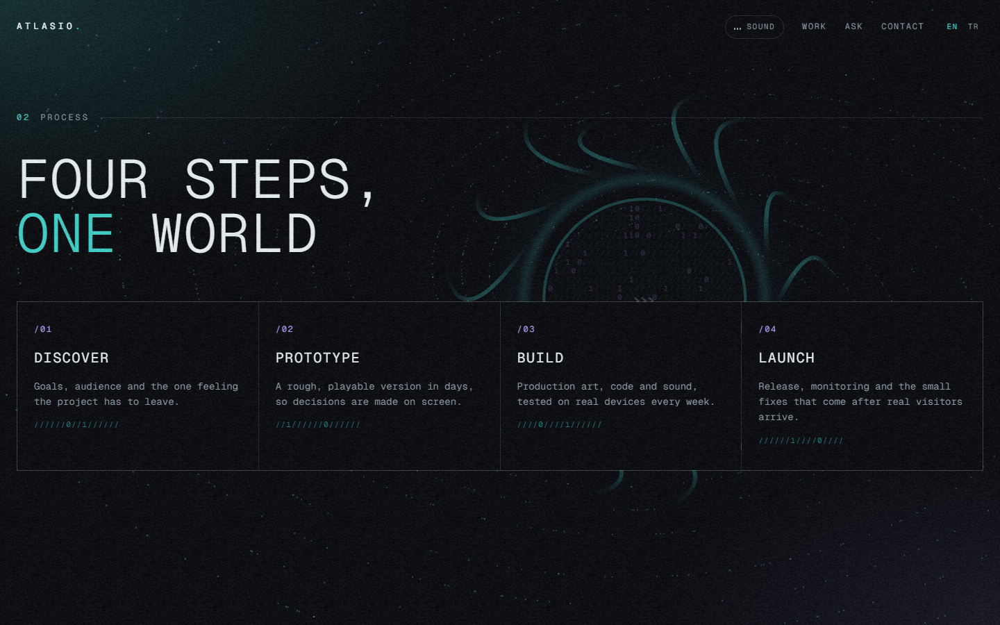
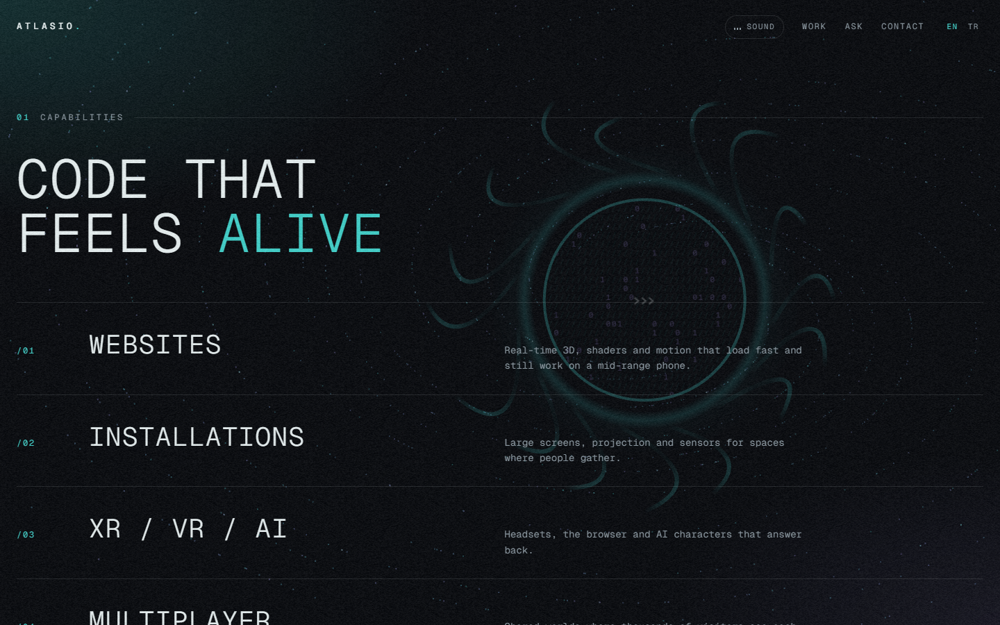
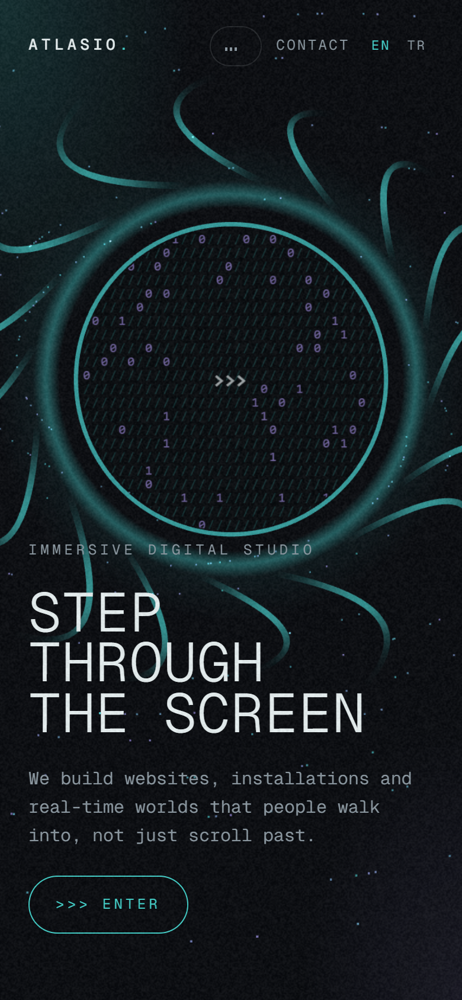

# portal-webgl-studio

> Part of the [web-design-skills](../../README.md) library.

An AI skill (Claude Code / Agent Skills) for immersive studio and agency websites: a full-screen **WebGL portal**
(glowing ring, light arms, ASCII disc, particles) behind small monospace UI, a slash-scramble preloader, film grain,
a 3D floating glass project gallery, an "ask me anything" terminal and an ambient sound toggle.

It ships with a complete reference build: **Atlasio**, a fictional immersive digital studio, in English and Turkish.



| Work gallery | Ask me anything | Turkish |
|---|---|---|
|  |  |  |
| **Process** | **Capabilities** | **Mobile** |
|  |  |  |

More in [`screenshots/`](screenshots) (desktop 1440×900, mobile 390×844, EN/TR, filtered gallery).

## What's inside

```
portal-webgl-studio/
├── SKILL.md                    # style rules, sections, effects, checklist
├── references/components.md    # copy-ready HTML/CSS/JS, including the three.js scene
├── example/index.html          # reference site (single file, three.js from cdnjs)
├── screenshots/*.png
└── scripts/screenshots.mjs     # re-create the screenshots; starts Chrome with SwiftShader so WebGL renders headless
```

## Features of the example page

- three.js portal: additive ring and halo, live ASCII disc, 16 shader-faded light arms, particles spiralling into the ring,
  mouse parallax, recedes on scroll; CSS fallback when WebGL is unavailable.
- Slash-scramble preloader with a `/0 → /100` counter, animated film grain, teal light leak, custom cursor.
- 3D glass coverflow with seeded generative art per project, `-> category` filters, `<< project >>` pager, swipe and keys.
- Ask-me-anything terminal with canned answers in two languages (clearly labelled as a demo).
- Ambient Web Audio drone, off by default.
- EN / TR switch; respects `prefers-reduced-motion`; responsive down to 390px.

## Install

```bash
/plugin marketplace add smyrna-pergamum/web-design-skills
/plugin install portal-webgl-studio@web-design-skills
```

Or copy this folder to `~/.claude/skills/portal-webgl-studio/`.

Then ask, for example:

> Build our studio site with the portal-webgl-studio skill. Use our six projects and keep it fast on phones.

## Regenerate the screenshots

```bash
node scripts/screenshots.mjs example/index.html screenshots
```

## Credits and notes

- **Atlasio is fictional.** Projects are samples with generated artwork; contact details use the reserved `.example` domain.
- No external images or audio files: the scene, the project art and the sound are generated in the browser.
- [three.js](https://threejs.org/) r128 (MIT) from cdnjs. Font: [Geist Mono](https://fonts.google.com/specimen/Geist+Mono)
  (SIL Open Font License) from Google Fonts.

## License

Code and documentation: [MIT](../../LICENSE).

---

### Türkçe özet

Yaratıcı stüdyo ve ajans siteleri için tam ekran WebGL portal, monospace arayüz, 3B cam proje galerisi, "bana bir şey
sor" terminali ve ortam sesi içeren deneysel bir web tasarım skill'i. Örnek site kurgusal "Atlasio" stüdyosu (EN/TR).
Kurulum: `/plugin marketplace add smyrna-pergamum/web-design-skills` ve `/plugin install portal-webgl-studio@web-design-skills`.
