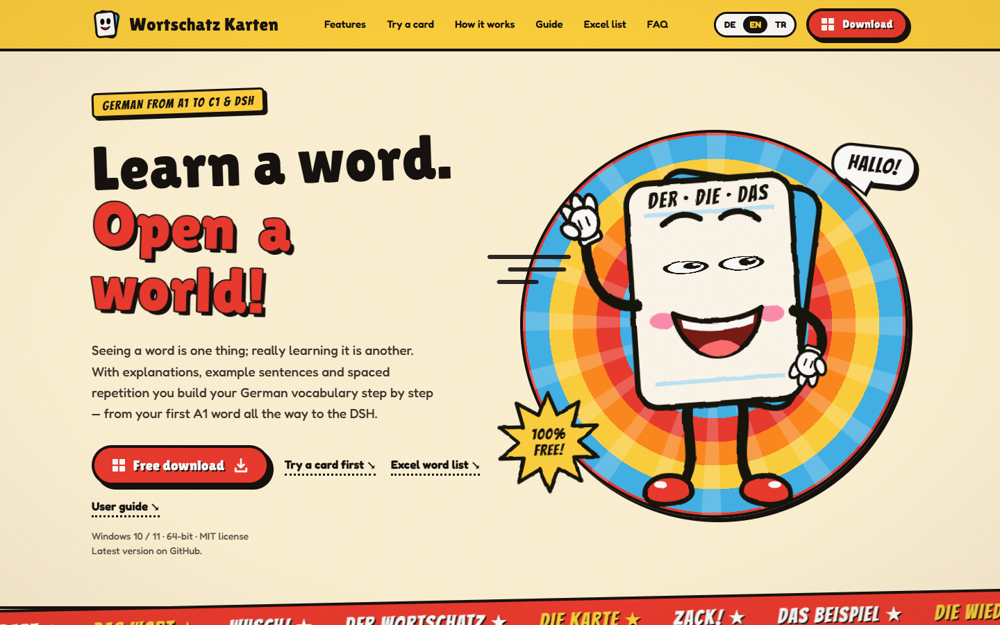
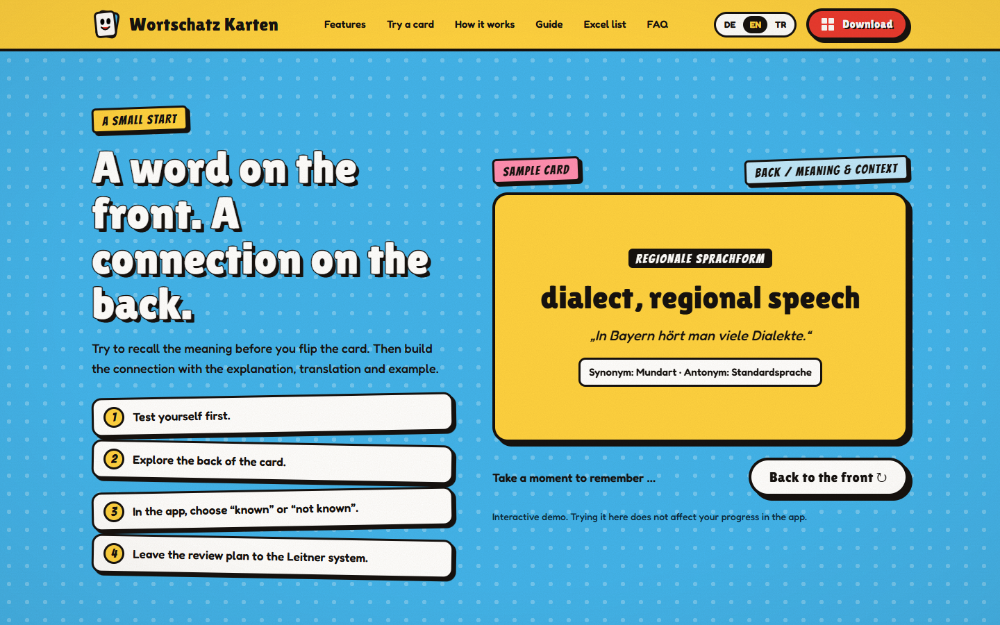
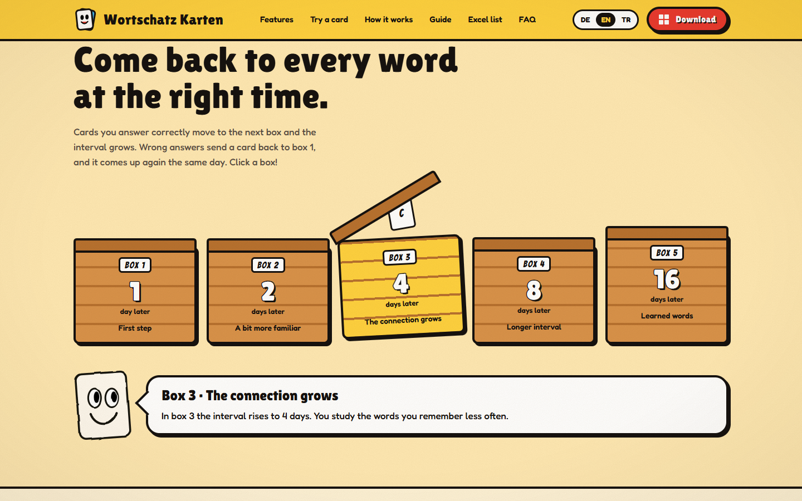
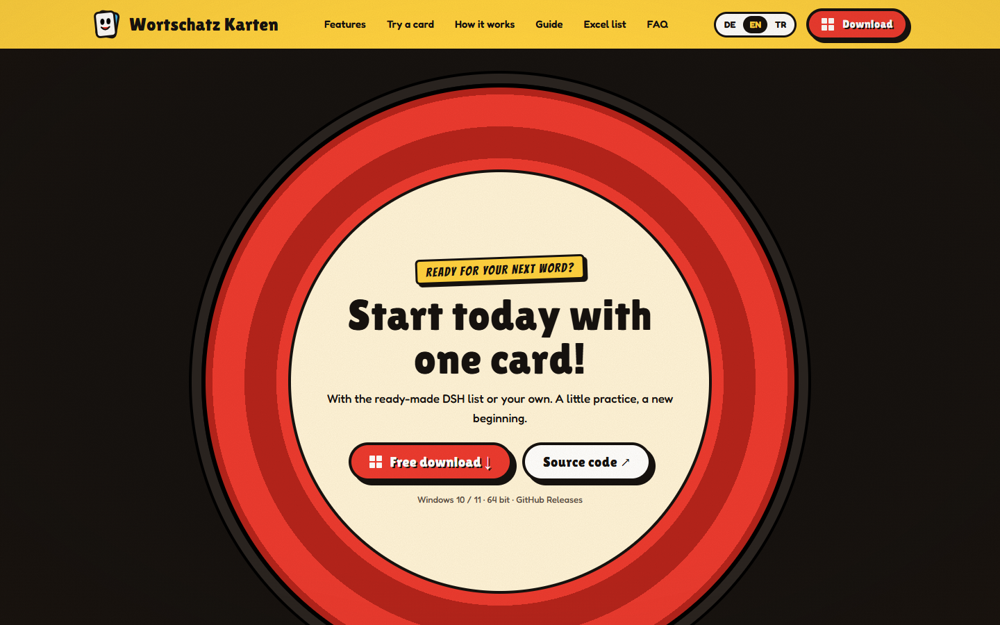
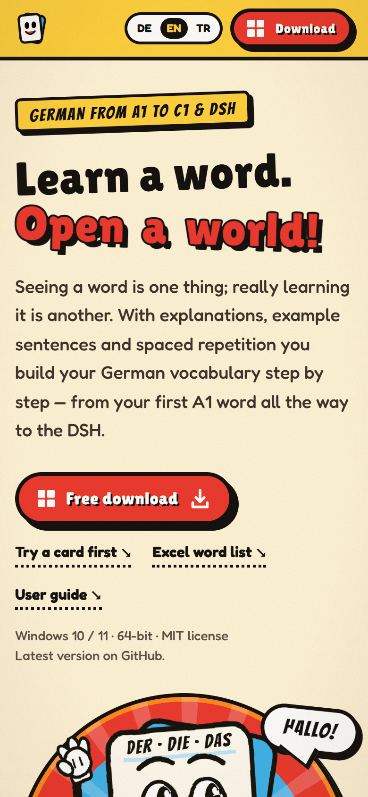
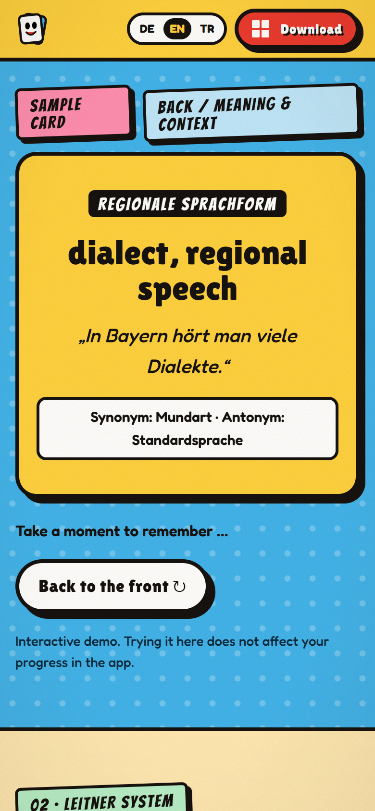
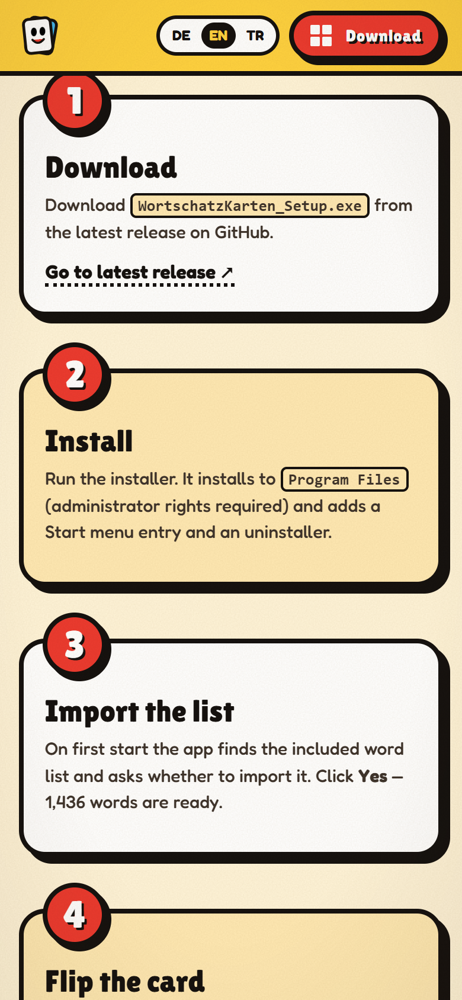

# rubber-hose-cartoon-app

> Part of the [web-design-skills](../../README.md) library.

An AI agent skill (Agent Skills / `SKILL.md` format) for **playful, experimental product pages in the style of
1930s–40s theatrical cartoons**. Cream paper with grain, thick ink outlines and hard shadows, an original rubber-hose
mascot bouncing in front of a ring target, drawings that "boil" like hand-drawn frames, starburst numbers, speech
bubbles, a wooden cartoon TV with real screenshots, a flip card with squash-and-stretch, wooden Leitner crates, an
iris-in download section and comic sound words wherever you click.

It ships with a complete reference build: the real **Wortschatz Karten** site, a free open-source German flashcard app
for Windows (English edition; the live site is in German, English and Turkish). The mascot is an original drawing —
the skill teaches the period style, never existing characters.



| Flip card | Leitner crates | Iris download |
|---|---|---|
|  |  |  |
| **Mobile hero** | **Mobile card** | **Mobile guide** |
|  |  |  |

More in [`screenshots/`](screenshots) (desktop 1440×900, mobile 390×844).

## What's inside

```
rubber-hose-cartoon-app/
├── SKILL.md                    # style rules, sections, interactions, build rules, checklist
├── references/components.md    # copy-ready code: tokens, boil filter, mascot, rings, starburst, TV, flip card, crates, iris
├── example/index.html          # reference site (single file, inline CSS and JS, no libraries)
├── example/assets/             # 3 real app screenshots (~150 KB)
├── screenshots/*.png
└── scripts/screenshots.mjs     # re-create the screenshots (Node 22+, Chrome; serves the example locally)
```

## Features of the example page

- Original flash-card mascot with rubber-hose arms, white gloves and big shoes; bobbing, waving and blinking.
- "Line boil" SVG filter on drawings, ring-target stage with rotating rays, tilted ticker band.
- Starburst numbers, sticker tags, outlined headlines with jumping words, buttons that boing.
- Wooden TV with a light/dark "channel" switch and a zoom dialog for real screenshots.
- Interactive flip card with dust puffs, Leitner crates whose lids pop open, FAQ answers as speech bubbles.
- User guide (steps, installer warning, keyboard shortcuts, modes, data) and a direct Excel file download.
- Iris-in download section, click onomatopoeia, full `prefers-reduced-motion` fallback.

## Re-create the screenshots

```bash
node scripts/screenshots.mjs example screenshots
```

Live site: https://smyrna-pergamum.github.io/wortschatz-karten/ · App: https://github.com/smyrna-pergamum/wortschatz-karten
