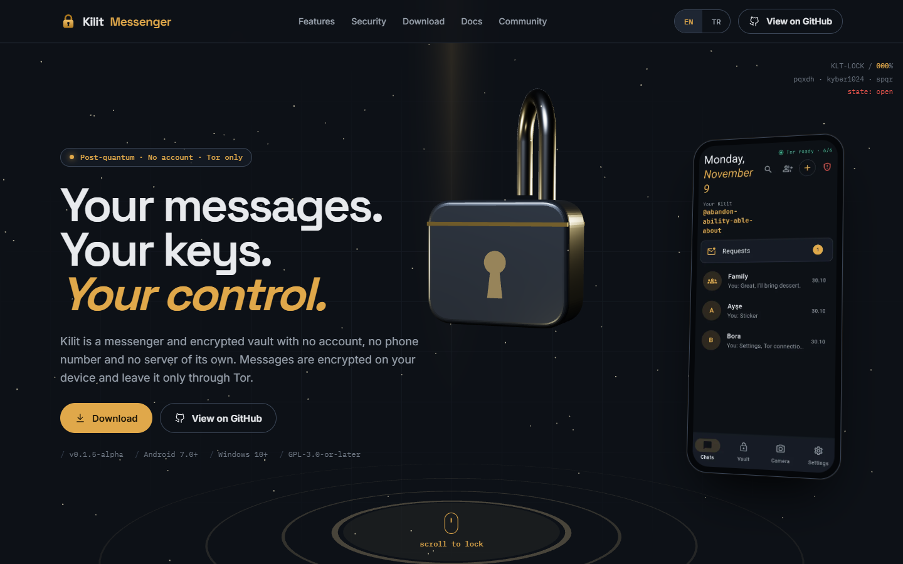
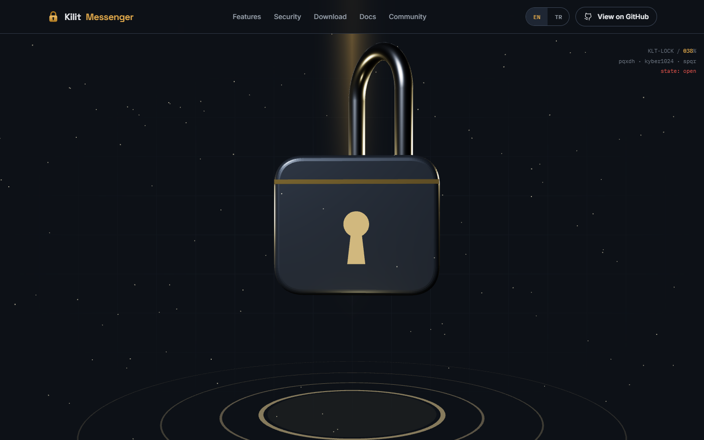
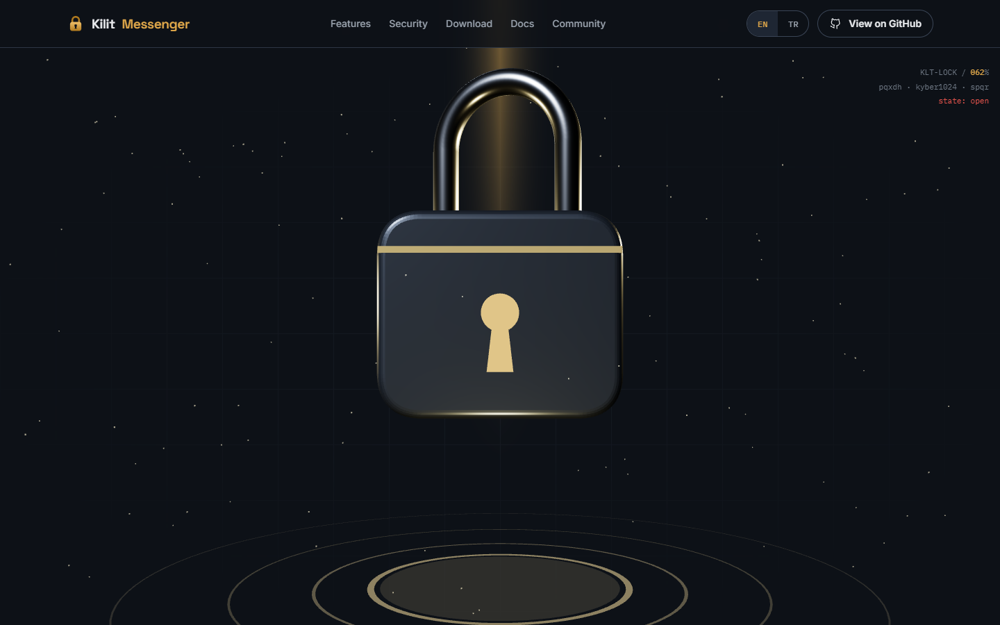
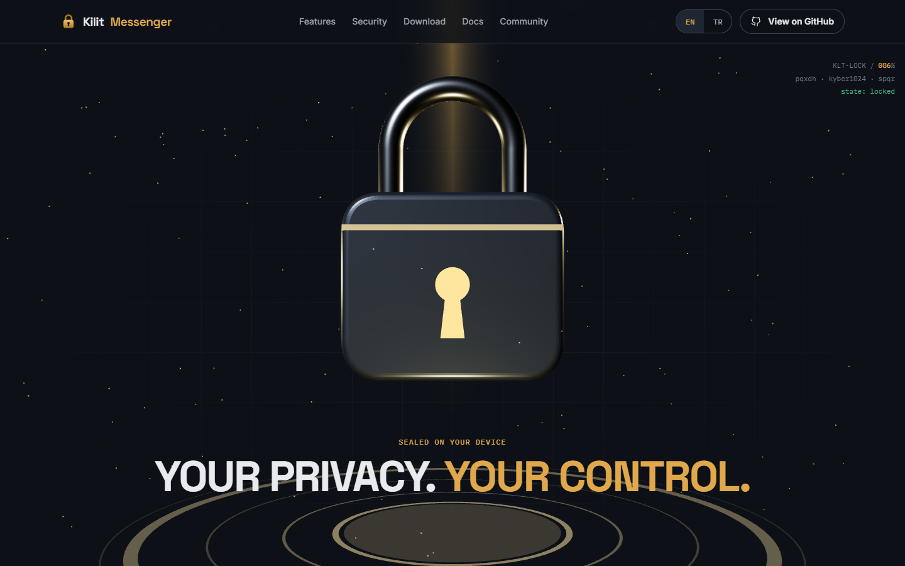
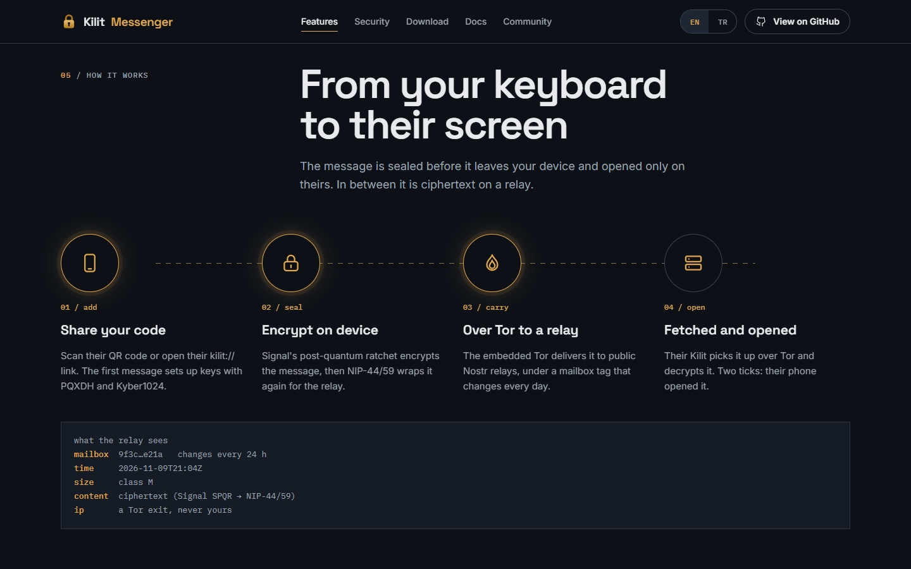
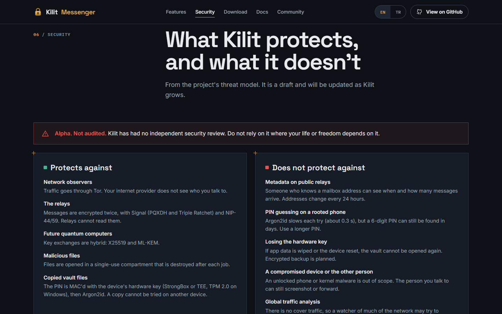
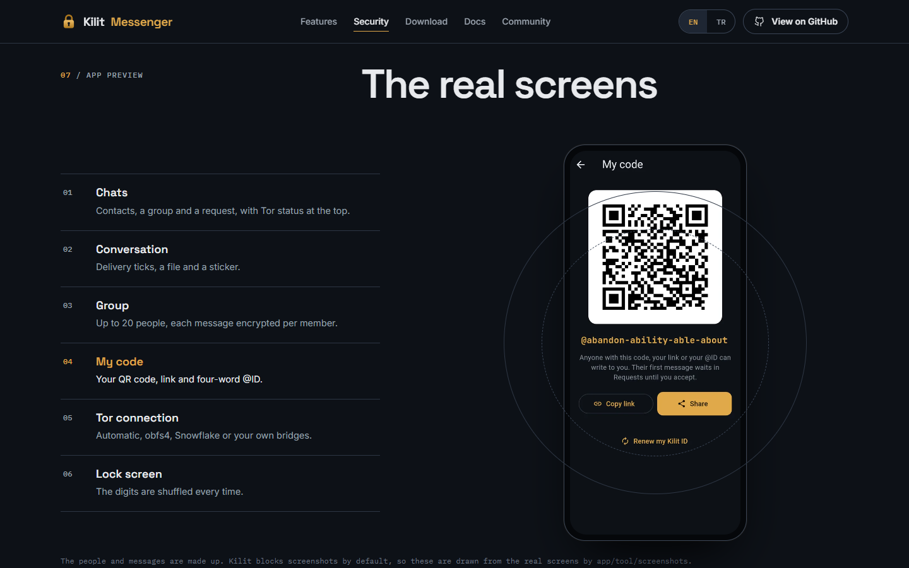
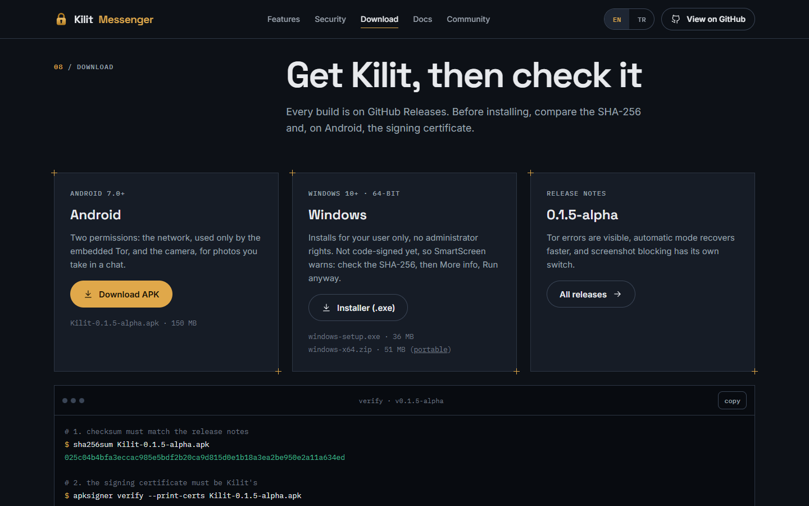
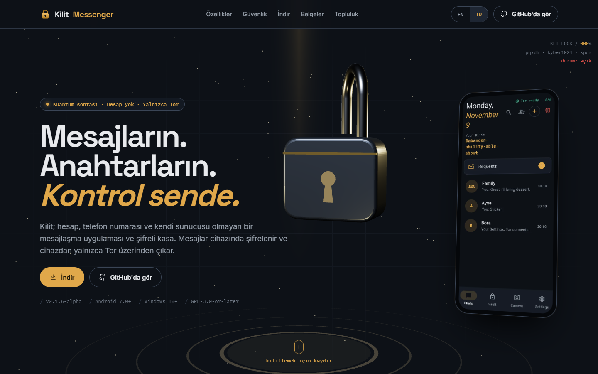
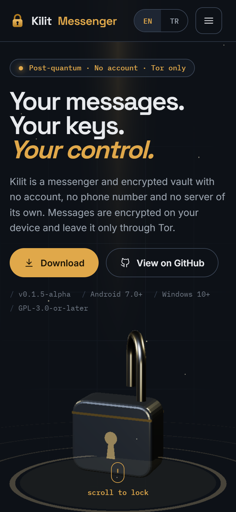

# scroll-lock-cyber-brutalism

> Part of the [web-design-skills](../../README.md) library.

An AI skill (Claude Code / Agent Skills) for privacy, security and encryption product websites in **postmodern cyber
brutalism**: night graphite, an asymmetric grid of hairlines with amber crosshairs, big tight grotesk headlines, mono
labels and one brass light. Its signature is **scroll to lock**: a three.js padlock that the visitor closes by
scrolling. It approaches, the shackle drops, the lock recoils and an amber pulse ring spreads. All of it rewinds when
you scroll back up.

The reference build is the real website for **[Kilit Messenger](https://github.com/smyrna-pergamum/kilit-messenger)**,
a post-quantum, serverless messenger and encrypted vault over Tor, in English and Turkish. Every claim on it comes
from the app's README, threat model or privacy policy.



| Approach | Closing | Sealed |
|---|---|---|
|  |  |  |
| **How it works** | **Security** | **App preview** |
|  |  |  |
| **Download + verify** | **Turkish** | **Mobile** |
|  |  |  |

More in [`screenshots/`](screenshots) (desktop 1440×900, mobile 390×844, reduced motion, EN/TR).

## What's inside

```
scroll-lock-cyber-brutalism/
├── SKILL.md                    # style rules, security-copy rules, sections, the scroll-to-lock timeline, checklist
├── references/components.md    # copy-ready code: tokens, panels, the three.js lock and timeline, flow, security, download
├── example/index.html          # Kilit Messenger site (single file, three.js r128 from cdnjs)
├── example/assets/             # real app screenshots (WebP) and icon
├── screenshots/*.png
└── scripts/screenshots.mjs     # re-create the screenshots (WebGL via SwiftShader, scroll positions, reduced motion)
```

## Features of the example page

- A sticky hero stage with a procedural three.js padlock, a tilted phone with a real screenshot and a live mono readout.
- Scroll to lock: approach, shackle closes, damped recoil, amber pulse ring, "YOUR PRIVACY. YOUR CONTROL.". Fully
  reversible; a static version for reduced motion and an SVG fallback without WebGL.
- Four value cards, each with the source file it comes from.
- A numbered feature index, a four-step encrypt-and-deliver flow and a "what the relay sees" panel.
- Protects / does-not-protect columns from the threat model, a cryptography table and status badges, plus an
  "Alpha. Not audited." warning.
- A tabbed preview of six real app screens.
- Download panels with the real v0.1.5-alpha files, a verify terminal (SHA-256 and signing certificate) and a copy button.
- Spec document links, an FAQ, an open-source call to action and a footer.
- EN / TR switch, keyboard support, `prefers-reduced-motion`, no analytics, responsive down to 360px.

## Install

```bash
/plugin marketplace add smyrna-pergamum/web-design-skills
/plugin install scroll-lock-cyber-brutalism@web-design-skills
```

Or copy this folder to `~/.claude/skills/scroll-lock-cyber-brutalism/`.

Then ask, for example:

> Build the website for our password manager with the scroll-lock-cyber-brutalism skill. Use our threat model for the
> security section.

## Regenerate the screenshots

```bash
node scripts/screenshots.mjs example/index.html screenshots
```

## Updating the Kilit site for a new release

Change the version, file names, sizes and SHA-256 values in the Download section and the hero meta row, using the
release notes on [GitHub Releases](https://github.com/smyrna-pergamum/kilit-messenger/releases).

## Credits and notes

- Content, screenshots and icon are from the [Kilit Messenger](https://github.com/smyrna-pergamum/kilit-messenger)
  repository (GPL-3.0-or-later). The people and messages in the screenshots are made up.
- [three.js](https://threejs.org/) r128 (MIT) from cdnjs. Fonts: [Space Grotesk](https://fonts.google.com/specimen/Space+Grotesk),
  [Inter](https://fonts.google.com/specimen/Inter) and [IBM Plex Mono](https://fonts.google.com/specimen/IBM+Plex+Mono)
  (SIL Open Font License) from Google Fonts.

## License

Code and documentation: [MIT](../../LICENSE). Kilit's content and screenshots: GPL-3.0-or-later, as in its repository.

---

### Türkçe özet

Gizlilik, güvenlik ve şifreleme ürünleri için **postmodern cyber brutalism** tarzında bir web tasarım skill'i: gece grafiti
zemin, ince teknik çizgili asimetrik grid, amber artı işaretleri, büyük sıkı başlıklar ve mono etiketler. İmza etkileşim
**Scroll-to-Lock**: ziyaretçi aşağı kaydırdıkça 3D kilit merkeze gelir, halkası kapanır, kısa bir geri tepme olur ve
amber ışık halkası yayılır. Yukarı kaydırınca animasyon geri sarar. Örnek site, gerçek **Kilit Messenger** sitesidir
(EN/TR). Tüm iddialar uygulamanın README, tehdit modeli ve gizlilik belgelerinden gelir. Kurulum:
`/plugin marketplace add smyrna-pergamum/web-design-skills` ve `/plugin install scroll-lock-cyber-brutalism@web-design-skills`.
