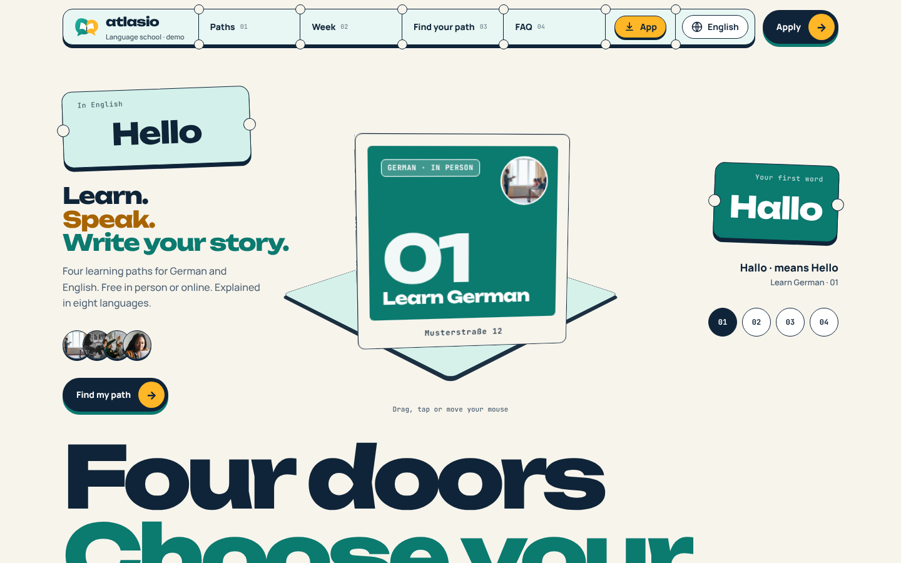
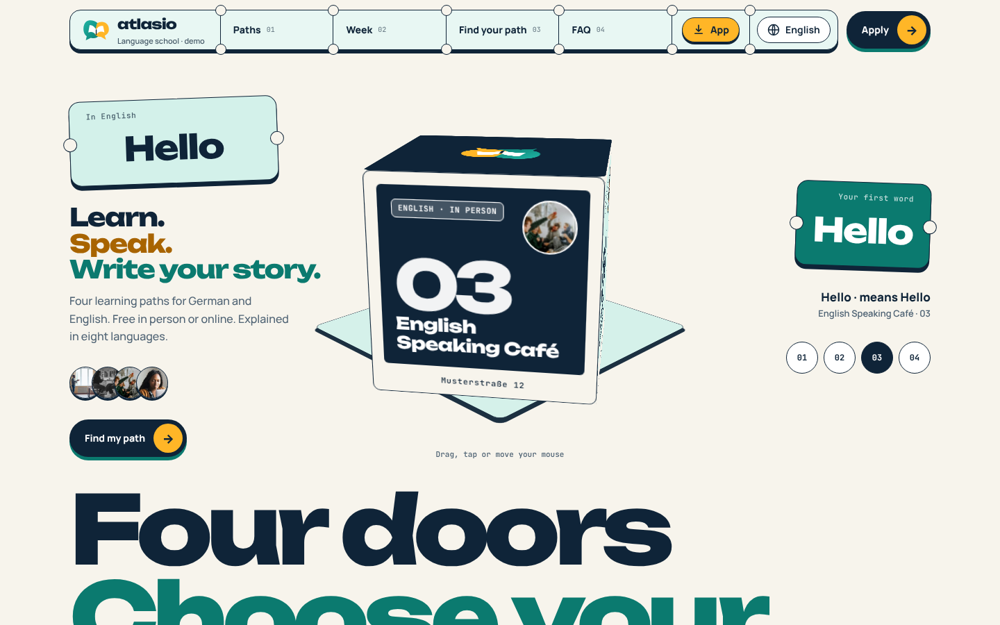
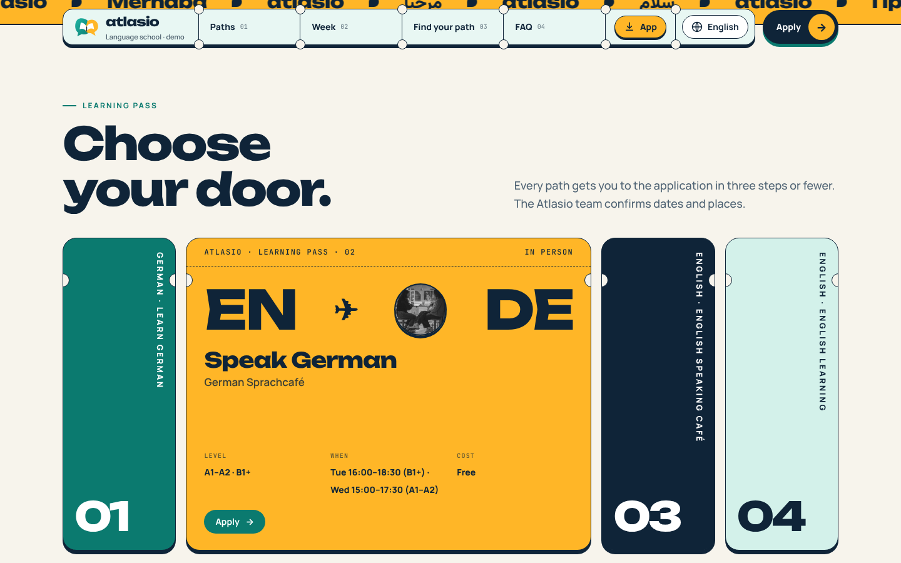
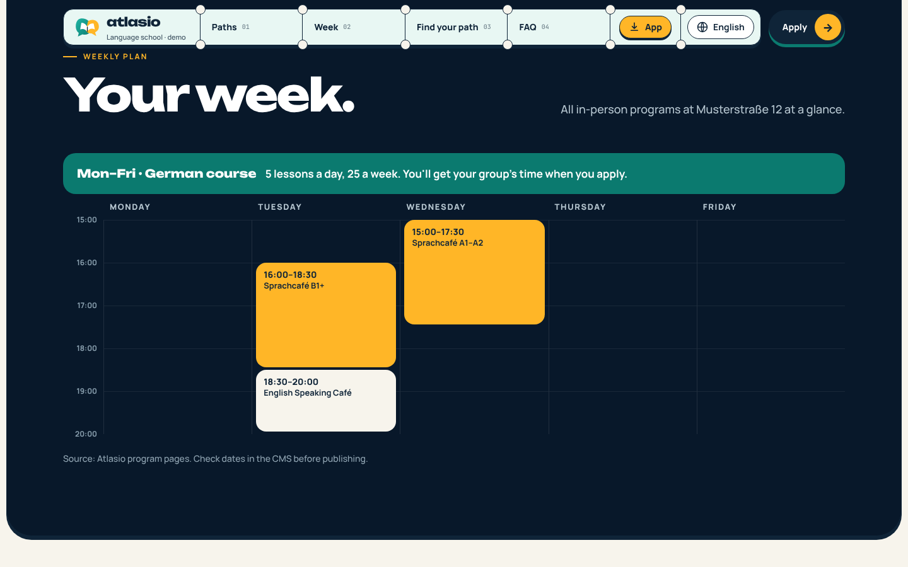
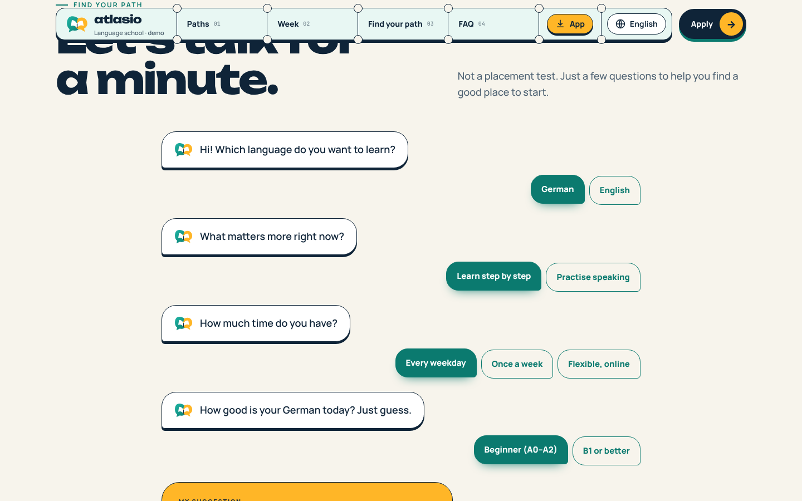
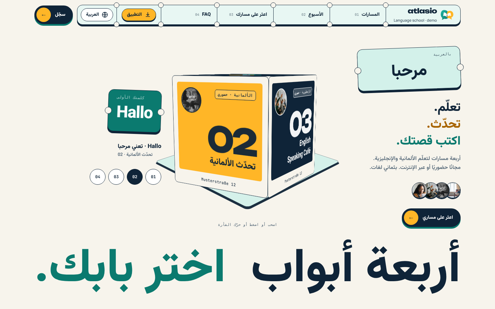
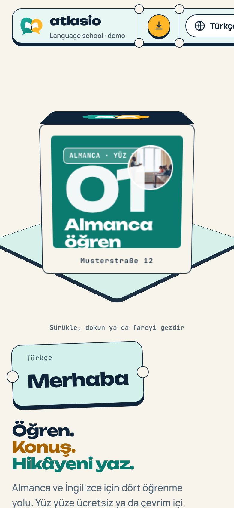

# ticket-cube-language-school

> Part of the [web-design-skills](../../README.md) library.

An AI agent skill (Agent Skills / `SKILL.md` format) for experimental, **multilingual** websites for language schools,
integration courses, language cafés and adult-education programmes. Everything is a ticket: a notched ticket-bar menu,
word tickets ("Hallo · means Hello"), boarding-pass course cards (`EN ✈ DE`) and a **mouse-reactive 3D cube** whose
faces are the learning paths.

It ships with a complete reference build: **Atlasio**, a fictional language school, in eight UI languages
(DE, EN, TR, AR, FA, UK, RU, FR) including right-to-left Arabic and Persian.



| Cube turned | Learning passes | Timetable |
|---|---|---|
|  |  |  |
| **Chat finder** | **Arabic (RTL)** | **Mobile** |
|  |  |  |

More in [`screenshots/`](screenshots) (desktop 1440×900, mobile 390×844).

## What's inside

```
ticket-cube-language-school/
├── SKILL.md                    # style rules, sections, effects, SEO and consent rules, checklist
├── references/components.md    # copy-ready code: ticket bar, cube, passes, timetable, finder, consent, PWA, SEO, form endpoint
├── example/index.html          # reference site (single file, Google Fonts only)
├── example/assets/             # 4 small photos + favicon
├── screenshots/*.png
└── scripts/screenshots.mjs     # re-create the screenshots (Node 22+, Chrome; serves the example locally)
```

## Features of the example page

- Ticket-bar navigation with punched notches, numbered links, an app chip and a language menu with eight languages.
- Hero with two word tickets, a slogan headline with a keyword line, round photos and a **3D cube** that tilts with the
  mouse, rotates by drag, click, keyboard or the `01–04` buttons, idles with a slow spin and stays in sync with the
  course cards.
- Boarding-pass accordion: one open pass (route, level, time, cost, apply), the others as vertical slivers.
- Weekly timetable grid, a chat-style course finder ("not a placement test"), a conditional application form
  (demo: sends nothing), split-flap FAQ and a big footer with a giant outlined wordmark.
- GDPR-style cookie popup with equal buttons, an unticked optional category and language chips; install-as-app dialog
  with platform instructions.
- Full RTL support (Arabic, Persian) with Vazirmatn; times stay left-to-right.
- Responsive down to 390px; respects `prefers-reduced-motion`.

`references/components.md` also documents the production setup the style was first used for: one URL per language with
`hreflang`, prerendered HTML, sitemap, JSON-LD, a service worker and a PHP form endpoint that sends through SMTP.

## Install

```bash
# Claude Code (2.1.275+ in one step)
/plugin install ticket-cube-language-school --marketplace smyrna-pergamum/web-design-skills

# Claude Code (older versions)
/plugin marketplace add smyrna-pergamum/web-design-skills
/plugin install ticket-cube-language-school@web-design-skills
```

Other agents: see the [main README](../../README.md#install).

Then ask, for example:

> Build our language school's homepage with the ticket-cube-language-school skill. We offer four courses: …

## Regenerate the screenshots

```bash
node scripts/screenshots.mjs example screenshots
```

## Credits and notes

- **Atlasio is fictional.** Address, phone, times and texts are examples; the form sends nothing.
- Photos (Unsplash License, free to use): Vitaly Gariev, Haberdoedas, Toa Heftiba, Daniel Thomas — illustrative only.
- Fonts: [Unbounded](https://fonts.google.com/specimen/Unbounded), [Manrope](https://fonts.google.com/specimen/Manrope),
  [Vazirmatn](https://fonts.google.com/specimen/Vazirmatn) and [JetBrains Mono](https://fonts.google.com/specimen/JetBrains+Mono)
  (SIL Open Font License) from Google Fonts.
- Translations other than DE/EN/TR were written for this template; have them checked before using them for real.

## License

Code and documentation: [MIT](../../LICENSE). Photos: Unsplash License.

---

### Türkçe özet

Dil okulları, uyum kursları ve dil kafeleri için deneysel, çok dilli bir web tasarım skill'i. Her şey bir bilet: çentikli
bilet menü, kelime biletleri, biniş kartı gibi açılan kurs kartları ve yüzleri öğrenme yolları olan, fareye tepki
veren bir 3D küp. Haftalık plan, "seviye testi değil" diyen sohbet tarzı yol bulucu, koşullu başvuru formu, DSGVO
uyumlu cookie penceresi, uygulama olarak kurma (PWA) ve sağdan sola Arapça/Farsça dahil 8 dil. Örnek site kurgusal
dil okulu "Atlasio".
